Already week 10..

Every time I write the opening of one of these posts, it still jolts me awake.

Separately, I think I'm only now starting to really settle in.
The past weeks, I think I just believed I had, but this time it's for real.

Or not? Will I look back on this later and call it an illusion too?

## Day 1 — Oct 5 (Mon) · Korea's National Foundation Day

It was a Monday like any other.

At lunch I listened to a talk on CD8 T cell exhaustion at the immunology WIPS,
ran experiments into the evening, and the sunset on my way home was beautiful.

.. Except for the fact that a guest was coming to my place!

::: {.photo-row}

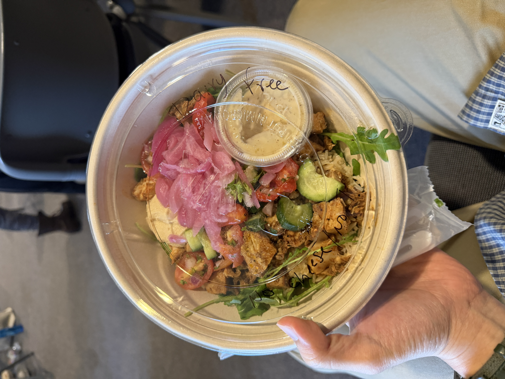

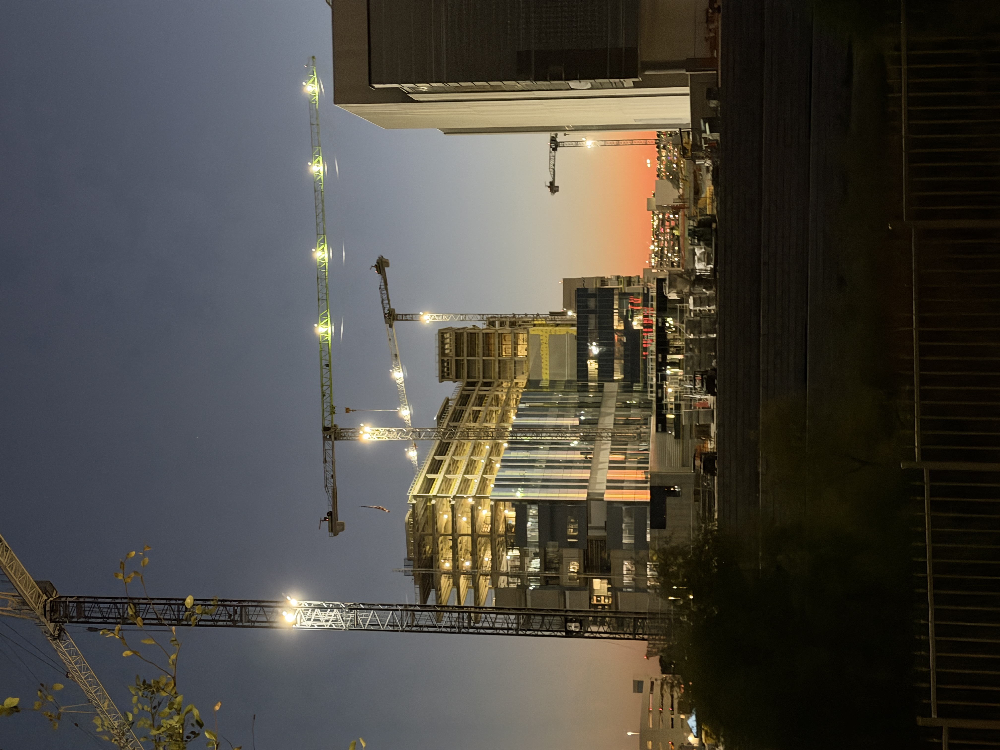

:::

All the way from Korea, after a 14-hour flight, he came to Texas!
Well, to be precise, he met another friend in Kansas City first and then took a domestic flight here.

He's an older friend, a hyung, I'd told myself I had to see before leaving to study abroad,
so seeing him here in Texas like this felt special.

His schedule was three days and two nights: arriving late at night on the first day and leaving very early on the morning of the third.
It was a short time, but the memories are still as vivid as if it were yesterday.

First, I picked him up at the airport.
I don't think it had even been a year since I'd last seen him,
but every time, he has this way of putting people at ease.

Tacos, and then a drink each at a casual bar near my place.
(My favorite, the Grapevine bar! The air on the patio was cool.)

It was a short, rambling night, but we raced to unload the stories of how our lives had been chasing us,
and the first night went on late.

::: {.photo-row}

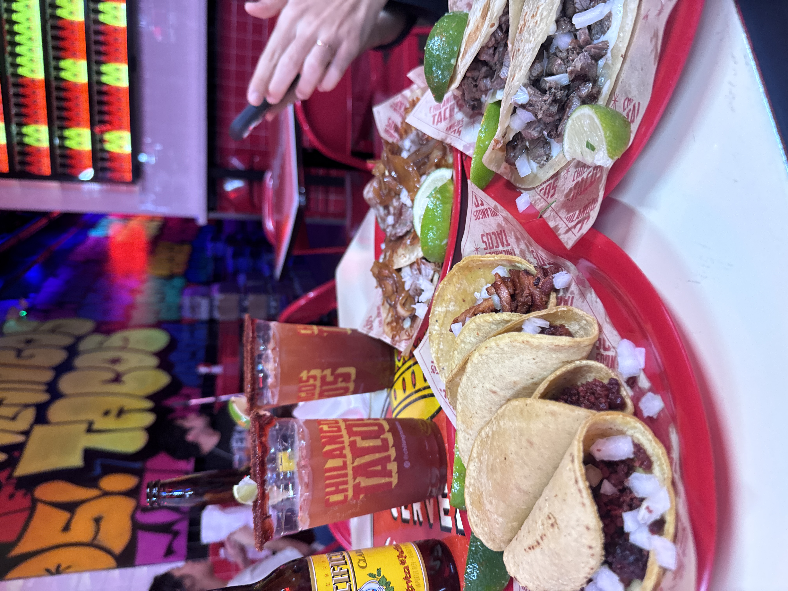

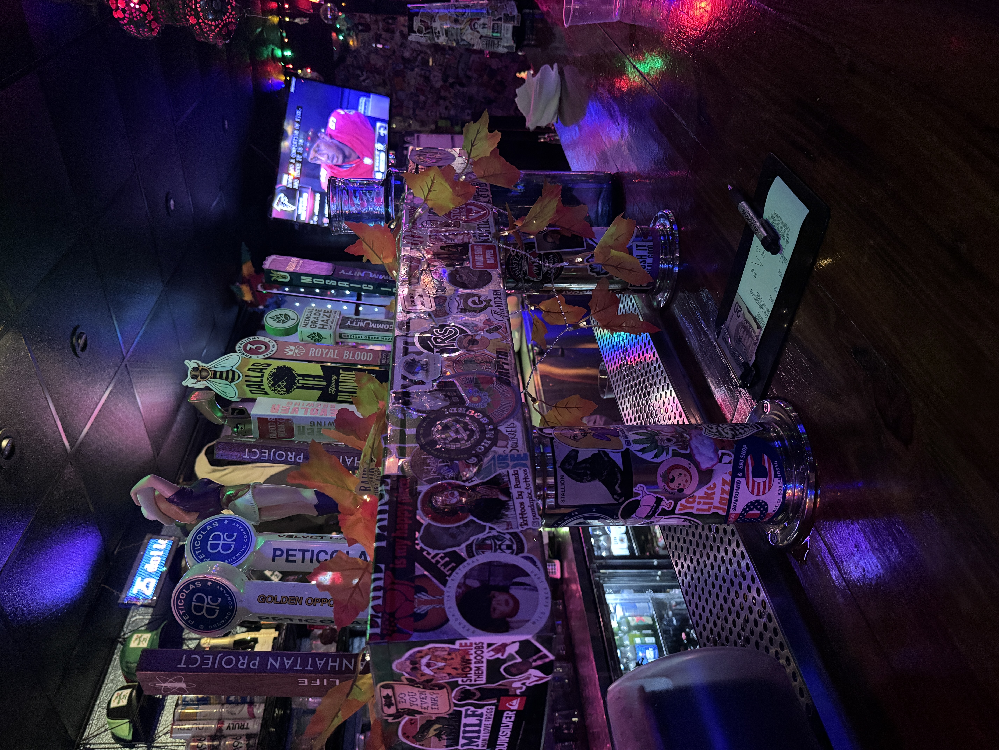

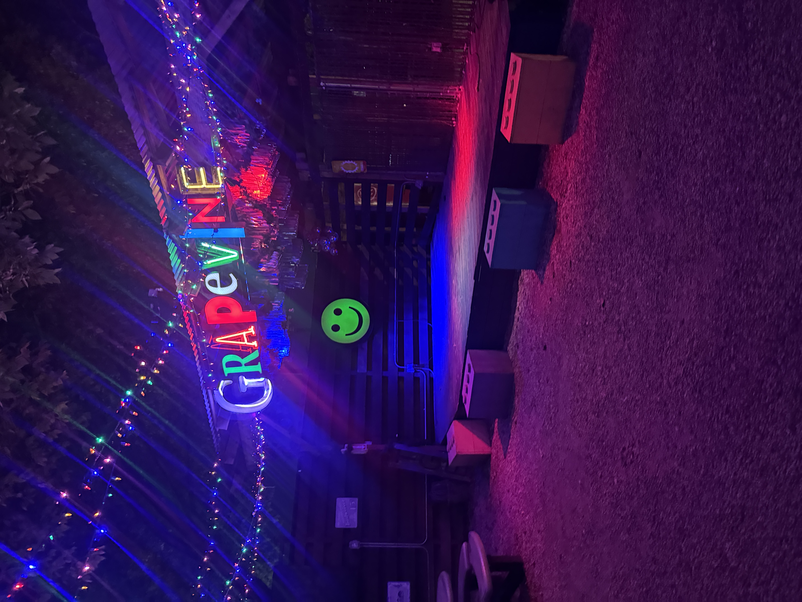

:::

## Day 2 — Oct 6 (Tue) · Paycheck Lupin!

In Korea there's a term, "wollu."
It's short for "wolgeup Lupin," a paycheck Lupin: someone who collects a salary while slacking off like the gentleman thief.

It's a little odd to call myself that,
but as someone who does officially draw a salary in grad school,
today I became the Lupin and savored the whole day.

The original plan was to leave around 3 or 4 p.m. and spend time with hyung.
But there was just no way.
The moment the clock hit noon, I explained the situation to my supervisor and said I thought I needed to spend time with my friend.

Honestly, the US is pretty generous about this kind of thing.
But behind that generosity, of course, comes accountability,
and next week's me will be the one paying for it.

...

### No Plan Is the Plan

My original plan was to head to the Stockyards at 4 p.m. and watch the longhorn show.
That is, until I took a wrong turn on the highway.

Anyway, there was plenty of time before 4, so I decided to tag along for the part hyung had planned on his own.
That meant going downtown for a great steak
and taking a quick look at the historic spot where J.F. Kennedy was assassinated.
The Sixth Floor Museum was also on the plan, but of course it was closed the one day we went.

At Y.O. Ranch Steakhouse we had a tomahawk and a fillet,
and it was so, so good it almost brought me to tears.. wasn't Texas supposed to be about barbecue?
The juiciness of the tomahawk and the balance of the fat.. plus a glass of Texas wine. Incredible.

Just as we finished and I was about to pay, hyung went and did it again.
After tacos yesterday, he paid for the steak too;;
Put like that, I sound like a shameless host who invites a guest over and lets him pay..
but there was no way I could break through hyung's blocking at the register. It must be the vibe that comes with experience.

For dinner we'd decided on Texas barbecue, and that time, very graciously, he said he'd give me the chance.
I was determined to pay for dinner no matter what.

::: {.photo-row}

:::

### A Longhorn Street Without the Longhorn Show

Oh no, it had gotten way too late.
There was no way we'd make it to the Stockyards by 4 p.m., when the longhorn show starts.
It was definitely a 30-minute drive, but traffic had stretched it to an hour.

We hurriedly grabbed an Uber, but in the end we didn't get to see the longhorn show.
Still, better than nothing! We decided to look around the Stockyards, one of Texas's landmarks, anyway.

I'd been there once before, but it felt different this time.
On a quiet weekday afternoon, the Stockyards were a truly charming place even without the longhorn show.
(On weekends it's always packed with people)

We explored every nook I hadn't gotten to on my first visit and soaked in the streets,
and of course we finished with some daytime drinking. After the wine, a cold beer on a patio.

And the next item on the schedule:
a Texas barbecue expedition with a Korean friend and a Japanese friend, four of us in total.

::: {.photo-row}

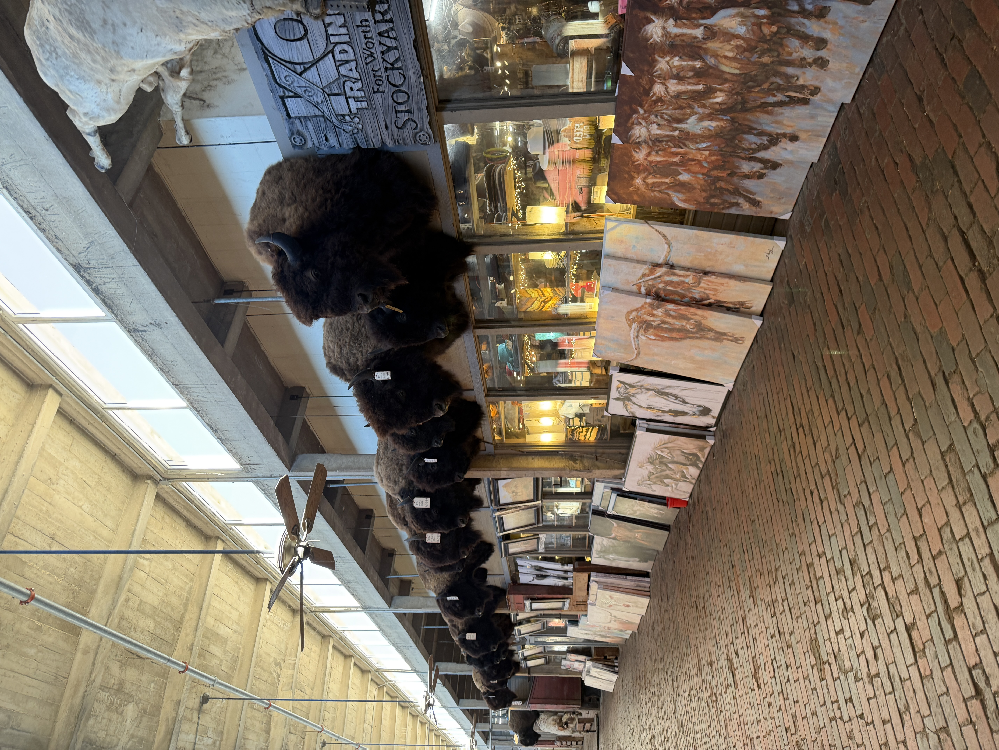

:::

### Meeting People Is Always New

My friends turned out in full force to welcome the guest from Korea.
Besides, to taste Texas barbecue cut by cut, a group of at least four is recommended.

The steak from lunch was still alive and breathing in my stomach,
but to show off the essence of Texas, we headed to the barbecue place.

We became friends so quickly you'd never guess we'd just met.
Hyung, who really loves Tokyo, seemed drawn to my Japanese friend from Yokohama.
Sadly, the English barrier meant the conversation wasn't perfect,
but with plenty of hand gestures we got to know a little about each other's backgrounds.

And as expected, the Texas barbecue was excellent.
Since coming to Texas I'd been to Terry Black's once and Goldee's BBQ once,
so this was my third Texas barbecue, and it felt very different from Terry Black's, my first.
(It was way better than that first visit! Maybe my expectations were just sky-high back then?)

Not ready to part ways yet, we went to a bar near Deep Ellum for one more drink
and talked about life and this and that.

By then it was past 10 p.m.,
and thinking everyone might want to head home, I made one last suggestion,
and everyone happily agreed, so we all headed to my place together.

That's also when I rode a Robotaxi for the first time. I got in half-doubtful, staring at the empty driver's seat,
but within seconds that doubt had turned into complete trust.

And so the fun night only wrapped up after 1 a.m.

::: {.photo-row}

:::

## Day 3 — Oct 7 (Wed) · East of Eden

## Day 4 - Oct 8 (Thu) · Biophysics Retreat

## Day 5 - Oct 9 (Fri) · The Aftermath

You didn't misread that.

That's right.
I'm going to cover three days in one section.

The reason being,
after hyung left I struggled with low energy for a while,
and nothing much happened.

On Wednesday I started watching a Netflix series called East of Eden.
It's based on the 1952 novel by John Steinbeck,
who received the Nobel Prize in Literature in 1962.

Anyway, since it comes from a novel whose brilliance was recognized just ten years later,
it was so incredibly gripping that I binged the whole thing in no time.
(Not in one day.. I have a life too)

Then the next day, Thursday, we had a full-day retreat with the Biophysics division.
The format was that everyone took turns giving a short 10–20 minute talk introducing their research topic.

And on Friday, on the verge of collapse, I got an emergency transfusion of In-N-Out burger
and tried hard to get my daily life back into its usual rhythm.

::: {.photo-row}

:::

## Day 6 - Oct 10 (Sat) · Genes Exam 1 D-3

That's right.
It was three days before the exam.

Freedom comes with enormous responsibility,
and it was time to settle the receipt for all the freedom I'd enjoyed.

On weekends I eat two meals: brunch and dinner.
I had brunch, studied at a café, and then had dinner.

And my credit card finally arrived!

Even now, as I write this, tomorrow's exam is closing in.
(Please forgive me if this post is short!)

::: {.photo-row}

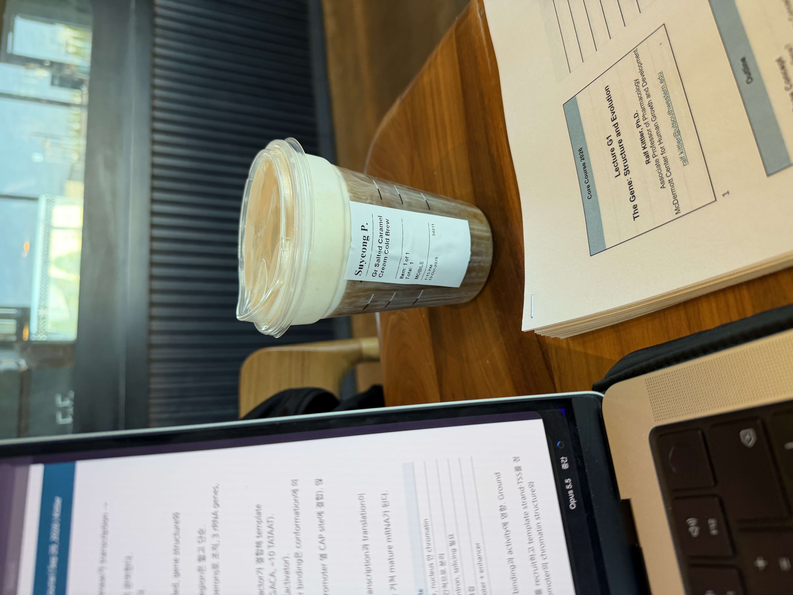

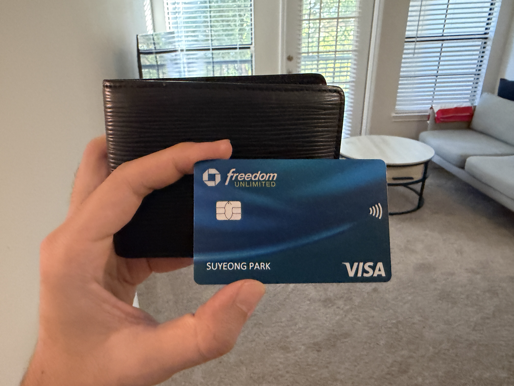

:::

## Day 7 - Oct 11 (Sun) · Marshall Stanmore III

My birthday is coming up soon.

My girlfriend offered to buy me a birthday present,
and it was a Marshall Stanmore III speaker!

I spent a lot of time thinking about what to buy to make a spot for the speaker.
A regular speaker stand would be useless for anything other than holding a speaker,
and way too expensive for that.

So what I came up with was a small table, about the size of a side table,
and there happened to be a good listing on Facebook Marketplace (think of it as the American version of Danggeun Market), so I went to check it out.

I came home wondering when the speaker would arrive,
and wouldn't you know it, there was a box I'd never seen before?
I opened it, and it was exactly what I'd been waiting for.

I quickly set up the table and the speaker,
connected it to the TV to try it as a TV speaker,
and connected my phone to play my playlist,
and I was so, so happy with it!

The bass was way punchier than the Marshall Acton III I used back in my KATUSA days.
And how do I put it, the sense of space in the sound?
My place is fairly roomy for living alone, and it filled the space with sound really well.

Right, this is no time for that.

I had lunch, went to study at a café until I'd more or less wrapped things up (peak of Mount Stupid, that is),
squeezed in the workout I'd missed during the week,
snapped my usual photo of the decorated Student Center on the way out,
and ended the day with dinner.

:::{.photo-row}

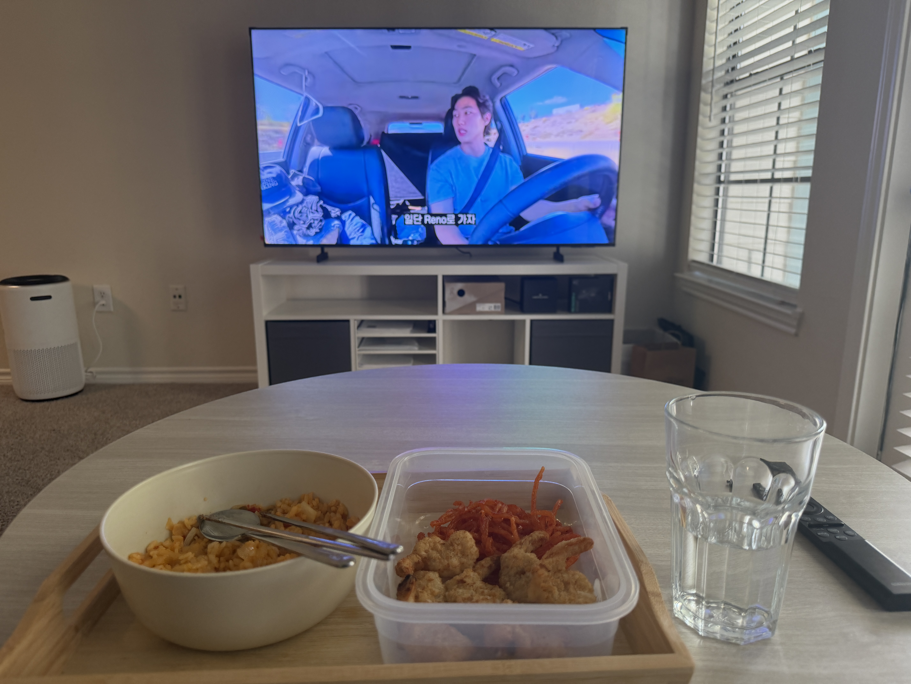

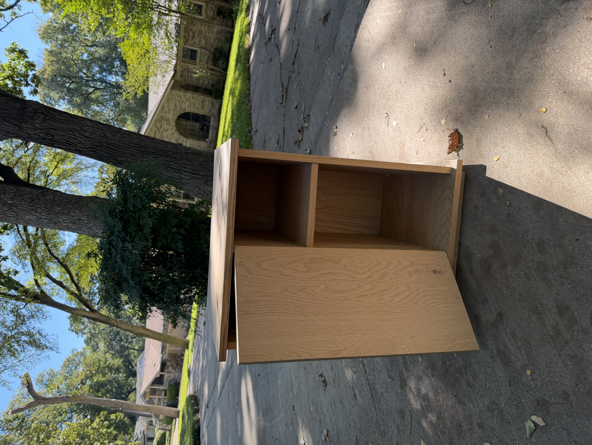

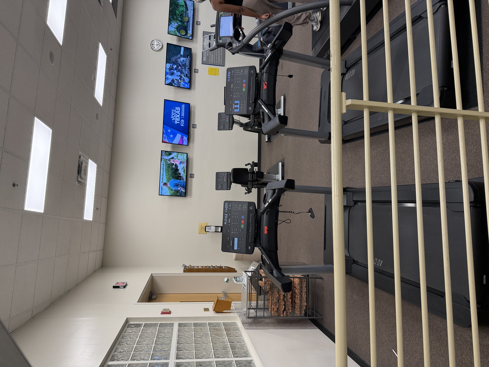

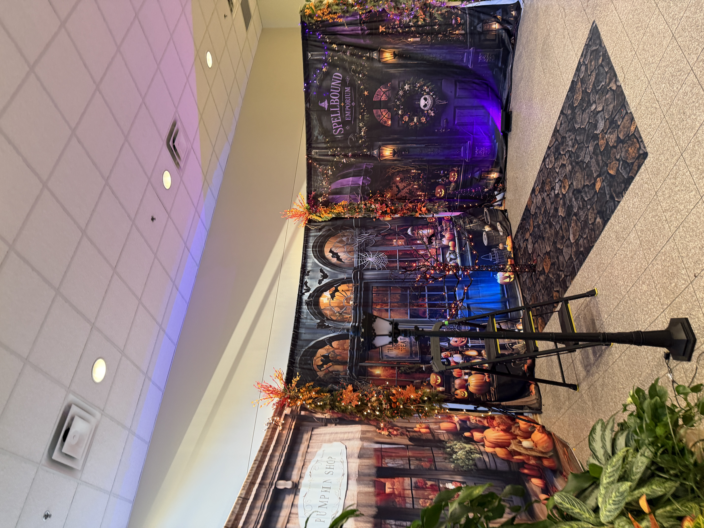

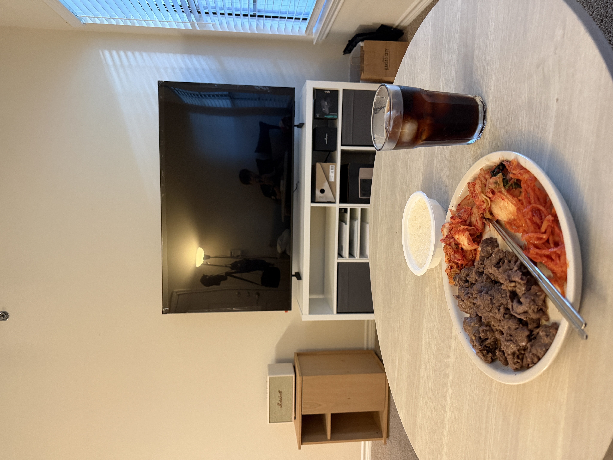

:::

Week 10 in the US.
Hosting a guest from Korea used up all my energy.

But he was that precious a guest to me,
and I think we had so much fun there's nothing to regret.

Whenever I see hyung, I always end up looking back at myself.
Is it because the way he enjoys life seems so different from mine?

Part of me envies him, and part of me wonders whether I could ever live that freely.
But everyone has their own life and their own struggles, right?

It was an honor to host such a precious guest in my humble place,
and my door is always open, so here's to the next guest.

And now I need to get back to my daily life, too.
