Week 14.

Next Monday I have my second and final Genes exam,
and the weekend right before it is the Worlds semifinal for T1, the team I root for.

The best kind of fun is the escape right before an exam.

## Day 1 — Nov 02 (Mon) · Immunology WIPS

It was an ordinary weekday.

Today was Immunology WIPS, which happens every two weeks.
It's an event where students who've chosen their affiliation gather in that department for academic exchange,
and one or two speakers each prepare a talk of about 30 minutes.

A lab I'd been interested in since before coming to UT Southwestern gave a talk, and I found it really interesting.
They do thymus research, and the PI is a true research nerd. Whenever you talk with him, you can feel how much he loves research. When it's time to put together my committee someday, I'd really like to include Dr. Nicolai Van Oers.

I enjoyed the free lunch they handed out,
and picked up the umbrella I'd left at last week's potluck.
(The longer I'm here, the more my Korean seems to be fading.. it takes me longer and longer to write these)

::: {.photo-row}

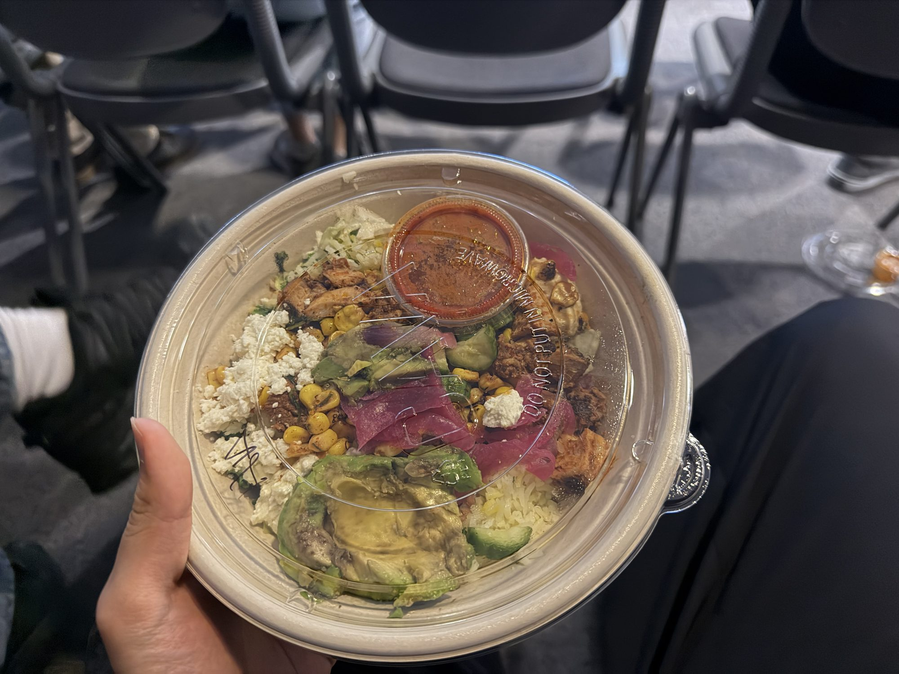

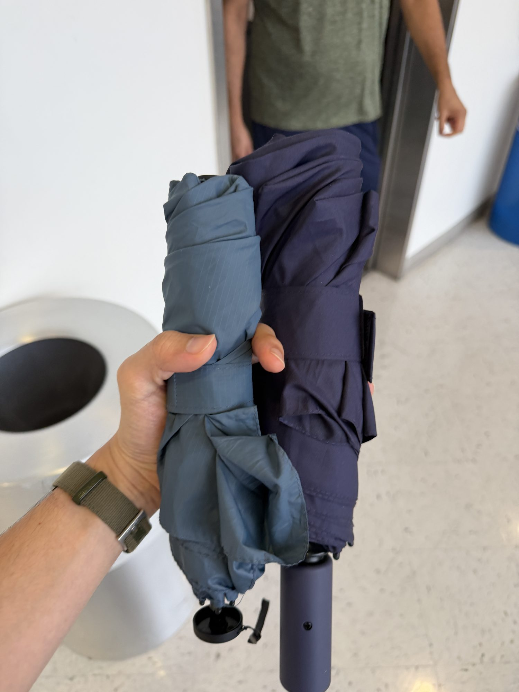

:::

## Day 2 — Nov 03 (Tue) · On to the Next Experiment

What I mainly study are patients with PML,
that is, a disease called Progressive Multifocal Leukoencephalopathy.

Since that painful failure last time, I've been reviewing hypotheses that come at the cause of the disease from a different angle,
and one of them involves an assay we can run in the lab fairly easily, so I'm going to test it.

Like another postdoc told me, being able to kill the project seems important.
Because it gives you a clear reason to move on to the next thing.

Anyway, before using the assay in the real experiment, I needed a practice run.
It's much simpler than the assay I'd been running before, with nothing especially hard about it,
but it relies relatively heavily on the positive and negative controls, so it definitely has its pros and cons.

And this assay takes three days in total.
On day 1 you seed the cells,
on day 2 you treat them,
and on day 3 you read the results.

So today I ran the experiment on the cells I seeded yesterday, and I'll know the results tomorrow.
While reading the results tomorrow, I'll seed cells so I can run the experiment right away on Thursday.

::: {.photo-row}

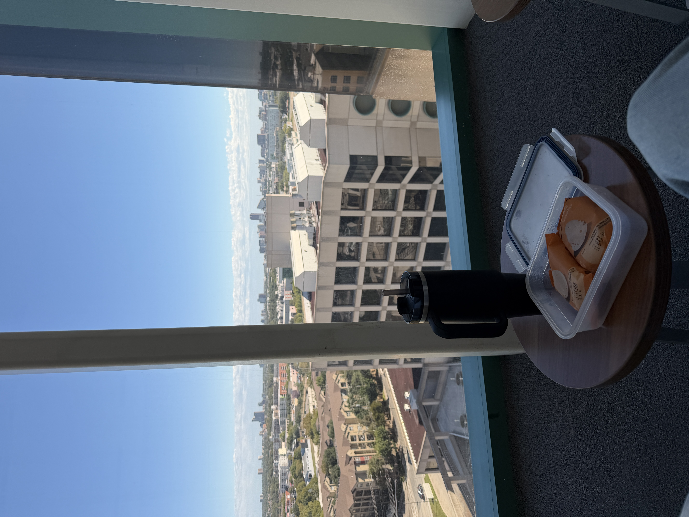

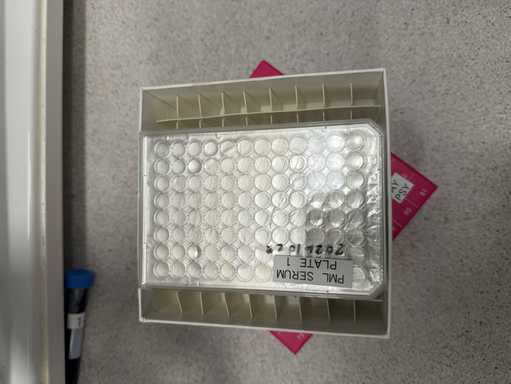

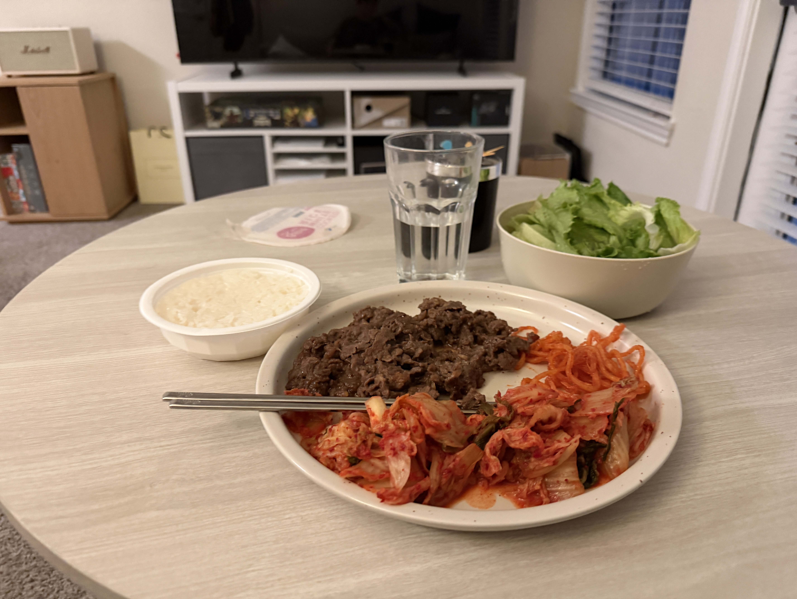

:::

## Day 3 — Nov 04 (Wed) · Pilot Study Results

Thankfully, the results came out as expected.
Nothing in the process was very difficult, so it seemed to go smoothly.

As planned, I seeded the cells for Thursday's experiment ahead of time,
and took a little look at the genetics analysis I'd been putting off.

Our lab's main approach is human genetics:
we get WGS/WES data from actual patients, look for genetic variants,
and then show through experiments whether those variants actually lead to the phenotype.

It's a really intuitive and powerful approach,
so if I find a good gene candidate hit, it could become my PhD project.

The thing is, I still don't really know how to filter genetic variants, or which variants make good candidates. It's an area that needs more time.

In the middle of all that, I went over to the hospital for some delicious sushi and ramen, and dinner was my usual home-cooked spread.

::: {.photo-row}

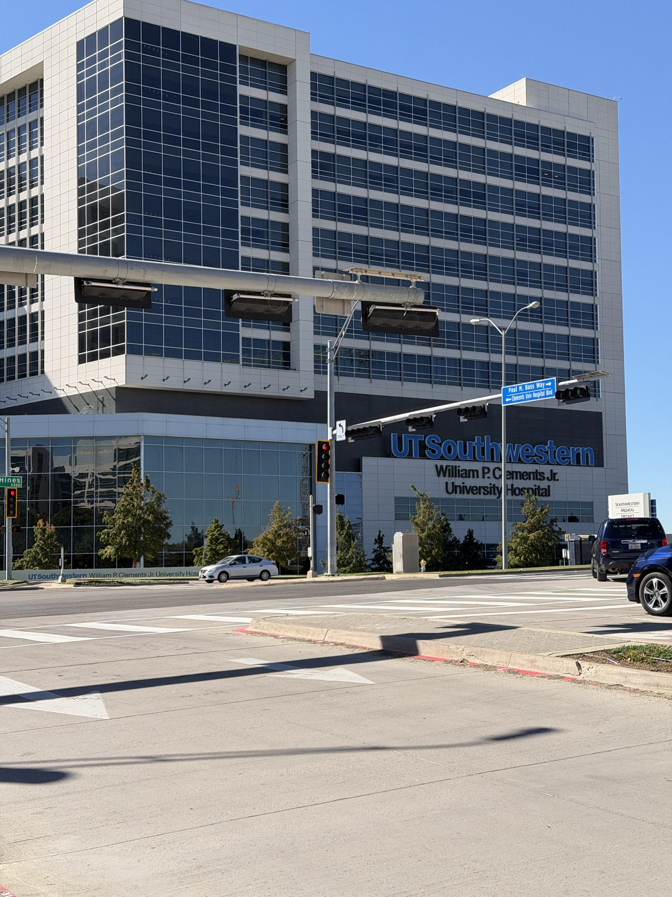

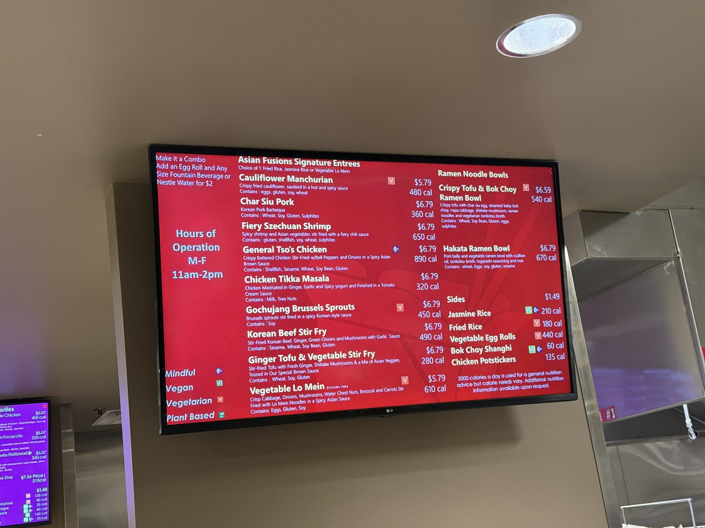

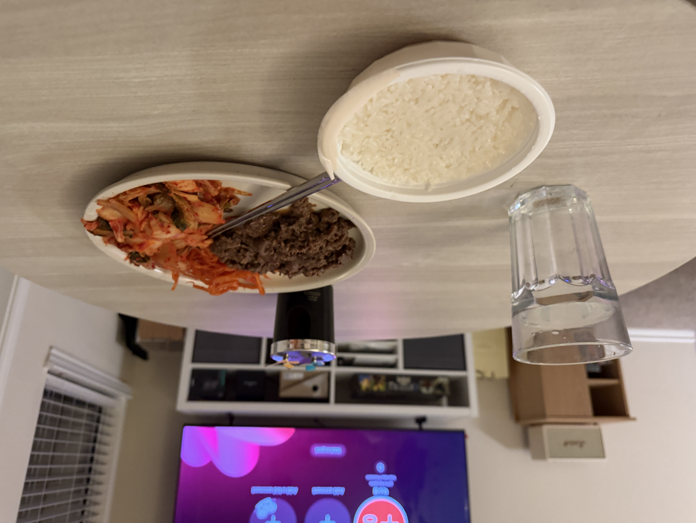

:::

## Day 4 - Nov 05 (Thu) · 2nd Big Day

For the patient plasma we were testing today, another postdoc named Vu and I decided to each run one plate.
It's closer to a technical duplicate than a biological duplicate,
but since my skills aren't fully there yet, comparing our two results should make it easier to reach a conclusion.

Once again I have to wait a day without knowing the results,
but for some reason I'm looking forward to tomorrow.

## Day 5 - Nov 06 (Fri) · Hit!

Today was finally the day to check the results of the second real experiment.
For some reason I woke up early, had breakfast for the first time in a while, and headed to school.

The assay reads out target gene expression through the activity of a luminescent enzyme,
and the patient sample showed the same activity as the positive control!
In other words, something interesting was detected in the patient sample.

It matched my hypothesis, so I was really surprised, and I was so happy, since I never expected a moment like this to come so soon.
"Now you got a paper" was all the postdoc I worked with said.

From here, I need to think about other experiments that can back up this result,
and think from many angles about what it means clinically.
Anyway, it's a hit!

::: {.photo-row}

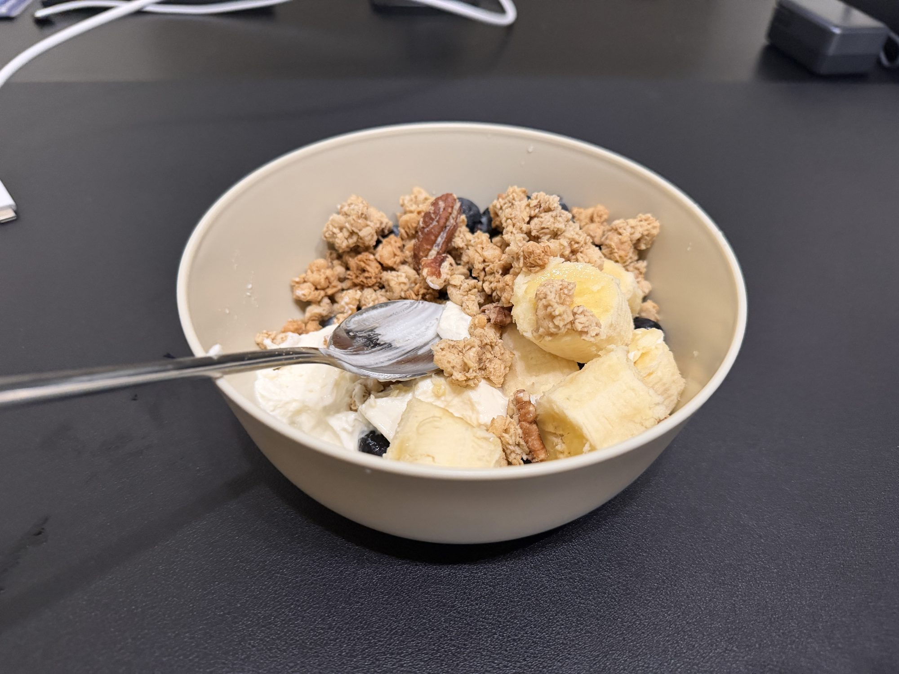

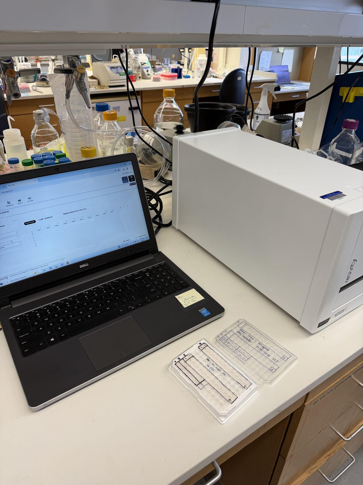

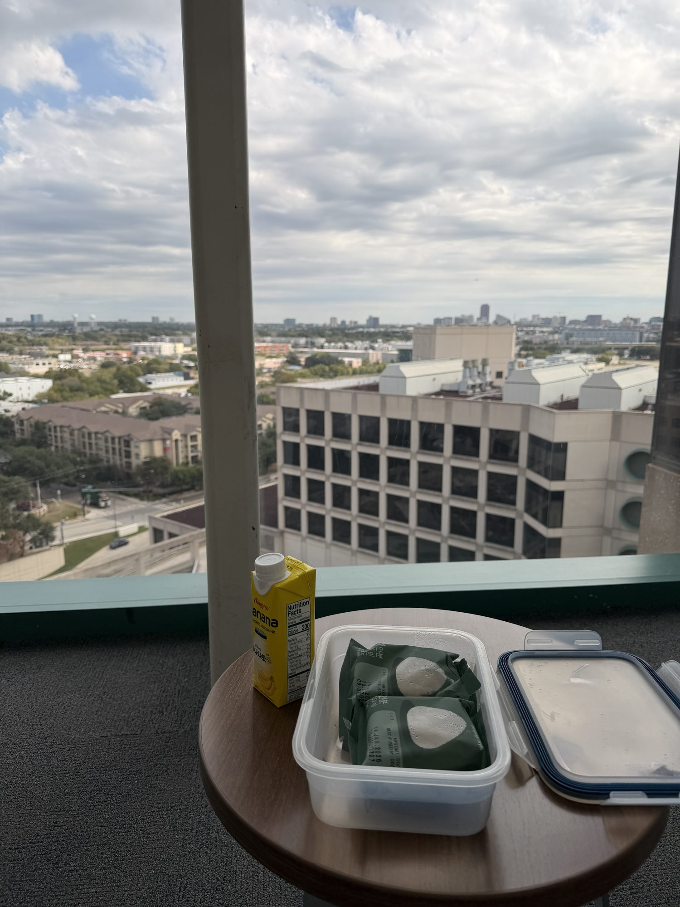

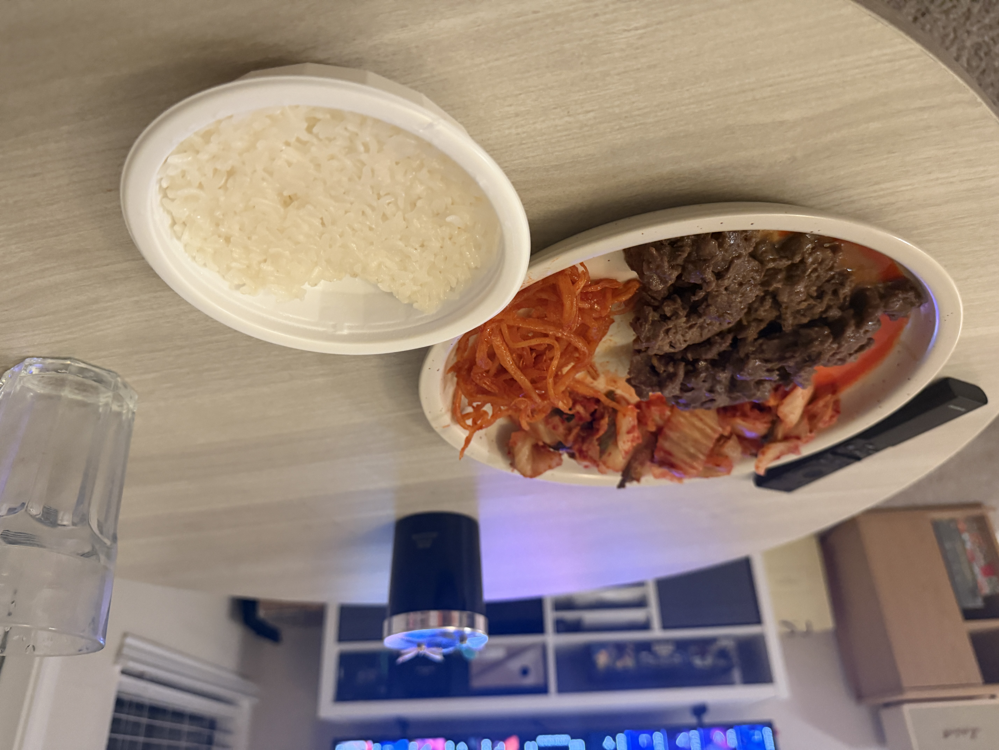

:::
## Day 6 - Nov 07 (Sat) · LoL Worlds GenG vs IG

Today was the Worlds semifinal in Dallas, Texas.

To catch the semifinal live from 4 p.m., I got moving early in the morning.
I checked how much I had to study before the exam, then crammed information into my head nonstop at Starbucks without a moment to breathe.
Normally you need to take breaks now and then to stay efficient, but I didn't have the luxury to think about that.

...

I made it through my quota, came home, and watched the match.

IG is a team in China's LPL, and GenG is a team in Korea's LCK.
On IG, both TheShy in the top lane and Rookie in the mid lane are Korean players who play in the Chinese league.

The semifinal is best of five,
and GenG seemed to take the first two games easily, but the third game was a struggle.

Then IG's AD carry made a critical mistake,
and GenG broke through the opening and closed out the series 3:0.

The pressure of the big stage really does seem to be the same for everyone in the world,
and the one who withstands it and turns it into a bigger opportunity decides everything.

::: {.photo-row}

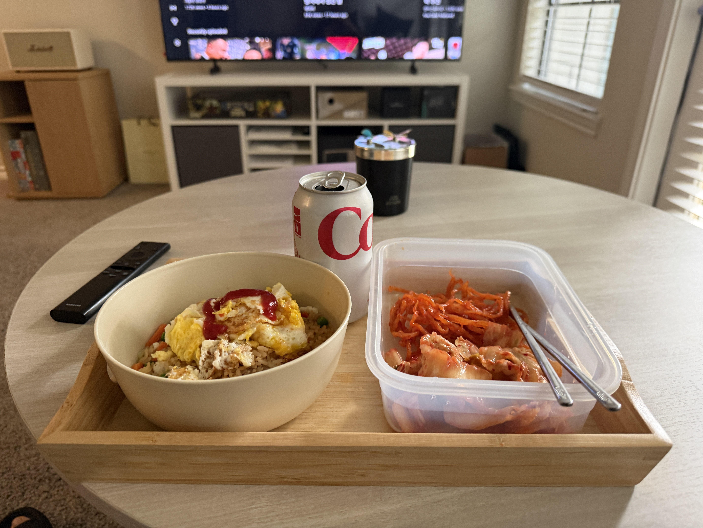

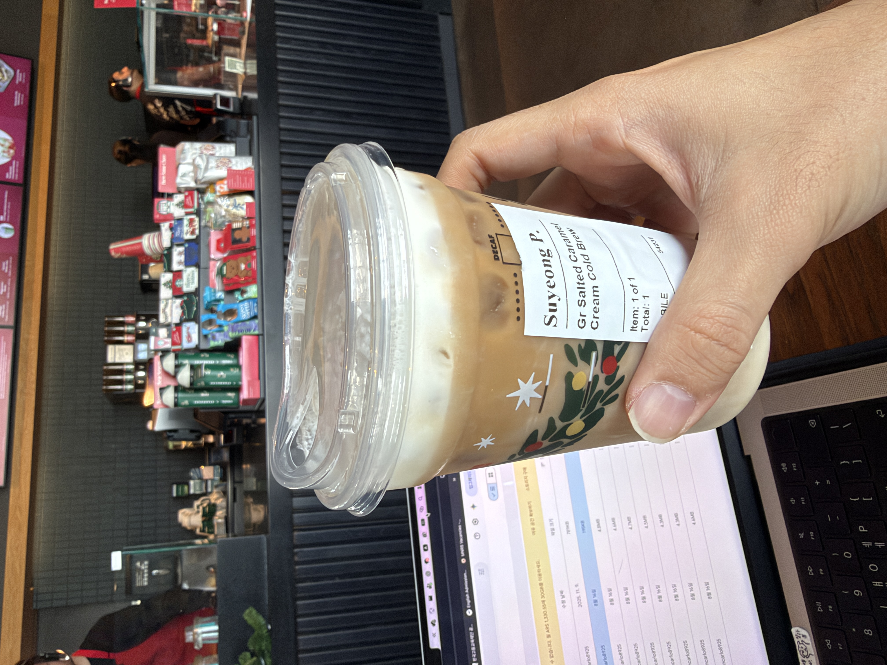

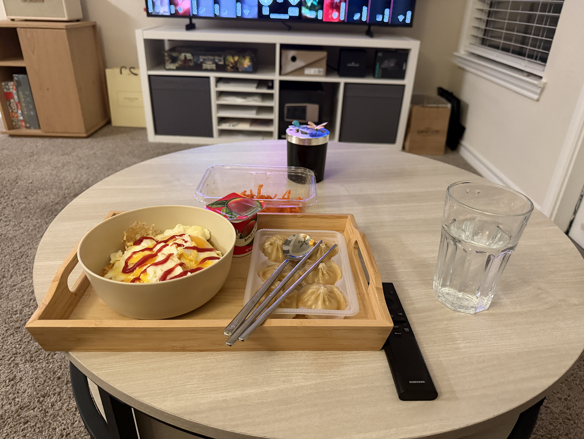

:::

## Day 7 - Nov 08 (Sun) · Good Game, T1

The day before my second and final Genes exam.
As always, there was a LoL Worlds semifinal, and an even more important one than yesterday's.
It was T1 against BLG.

BLG is another team from China's LPL,
and since they've lost to T1 every time they've met at Worlds, they came in hungry for revenge.

T1, on the other hand, hasn't been in their old form lately,
and a lot of experts seemed to be predicting a BLG win.

...

The result was a 3:1 loss.
In the last game there was a moment when Faker nearly turned the game around with an incredible performance,
but in the end, the balance that had collapsed in T1's top lane kept dragging down the whole game.

I personally like that player,
but after taking a lot of criticism from people lately, they seemed to be in a rough place mentally.
I guess the weight of the crown is hard to bear.

They probably won't re-sign with T1.
I hope they keep playing well on another team.

Anyway, T1's Worlds run sadly came to an end,
and I finished studying for tomorrow's exam.

:::{.photo-row}

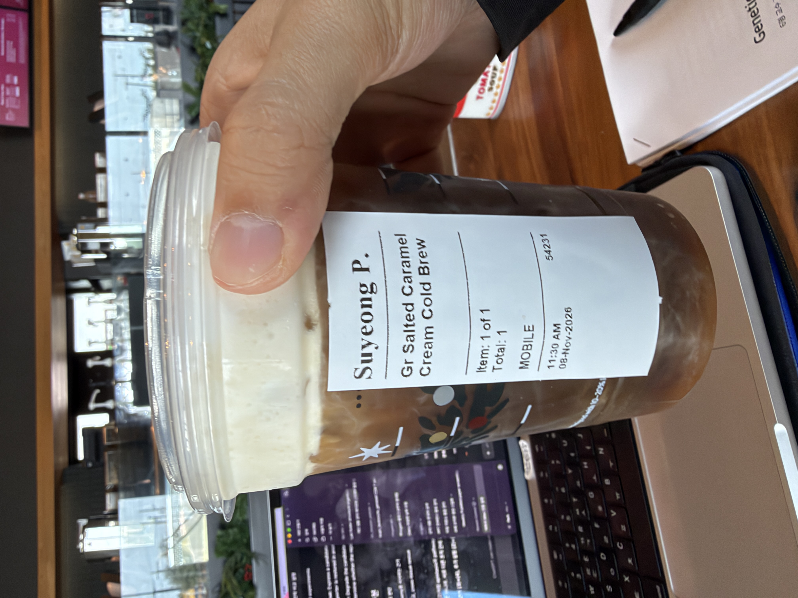

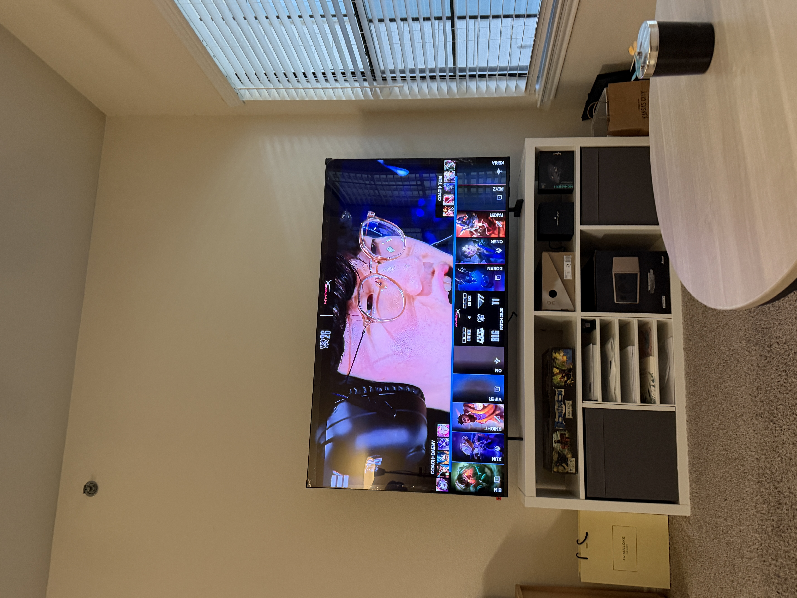

:::

Week 14 in the US,
and next Saturday is the Worlds final, GenG vs BLG.
We're all watching it together at a friend's place, and I'm looking forward to it.

And exactly two weeks after this exam, I have my first Cells exam.

On 11/23 I take the Cells exam, and from 11/24 to 28 it's an exciting trip to Washington, D.C.
Once I take the final Cells exam on 12/14, this semester is over.

Before I knew it, the end of the semester is already in sight.
Just a little more!
