Week 16.

It felt like I'd barely finished my last exam,
and here I was, preparing for another one.

Once this one is over, only one of my six exams will be left!
Just a little more.

## Day 1 — Nov 16 (Mon) · Grilled Beef

Just an ordinary day.

Ahmad, my former supervisor, came back from Paris after a long two-week vacation,
and gave me a super cute!! little peanut(?) figurine as a gift. It's adorable.

The lab is having a Thanksgiving potluck this Wednesday,
so I signed up in advance for what I'd bring.

This time I'm planning to keep it simple and bring orange chicken from Trader Joe's.
Since it's a national lab, you get to taste delicious dishes from all sorts of countries, so I was really looking forward to it.

At lunch I sat in on the Immunology WIPS, held every two weeks,

and for dinner, grilled beef for the first time in a while!
I still have no idea how to control the heat on this induction stove.

I finally finished sleeving 400 cards, which I'd been putting off, and called it a day.

::: {.photo-row}

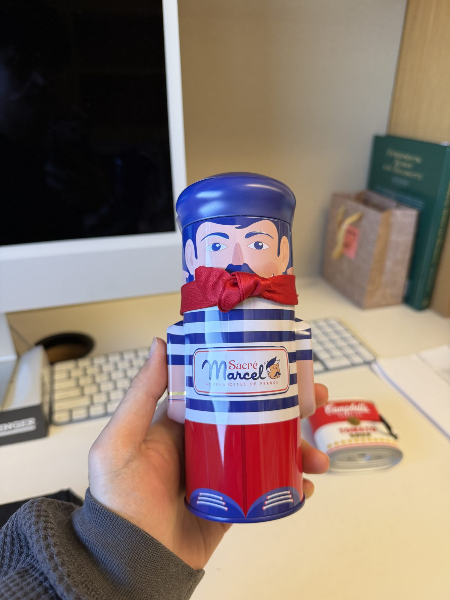

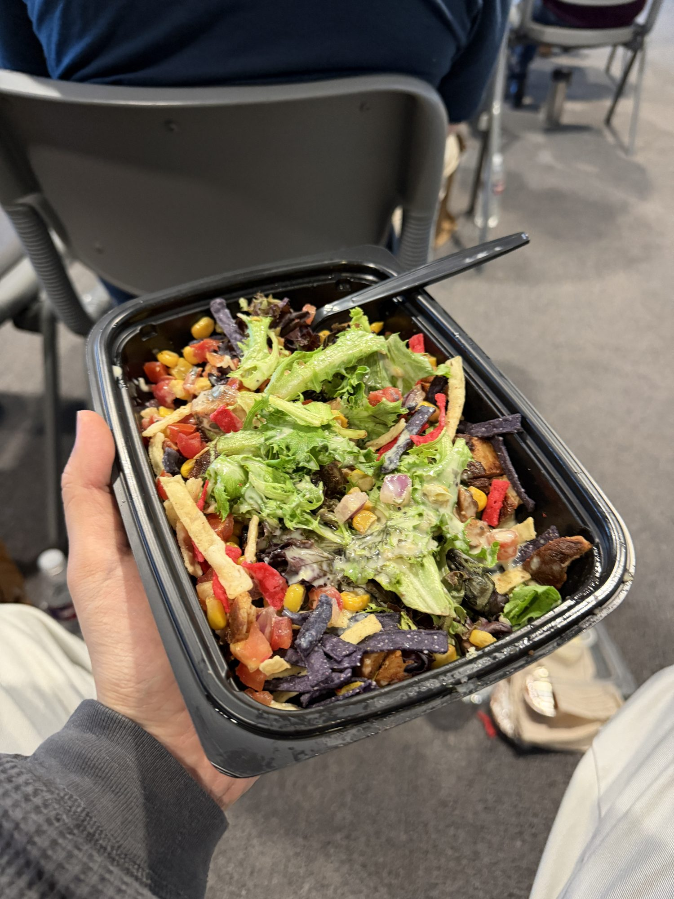

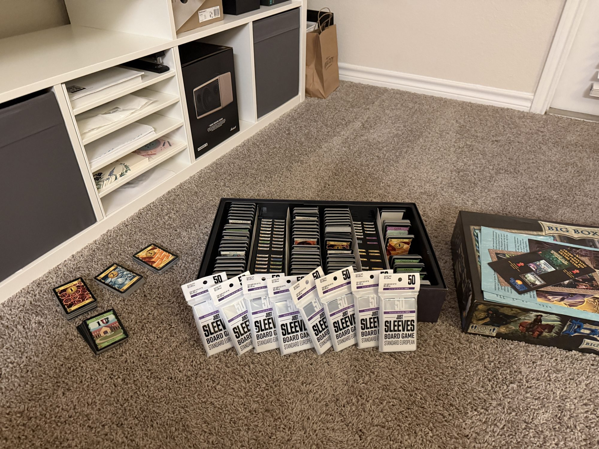

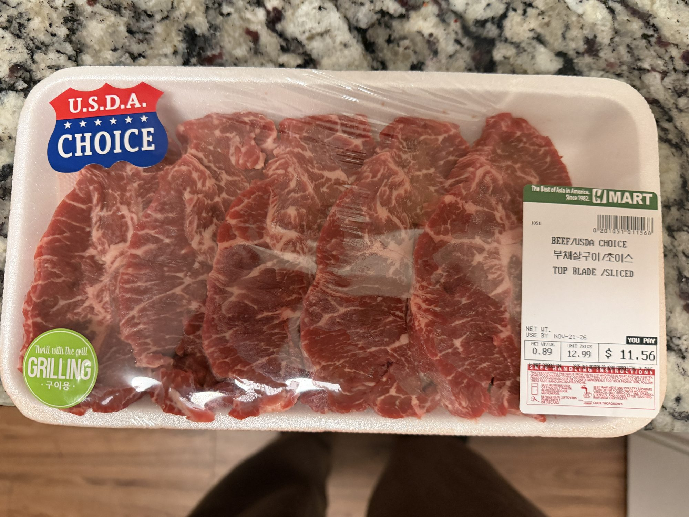

:::

## Day 2 — Nov 17 (Tue) · Off to the Auto Shop!

Today I decided to finally visit the auto shop I'd been putting off forever.

Normally there's a literature discussion session every Tuesday,
but the professor who leads it was away this week, so we skipped it.

With some free time on my hands, I headed to Seeon Auto for an oil change.
It's where an acquaintance of the YouTuber Youngalnam works, and I already knew the place because I'd had my pre-purchase inspection done there when I bought my first car.

Anyway, the owner is Korean and the prices are reasonable, so I plan to keep coming here.
Full-synthetic oil for $60!

Then a tasty lunch,
and I left work early to hit the gym for the first time in a while.
I really need to work out consistently, but exams and this and that keep giving me excuses to put it off.
I feel stuck in an endless loop of regret. (All regret, no gym...)

The sunset when I walked out was beautiful,
and these days my place is slowly filling up with things I love.

::: {.photo-row}

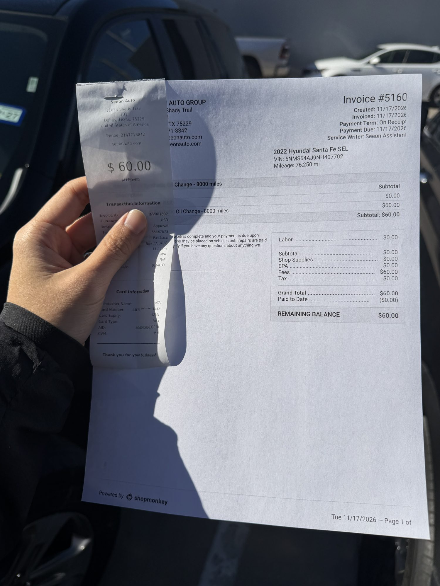

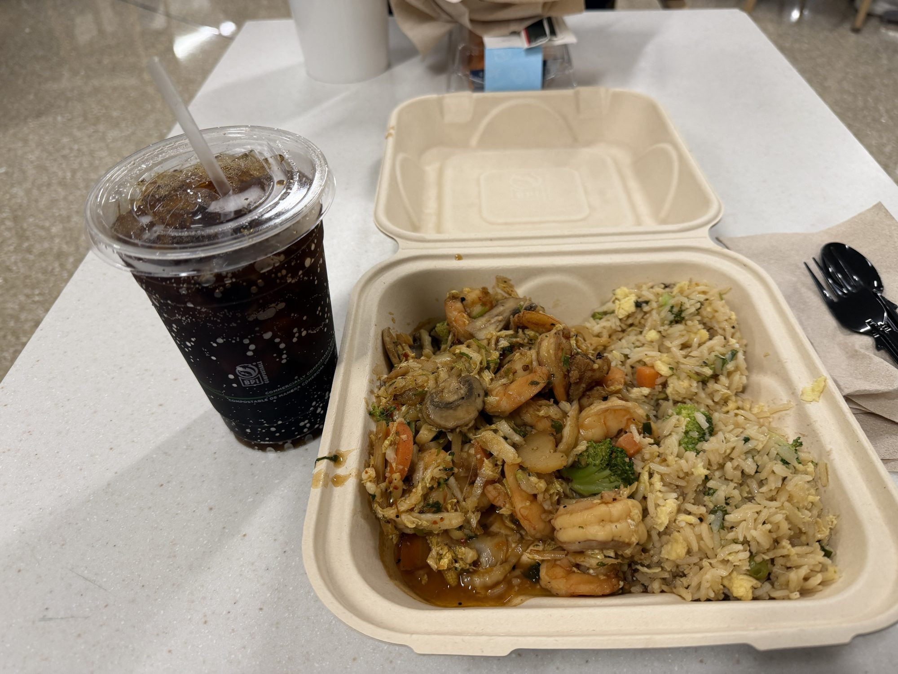

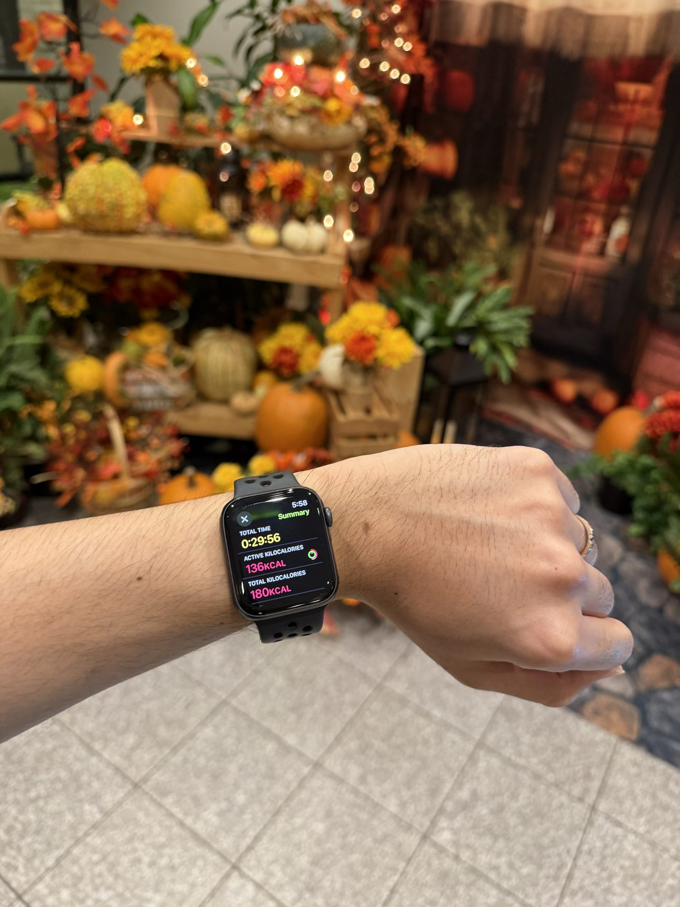

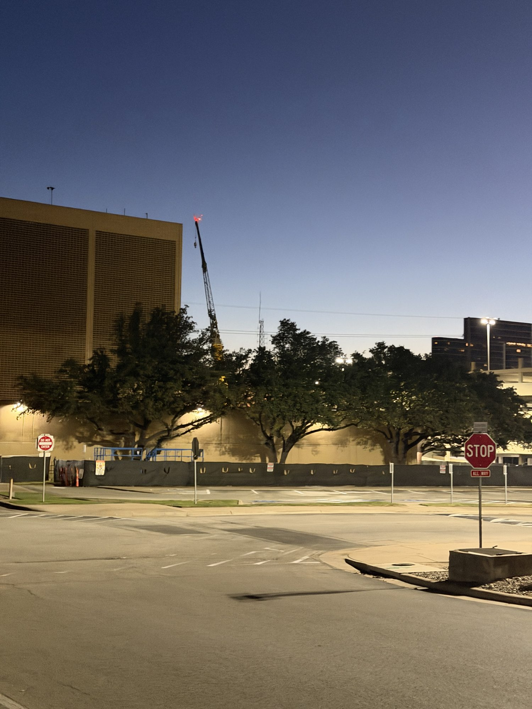

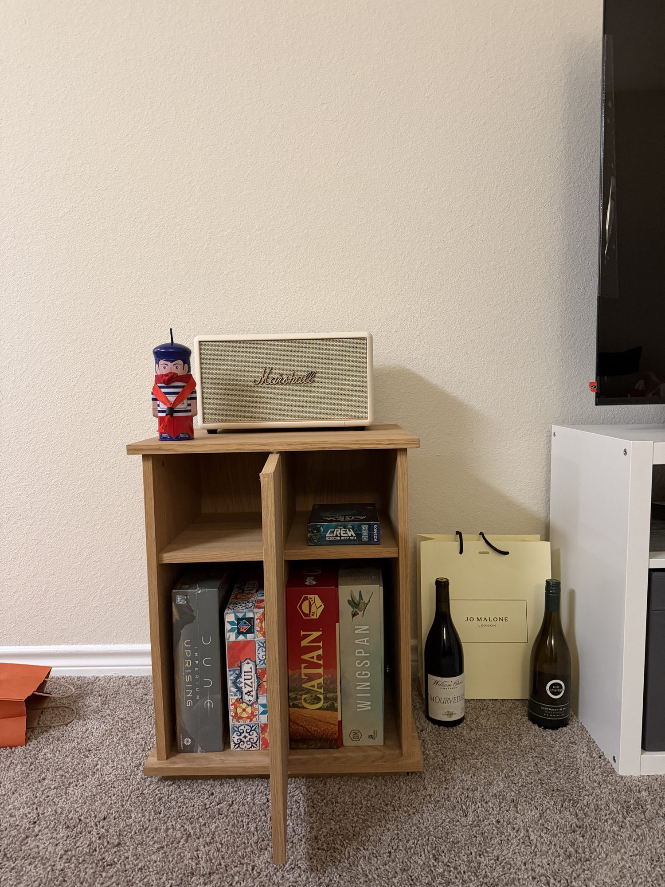

:::

## Day 3 — Nov 18 (Wed) · Thanksgiving Potluck!

The potluck culture I introduced last time came back around, right on schedule.
This time, for Thanksgiving!

The opening remarks from Mark on the admin team, kicking off the event, stuck with me:
"We always feel grateful to one another, but we don't often get the chance to say it. Thanksgiving is literally a day for giving thanks."

When someone did something for me, did I thank them enough?
It made me look back at myself.

If last time was a mini-potluck,
this time was the real deal, overflowing with main dishes.

It was a bit of a shame not really knowing what I was eating,
but almost everything was a safe bet, and I ate until I was stuffed.

...

And after work, RA!
It's a board game I found while digging through memories of playing with friends back in Daejeon,
and I remembered having so much fun with it that I bought it.

Buying a new board game comes with the joy of peeling off the shrink wrap,
but punching out every single component one by one is a bit of a chore.

Then again, all that time and effort is what makes you grow attached to it.

::: {.photo-row}

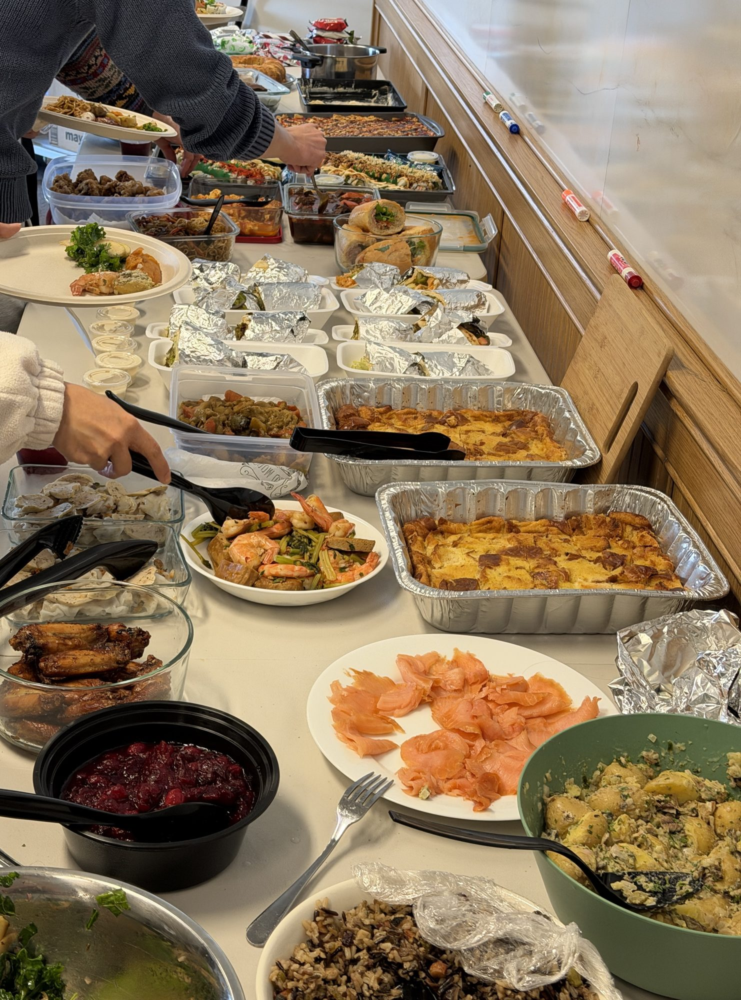

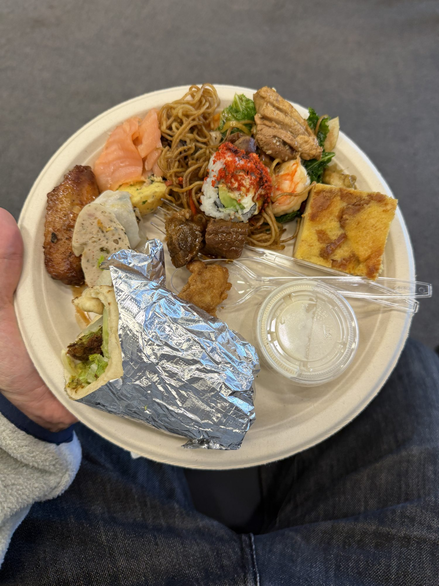

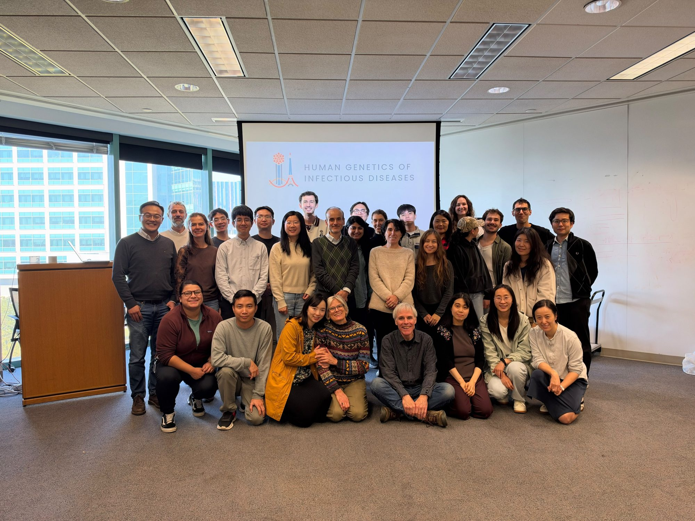

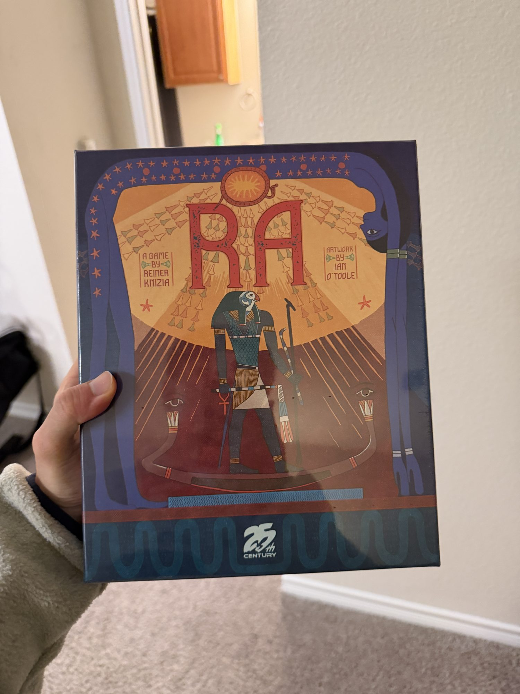

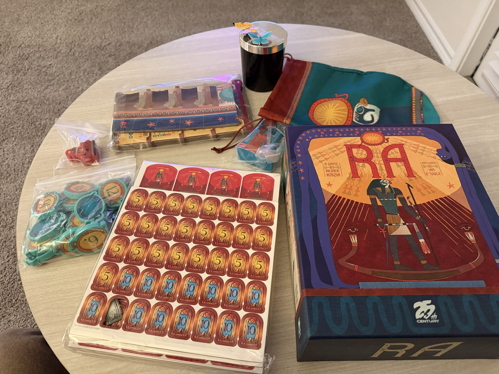

:::

## Day 4 — Nov 19 (Thu) · Exam Prep

Maybe because this is already my fifth exam since setting foot in the US,
I feel like I've developed a decent sense of how to prepare.

The catch is having to carve out time for exam prep in the middle of lab life.
Usually I run things through AI and then spend a while reshaping the output into something I like to study from,
so I make all the materials on weekdays and cram on the weekend.

I used to go through the lecture slides stitch by stitch, understand them, and write my own summaries.
Now, if there's something I don't get, I just copy it and ask GPT.

The way I study has changed a lot, and I've reached the point of wondering whether "education" even needs to be delivered by people anymore. I've heard that many cram-school instructors in Daechi-dong, Seoul's hagwon district, have felt this shift and changed careers. Standing right at that inflection point feels strange.

Some people also point out that students "can't read" anymore.
I worry that I'm actually losing the ability to read well, too.

Thanks to the inertia of old habits, I still read a lot of what I need or what interests me,
but anything outside those topics just doesn't get read at all, and that worries me.

## Day 5 — Nov 20 (Fri) · My First Paper?

Next Tuesday, I finish my fifth exam and head to my cousin's place in D.C.
I'm staying four nights and five days, which means I'll barely be in the lab next week.

So (even if it doesn't really come through in this post!) I ran a ton of experiments and worked hard on organizing the data.
Today, a postdoc friend named Vu showed me how he polishes data figures in Adobe Illustrator.

I've pretty much pulled together the data for Figures 1, 2, and 3,
and with some writing, I think I could finish a rough draft of a paper.
After I'm back from the D.C. trip, I'll push hard again with a finished draft as my goal.

Honestly, it's not an easy pace for a wet lab,
but within the big theme of viral infection, the autoantibody-based research here is so well established that the screening wasn't hard to run, and luckily we got a hit, so things seem to be moving along nicely.

It's not a full paper, but I'm glad I got the chance to turn my first project into a paper this quickly.
(Papers matter so much in science that there's a meme called "Publish or Perish.")
((Photos: last night's dinner, today's lunch, and today's dinner))

::: {.photo-row}

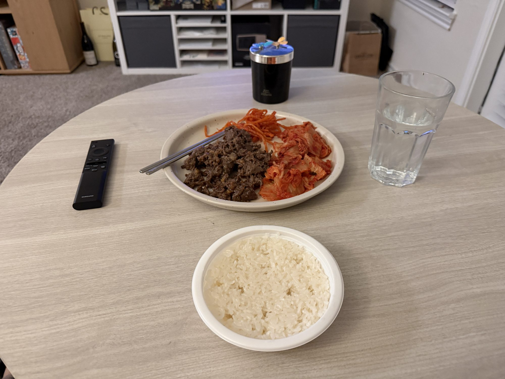

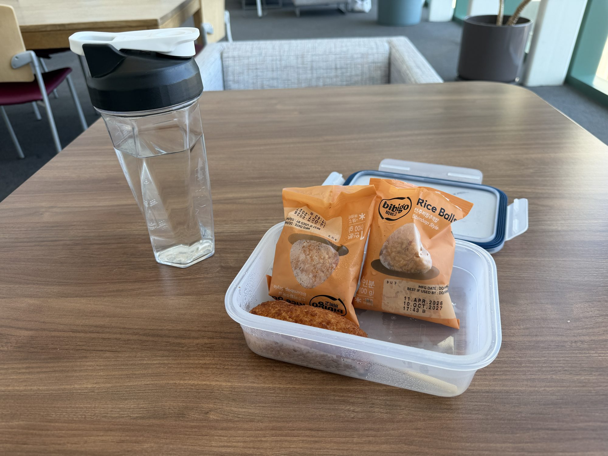

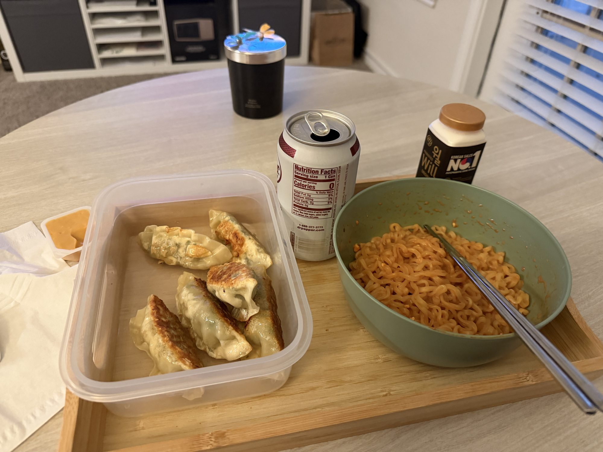

:::

## Day 6 — Nov 21 (Sat) · The Power of Repetition

With my fifth exam right around the corner,
I went with the simplest, most powerful strategy, based on all the big data I've built up so far.

Lunch and dinner in my usual setup, with Starbucks in between.
Digest the mountain of materials I made during the week,
and cap studying at five hours a day so my brain doesn't overload.

It actually feels like leaving plenty of rest time lets the information I compressed and stored in my subconscious expand and settle into place.
(It's definitely not because I don't want to study more than five hours.)

## Day 7 — Nov 22 (Sun) · Worldsprings

These aren't the same photos twice — it's the exact same meals and coffee, two days in a row.
Eating the same food is less boring than you'd think, and I don't have much bandwidth to try new things anyway, so this is just easier.
It's not like I'm eating poorly, either — I'm pretty happy with it.

When I'm short on protein, I just top it up with a protein shake.

::: {.photo-row}

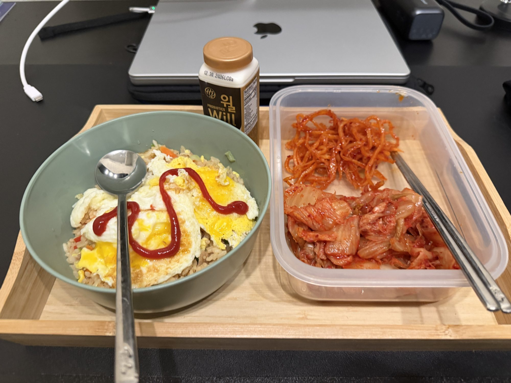

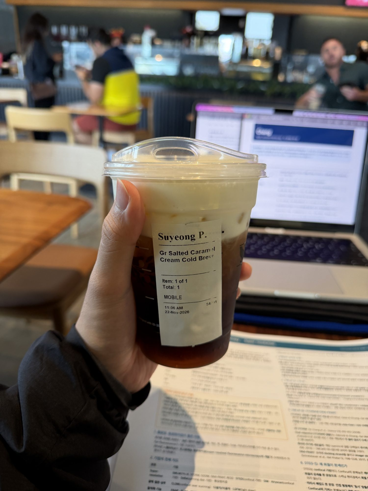

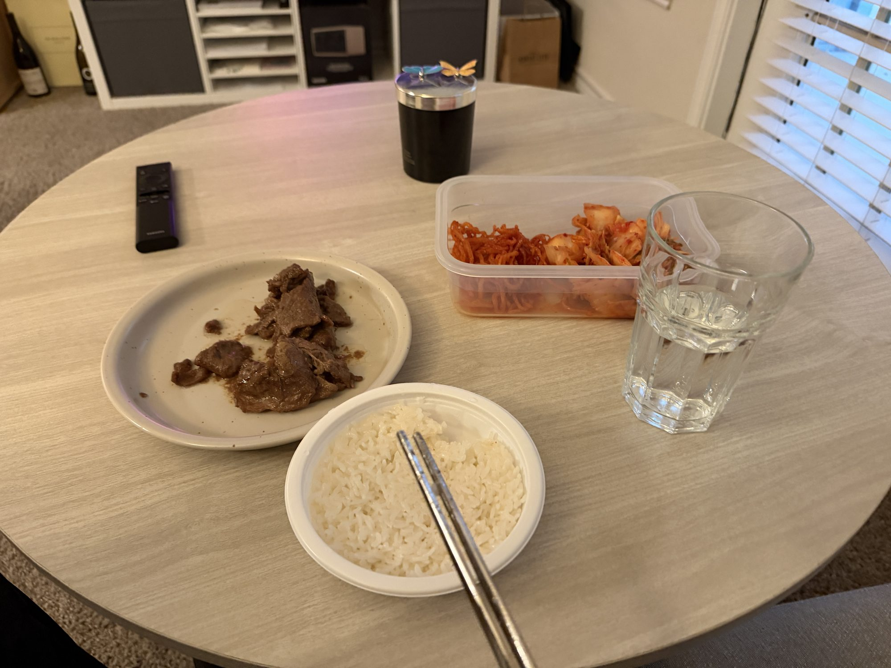

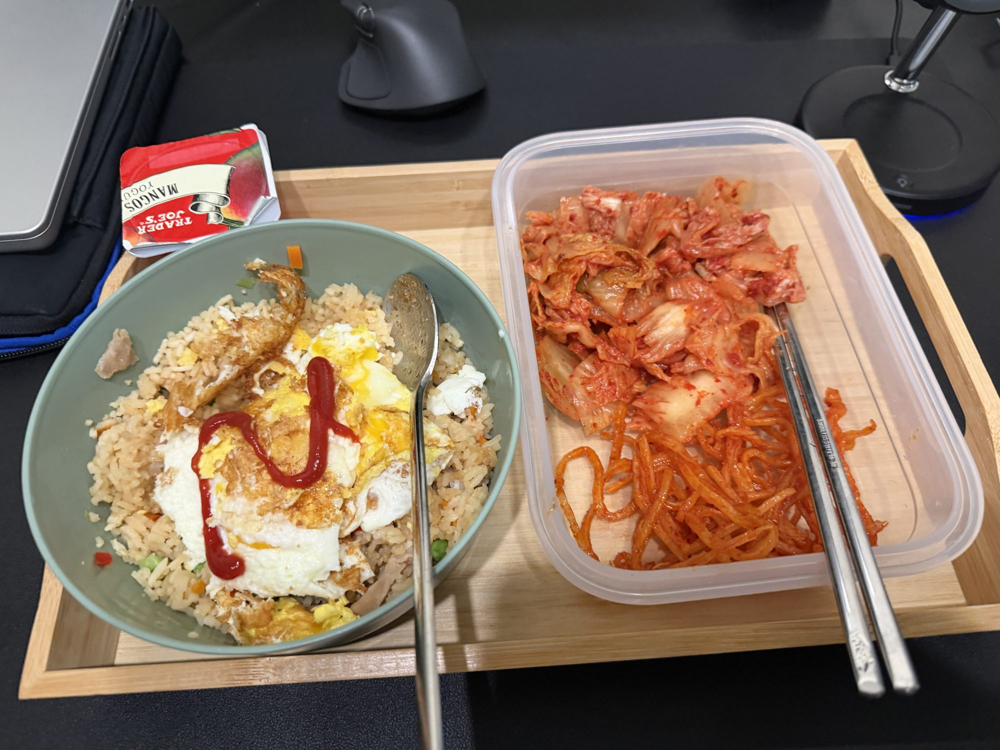

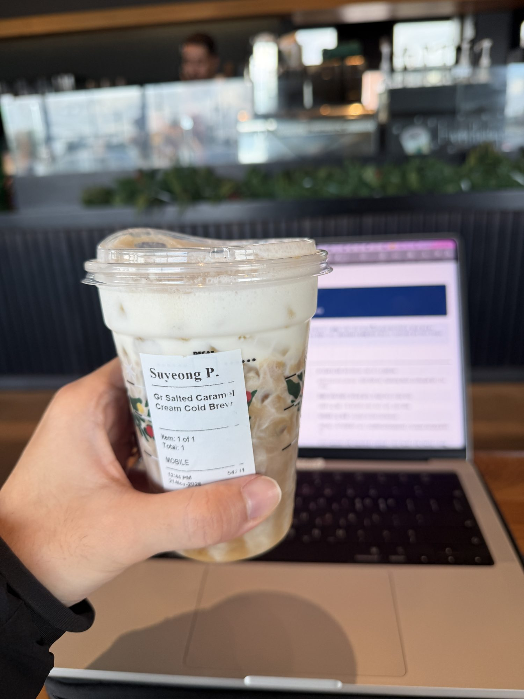

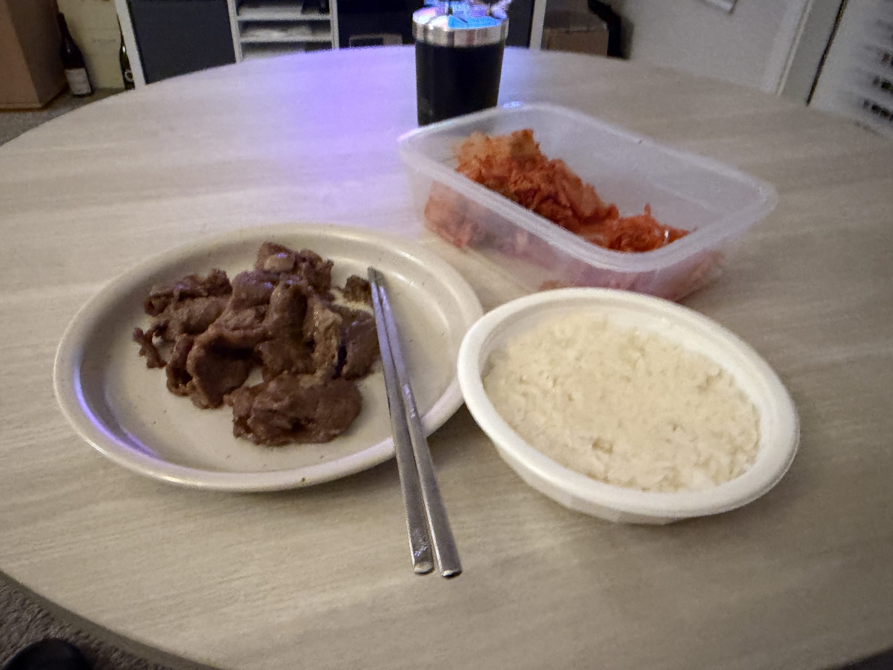

:::

Week 16 in the US,
and my board game collection is spiraling toward an unmanageable size.

Still, next Monday a Japanese friend, a friend from the Middle East, and I are going to play board games all day!
I need to learn the rules and get the games ready for that day.

It'll be my first time explaining rules in English, but I'll get some English practice out of it.

By next week, the exam will be over and I'll be off on my trip to D.C.
Everything is a process, and the hard parts don't last.
Enjoy the process!
