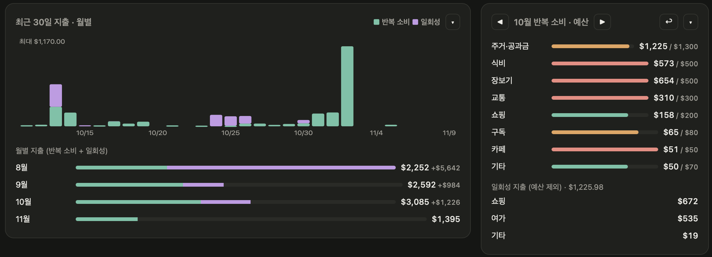

About two more months have gone by since my [spending review for the first month of settling in](us-cost-of-living-month1.html). This time I want to do a full review of three months of spending: August, September, and October.

First, there were a few rather critical items among my one-time expenses, so I'm leaving those out and only going through purely recurring spending. One-time spending varies too much from person to person, and from personality to personality. (I spent so much that I honestly couldn't bring myself to cover it)

I recently built a supporter for myself with AI, in the form of an app, called Life agent.
It's split into three themes, my finances / exercise and nutrition / research, and I'm getting a lot of help from it.
Right now I take screenshots of my bank transactions and upload them, and it sorts them properly and shows them in a table like this.

Transfers and transactions that aren't clearly one thing or another still have to be sorted by hand,
but the weak spots keep getting better as I use it.

Anyway, every number in this post comes from this app.

---

## At a Glance

| Month    | Recurring | One-time |
| -------- | --------- | -------- |
| August   | $2,252    | +$5,642  |
| September | $2,592   | +$984    |
| October  | $3,085    | +$1,226  |

(November is already at $1,395 as of the 9th, but that's because rent goes out all at once at the start of the month. It's still being tallied, so I left it out of the table.)

My recurring spending has been creeping up every month.
That's $833 more from August to October, so on the numbers alone it's a pretty worrying graph.

But my first rent payment landed in September, so August was never a fair comparison to begin with.
So I decided to use **October** as my baseline: a month with full rent in it, and with the aftershocks of settling in more or less gone.

::: {.callout-tip}
**$3,085 a month** — about $165 more than the $2,919.62 a month I estimated in my last post. What a grad student living alone in the US has to "brace for every month" seems, at least in my case, to be somewhere around $3,000.
:::

---

## October Recurring Spending — Budget vs. Actual

Starting this month, I also set a budget for each category. $3,000 in total.
To give you the result first: $85 over.

| Category          | Actual | Budget | Difference |
| ----------------- | ------ | ------ | ---------- |
| Housing/Utilities | $1,225 | $1,300 | -$75       |
| Eating out        | $573   | $500   | +$73       |
| Groceries         | $654   | $500   | +$154      |
| Transportation    | $310   | $300   | +$10       |
| Shopping          | $158   | $200   | -$42       |
| Subscriptions     | $65    | $80    | -$15       |
| Cafés             | $51    | $50    | +$1        |
| Other             | $50    | $70    | -$20       |
| **Total**         | **$3,085** | **$3,000** | **+$85** |

### What I Spend on Food = What I Spend on Housing

Eating out at $573 plus groceries at $654 comes to $1,227.
That's almost exactly the same as housing and utilities at $1,225.

So about 80% of all my spending comes from these two chunks,
which means I've been spending as much on food as on rent.

Food was $1,166.64 in my last post, so it's gone up a little,
and it's funny how when I cut back on eating out, groceries go up, and when I cut back on groceries, eating out goes up.
(I'm not planning to cut back on both)

Groceries in particular went $154 over budget.
These days I go back and forth between H-mart and Trader Joe's, and every time I walk in I end up grabbing things that weren't on the list.

### What I Managed Better Than Expected

Surprisingly, shopping came in under budget.
Though to be clear, that number only counts shopping classified as recurring.
October's one-time shopping is right there in the screenshot above, so.. I won't add anything further.

Cafés came in at $51, exactly $1 over budget.
For someone who got tired of Kanu and started buying coffee, that's not bad, and the 20% student discount at the campus café is doing a lot of the work.

---

## Still, the Big One-Time Expenses

I said at the top that I couldn't bring myself to cover one-time spending,
but I felt like I should still sort it out once before moving on, so I gathered just the big ones.
(I already covered the car in my last post, so it's left out here)

Some of these trips haven't happened yet, so the ones that aren't settled are estimates.

### Travel — $14,400

| Trip                                       | Amount | Note                |
| ------------------------------------------ | ------ | ------------------- |
| D.C., late November                        | $800   |                     |
| Dallas, Austin, and Cancún, over the holidays | $7,000 |                  |
| Grand Canyon, early January                | $2,600 | Not final, estimate |
| New York, 3 days and 2 nights, mid-April   | $1,500 | Not final, estimate |
| Korea, mid-May                             | $2,500 | Not final, estimate |
| **Total**                                  | **$14,400** |                |

### Shopping — $1,870

| Item    | Amount |
| ------- | ------ |
| Watch   | $670   |
| Clothes | $1,000 |
| Shoes   | $200   |

### Furniture — $2,010

| Room        | Items                                         | Amount |
| ----------- | --------------------------------------------- | ------ |
| Living room | TV $450, sofa $200, table $80, TV stand $80   | $810   |
| Study       | Desk $150, chair $450, monitor $350           | $950   |
| Bedroom     | Bed $200, side table and lamp $50             | $250   |

Add it all up and you get **$18,280**.

Of that, travel is $14,400, almost 80%.
I guess I'm someone who spends on experiences rather than things.
(Though maybe someone who spent $1,000 on clothes shouldn't be saying that)

Spread over the roughly 10 months from August through next May, that's about $1,830 a month,
and adding October's recurring $3,085 means I'm spending around $4,900 every month.

---

## Wrapping Up

After three months here, the numbers feel like they're starting to settle into place.

If the first month was about "how much does this even cost?",
now I find myself asking "where did I overflow this month?"

Next month's goal is simple.
Keep groceries at $500.

(There's a trip to Washington, D.C. coming up at the end of November, so I'm already worried about the next review.)
