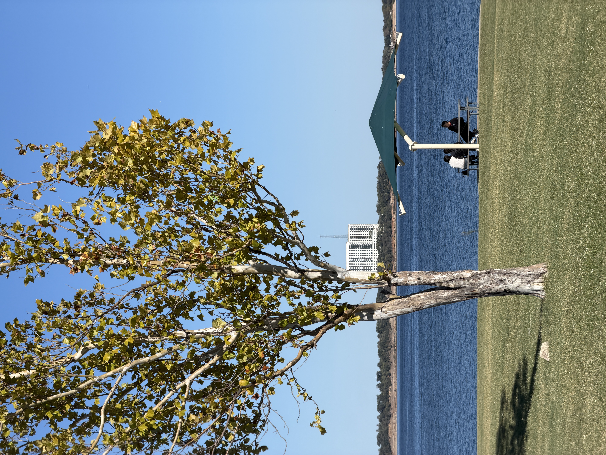
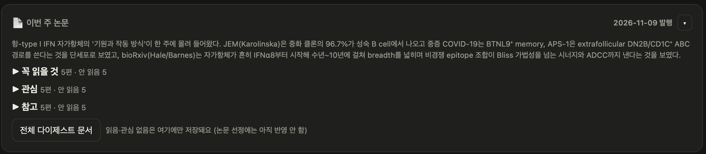

Two months have already passed since I started my PhD in the US.
(Actually, I'm now nearly three months in — I was lazy, so this post is late.)

Around mid-October, I finished my first rotation.
I wrapped up a rotation project of about 8 weeks and started my second rotation.

My case is a bit unusual: I'm continuing in the same lab on a similar topic,
but either way, I want to write down what I learned as I finished my first rotation.

My goals for the rotation were:
1. Understand the lab's ongoing projects
2. Join research among them that matches my interests
3. Bring one conclusion to completion

## Understand the lab's ongoing projects

For #1, I got a rough picture just by consistently sitting in on lab meetings, held twice a week on Mondays and Fridays.
On top of that, hearing the same people's topics several times at lab-hosted seminars like Nature's Typo,
and continually following the papers the lab publishes (even without reading them closely) to get a sense of "so this is the kind of research coming out of this lab," helped a lot.

To follow papers, I split my interests into a few broad areas and use AI to generate a weekly digest.
In my case, I split them into three areas — Autoantibodies, Inborn errors of immunity, and Human genetics —
and every Monday, AI lets me know if any new papers closely related to those three topics have been published.

At this point it's still a screening stage — the goal isn't to dig into papers deeply, but to get a rough sense of what research has been coming out lately. I sort each paper into three tiers — must-read, interested, and reference — to roughly decide how much weight to give it.

## Join research among them that matches my interests

This is a slightly different story.

If an ongoing project is far enough along to appear in a talk or be published as a paper,
most of its data has usually already been sorted out.
In other words, there's not much left for me to contribute.

Since my goal for the PhD is to train my scientific thinking,
I thought from many angles about which research I should join to achieve that goal.
For example, starting with whether I could take ownership from the experimental design onward,
whether I truly want to solve that problem, and whether that problem actually has impact.

For this, #1 has to be done really well.
Only then does the whole picture come into view, letting me pick and choose what I actually want from it.

In my case, I'm working on PML, a brain disease caused by a viral infection.
Studying immunology in the context of the brain is fascinating, and because patients are so rare, it's a disease that hasn't been studied well — which made me want to study it.

I'm connecting this to my other interest, autoantibodies, in my research,
and since so little has been uncovered, it's very hard to find a starting point — but on the flip side, if I can uncover even something small, the impact could be huge.

## Bring one conclusion to completion

And during the rotation period, 8 weeks — long or short depending on how you look at it —
I wanted to finish one independent project.
(In the end, reaching one conclusion took a bit longer than 8 weeks: about 10.)

I'm someone who values done over perfect. It's a personal tendency, so I can't say it's right or wrong,
but I'd say it's thanks to this tendency that I was able to publish a co-first-author paper during my master's.

For the part I'm responsible for, I need to design experiments that can answer Yes/No as best I can,
then interpret the results within an appropriate scope and draw a conclusion.

If you can't draw a conclusion, the problem might lie in the experimental design itself.
Or if reaching a conclusion demands too many steps, think again about whether the process you designed is really the only possible experiment.

Everything should start from the smallest possible unit.
You can prove a theory with a very fancy, impressive method,
but breaking a theory with a single, simple "click" of an experiment is the more elegant science.

Rather than repeating an experiment many times and saying, "Look, the p-value is below 0.05, right? So I'm right,"
showing a clear O/X in black-and-white terms is far more intuitive and powerful.

Sometimes the most basic, fundamental logic is the strongest.

## How I approach coursework

In a US PhD, coursework is too valuable to think of as simply learning "theoretical background."
Even while I'm swamped with rotations, the reason I still focus entirely on coursework before exams is very clear.
Because it really matters.

I think there are two ways I learn research:
1. Top-down: start from a project and fill in the knowledge you need
2. Bottom-up: start from general domain knowledge and gradually narrow down

I'm applying the top-down approach by carrying out a specific project during rotations,
while learning the bottom-up approach through coursework.
It feels like I'm starting to see the line between "what I can do" and "what I can't do."

As I learn general biology background that I'd never pick up through the top-down approach,
points of intersection start to appear — "Oh, I could apply this knowledge like this," "I could think about this part this way too."
That's why coursework matters.

Honestly, until recently I thought coursework wasn't very meaningful,
but I kept holding onto something Professor Mu-Rim Choi told me when I visited him before leaving Korea:
"Work hard in your coursework there. It'll help you a lot."

I'd been trying to follow his advice while half-doubting it, and only now do I think I'm starting to understand what he meant.
Even in the age of AI, you have to keep working to build solid domain knowledge.
And as you learn, one by one, how to approach almost everything in coursework biology experimentally and theoretically, you start to see — even if only faintly — what experimental design you really need.

## Wrapping up

What I've felt over two months of my US PhD ultimately comes down to "how sustainable is it?"

No matter how influential or important a research topic is, if I'm not interested, that's the end of it.
I realized how important it is to start from understanding myself.

And conversely, even if I truly love the research I'm doing,
it has to be research someone else would also care about to create impact.

And while you can learn biological domain knowledge in a project-driven way,
it's also important to learn more broadly, starting from coursework.
At a point when I haven't yet defined exactly what I don't know, it becomes the foundation for defining it.
