벌써 10주차라니..

아직도 매 글의 초입을 쓸때마다 정신이 번쩍 드는 느낌이다.

별개로, 이제야 좀 적응하기 시작한 것 같다.
지난 날들은 적응했다고 착각한 것 같고, 이제는 진짜다.

아닌가, 또 나중에 착각이라고 생각하게 되려나?

## Day 1 — 10월 5일 (월) · 개천절

평소와 다름없는 월요일이었다.

점심에 있는 immunology WIPS에서 CD8 T cell exhaustion 관련 발표를 듣고,
저녁 쯤 실험을 하고 퇴근하는 길에 노을이 이뻤다.

.. 우리 집에 손님이 온다는 사실만 빼면 말이다!

::: {.photo-row}

:::

무려 한국에서, 14시간의 비행을 거쳐 텍사스에 왔다!
정확히는 켄자스 시티에서 다른 친구를 만나고, 국내선으로 온거긴 하지만.

유학 떠나는 길에 꼭 보고 가야지 했던 형인데,
이렇게 텍사스에서 보게되어 감회가 새로웠다.

형은 2박 3일, 첫날 늦은 밤 저녁 도착해 셋째날 아주 이른 아침 떠나는 일정이었다.
짧은 시간이었지만 지금도 어제처럼 생생한 기억이다.

우선 공항에 도착한 형을 픽업했다.
못본지 일년은 채 안된 것 같은데,
항상 볼때마다 형은 상대를 편안하게 해주는 느낌이다.

타코, 그리고 집 앞의 간단한 바에서 한잔씩. 
(내가 좋아하는 Grapevine 바! 야장의 공기가 선선하다.)

횡설수설 짧은 시간이었지만 각자의 삶에 쫓겼던 이야기들을 앞다퉈 풀어내고,
그렇게 첫날 밤이 깊었다.

::: {.photo-row}

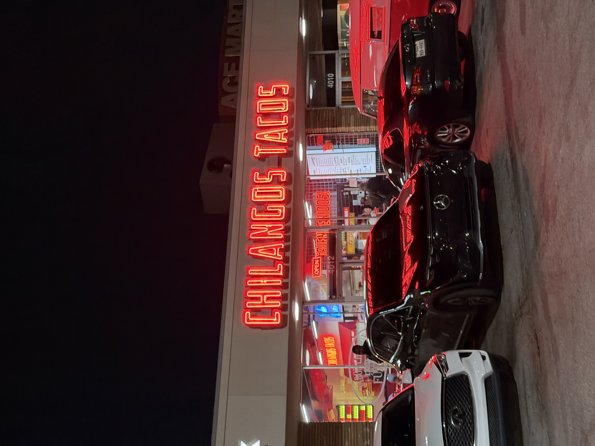

:::

## Day 2 — 10월 6일 (화) · 월루!

한국에는 월루라는 용어가 있다.
월급루팡을 줄인 말이다.

월루라고 하기엔 이상하지만,
그래도 엄연히 대학원에서 월급을 받으며 지내는 입장에서
오늘은 루팡이 되어 하루를 만끽한 날이었다.

원래 계획은 오후 세네시쯤 퇴근해서 형과 시간을 보내려고 했다.
그런데 도저히 그럴수가 없었다.
오후 열두시 땡하자말자 Supervisor에게 사정을 설명하고, 친구랑 시간을 보내야할 것 같다고 얘기했다.

사실 미국은 이런 부분에 대해 굉장히 관대한 편이다.
하지만 그 관대함 뒤에는 당연히 책임을 묻게 되어있고,
그 책임은 다음주의 내가 지겠지.

...

### 무계획이 곧 계획

원래 내 계획은 오후 네시에 stockyard로 가서 롱혼쇼를 보는 것이었다.
고속도로에서 길을 잘못 들기 전까지는 말이다.

어쨌든 네시 전까지 시간이 한참 남아서, 형이 혼자서 계획했던 부분을 동행하기로 했다.
Downtown으로 가서 맛있는 스테이크를 먹고,
J.F. Kennedy가 암살당한 역사적 장소를 잠깐 둘러보는 것이었다.
Sixth Floor Museum도 계획에 있었는데, 하필이면 가는 날이 장날이었다.

Y.O Ranch steakhouse에서 토마호크랑 fillet을 먹었는데,
정말정말 눈물나게 맛있었다.. 텍사스는 바베큐 아니었나?
토마호크의 육즙, 그리고 기름의 밸런스.. 게다가 텍사스 와인까지 한잔. 기가 막혔다.

다먹고 계산하려는 찰나, 형님이 또 일을 벌이고 말았다.
어제 타코에 이어 스테이크까지 계산해버린 것이다;;
이렇게만 얘기하면 손님을 초대해놓고 얻어먹는 파렴치한이 되어버리는데..
계산대의 형님 블록킹을 도저히 뜷어낼 재간이 없었다. 역시 연륜에서 나오는 바이브인가보다.

저녁에는 텍사스 바베큐를 먹기로 했는데, 그 때는 정말 감사하게도 기회를 주신다고 했다.
저녁은 꼭 내가 사야지.

::: {.photo-row}

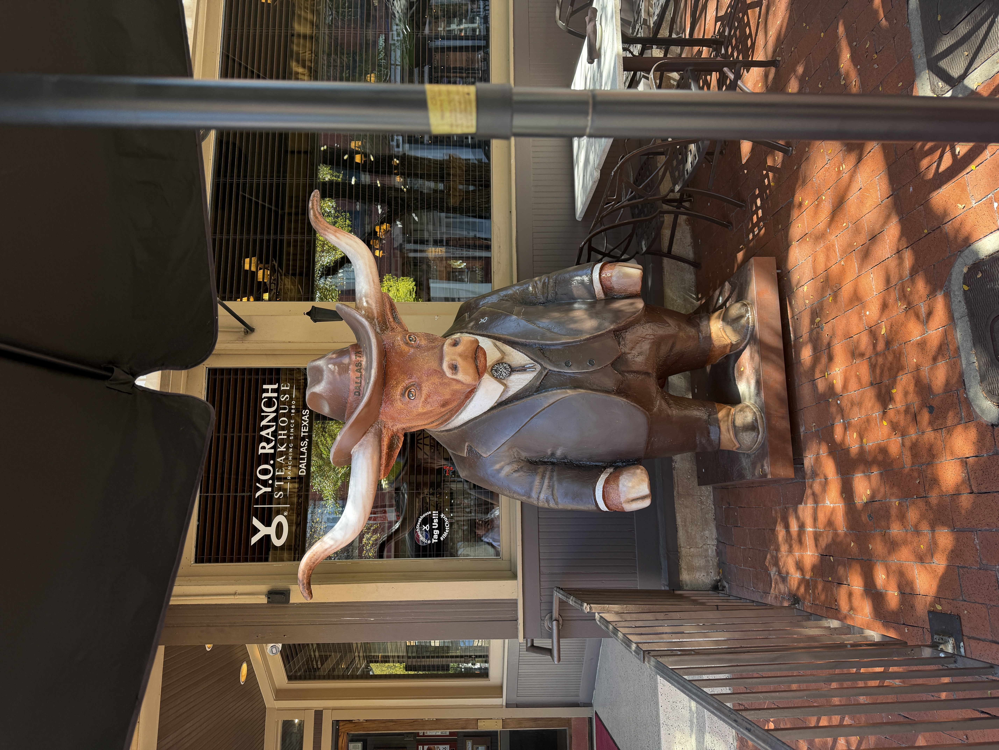

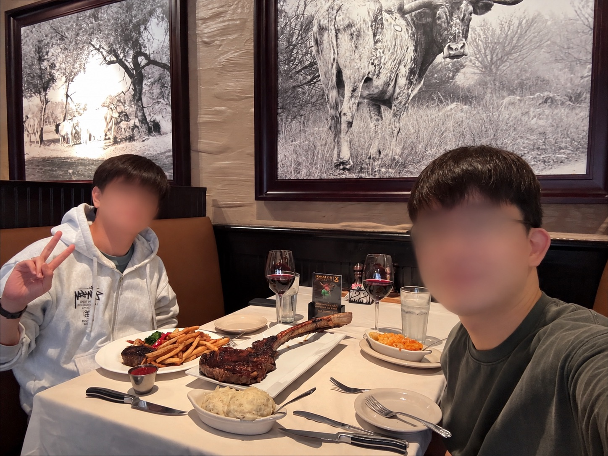

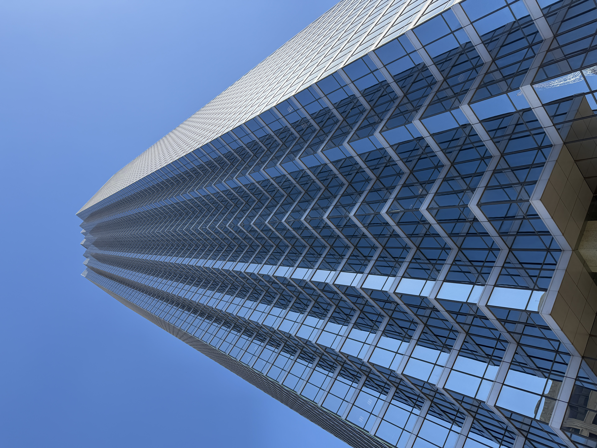

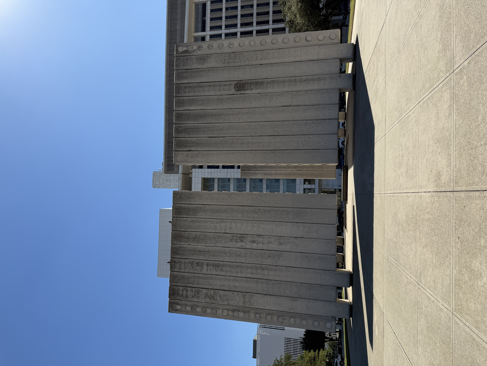

:::

### 롱혼쇼 없는 롱혼 거리

아뿔싸, 시간이 너무 늦어버렸다.
롱혼쇼의 시작인 오후 네시까지 도저히 Stockyard에 갈 수 없었다.
분명 30분 거리였는데, 차가 막혀 1시간으로 늘어나버린 것이었다.

황급히 우버를 잡아탔지만, 결국 롱혼쇼는 보지 못했다.
그게 어디인가! 그래도 텍사스의 명소 Stockyard를 둘러보기로 했다.

전에도 한번 온적 있었는데, 그때와는 또 느낌이 색달랐다.
평일 낮 한산한 거리의 Stockyard는 롱혼쇼가 없어도 정말 매력적인 곳이었다.
(항상 주말에는 많은 사람들로 붐빈다)

처음 갔을때는 가보지 못했던 구석구석 둘러보며, 거리를 만끽했고,
마무리는 역시 낮술. 와인에 이어 야장에서 시원하게 맥주 한잔을 들이켰다.

그리고 다음 일정은, 
한국인 친구, 그리고 일본인 친구 총 넷이서 텍사스 바베큐 원정을 떠나기로 했다.

::: {.photo-row}

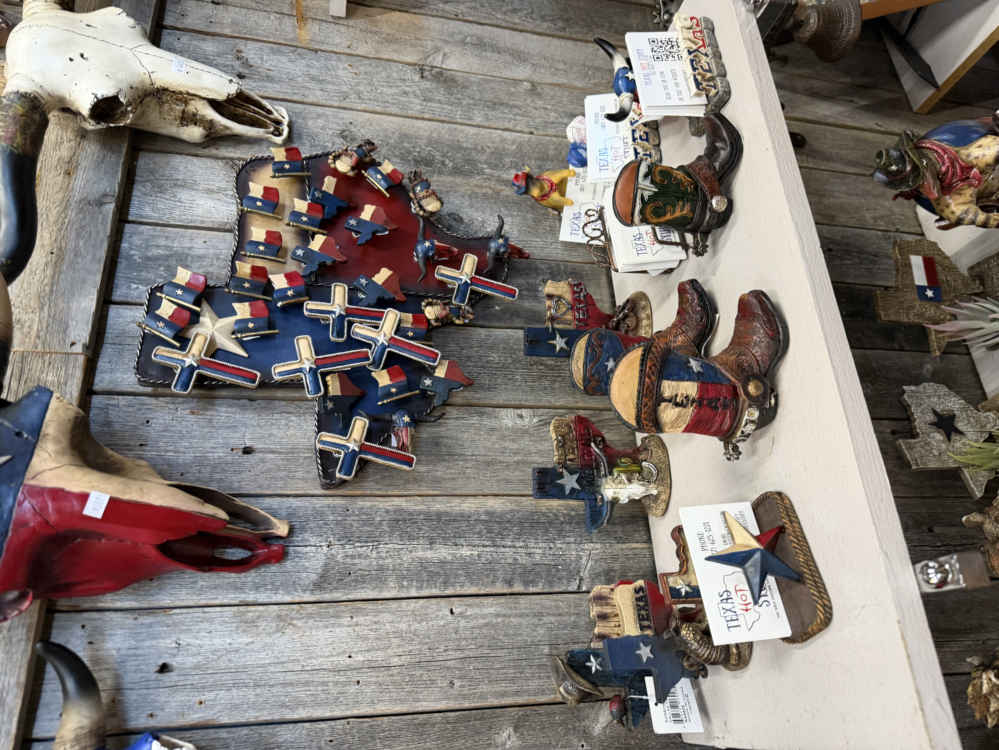

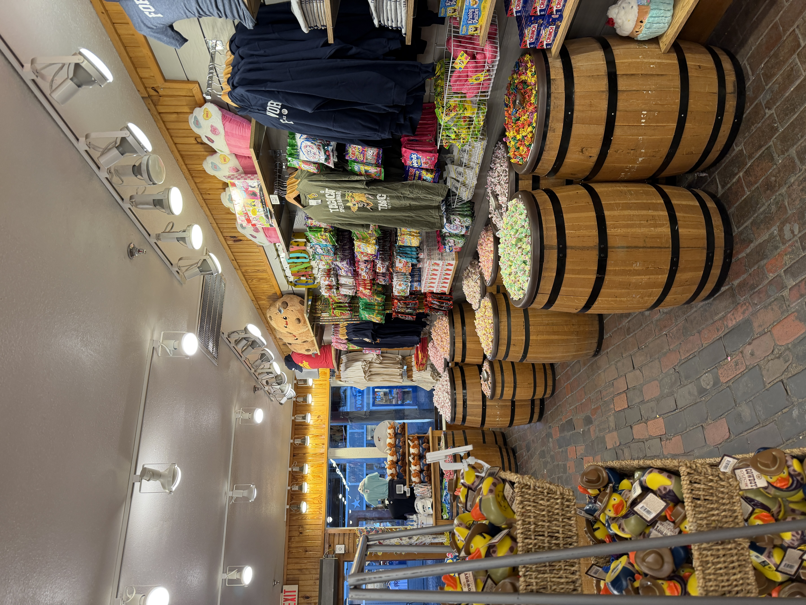

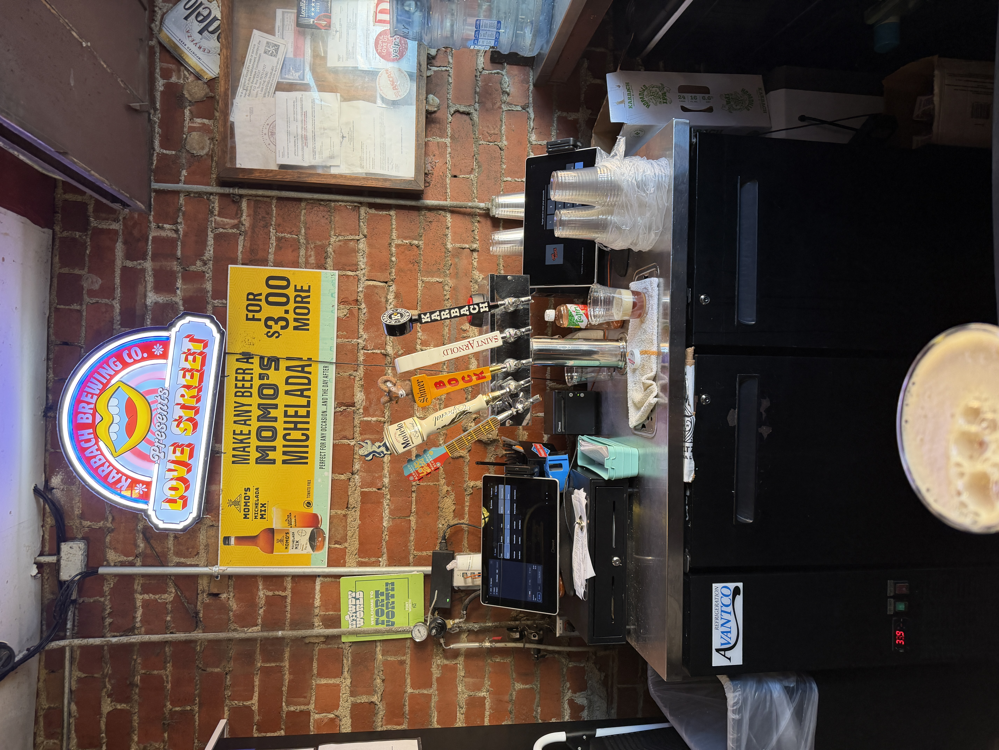

:::

### 만남은 늘 새로워

한국에서 온 손님을 맞이해주기 위해 내 친구들이 총출동했다.
그리고, 텍사스 바베큐를 부위별로 맛보기 위해서는 최소 4인 이상이 권장된다.

점심에 먹은 스테이크가 아직 배에서 살아 숨쉬고 있었지만,
텍사스의 정수를 보여주기 위해 바베큐집으로 이동했다.

초면이라는 사실이 무색할만큼 금방 친해졌다.
도쿄를 정말 좋아하는 형은 요코하마 출신이라는 일본인 친구에게 관심이 동했나보다.
아쉽게도 영어라는 장벽때문에 완벽한 소통이 이루어지진 않았지만,
손짓발짓 섞어가며 서로의 배경에 대해 조금씩 알아갔다.

그리고 역시 텍사스 바베큐는 훌륭했다.
여태 텍사스에 와서 Terry's black 1회, 그리고 Goldee's bbq 1회
이번이 세 번째 텍사스 바베큐인데, 처음 왔던 Terry's black과는 느낌이 많이 달랐다.
(첫 방문보다 훨씬 맛있었다! 그 땐 너무 기대감이 최고조여서 그랬을까?)

이대로 헤어지기 아쉬워 Deep Ellm 근처 바에 가서 한잔 더 걸치며,
이런 저런 사는 얘기를 했다.

이 때 시간이 밤 10시가 넘어, 
집에 가려나 생각하면서 마지막 제안을 했는데,
다들 흔쾌히 승낙해서 다같이 우리집으로 향했다.

그리고 이때 Robotaxi를 처음 경험했는데, 텅빈 운전석에 반신반의하며 탔지만
그 의심은 몇초도 지나지 않아서 완전한 믿음으로 바뀌어버렸다.

그렇게 새벽 한 시가 넘어서야 즐거운 자리가 끝이났다.

::: {.photo-row}

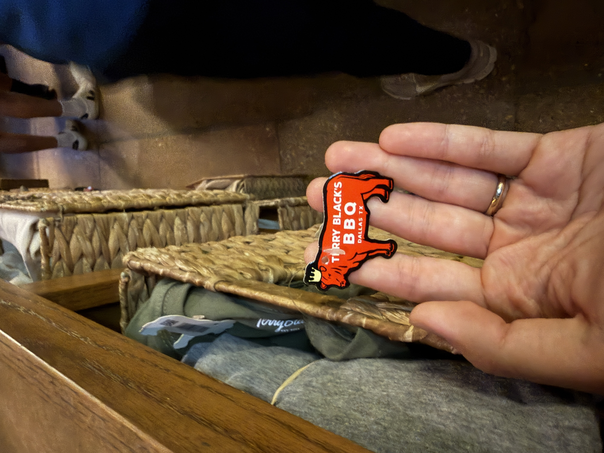

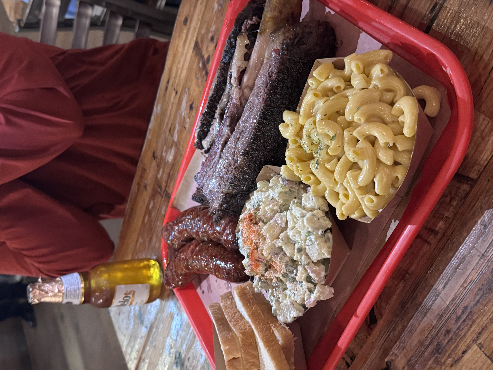

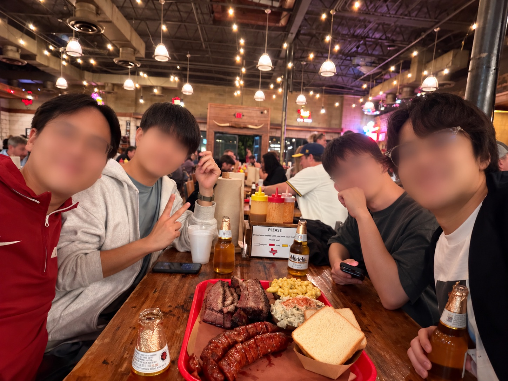

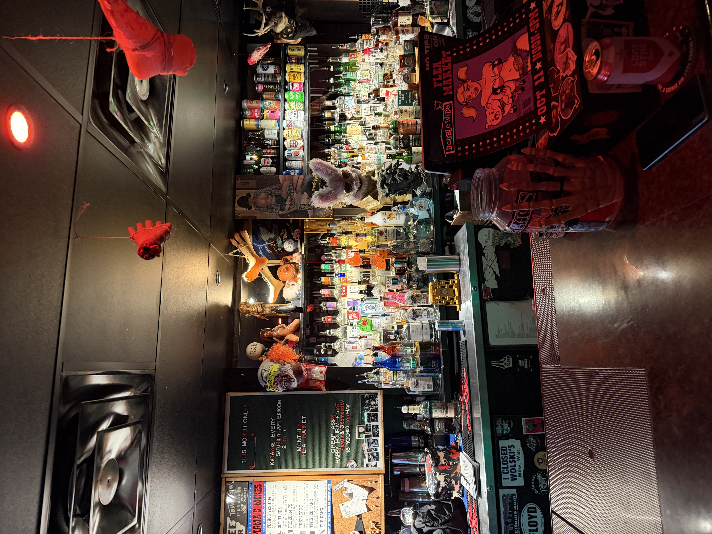

:::

## Day 3 — 10월 7일 (수) · 에덴의 동쪽

## Day 4 - 10월 8일 (목) · Biophysics Retreat

## Day 5 - 10월 9일 (금) · 휴유증

잘못 본 것이 아니다.

맞다.
3일치 글을 한 단락에 쓰려고 한다.

그 이유인 즉,
형이 가고 나서 한동안 체력 이슈에 시달려
별다른 일이 없었기 때문이다.

수요일에는 에덴의 동쪽이라는 넷플릭스 시리즈를 시청하기 시작했는데,
1952년 John Steinbeck이 지은 소설 원작의 작품으로,
해당 원작은 1962년 노벨문학상을 수상했다.

어쨌든 그 뛰어난 작품성을 10년만에 인정받은 원작에서 출발한 작품이다 보니,
너무너무 흡입력이 뛰어나서 순식간에 모두 시청해버렸다.
(하루만에 끝낸 것은 아니다.. 나도 일상이 있다)

그리고 그 다음 날, 목요일에는 하루종일 Biophysics 분과와 함께 Retreat 행사를 진행했다.
행사의 내용이라 함은, 각자가 10-20분 가량 연구 주제를 소개하는 짧은 talk을 돌아가면서 하는 형태였다.

그리고 금요일은, 거의 실신 직전에 in-N-out burger를 급히 수혈하며
다시 일상을 원래 리듬으로 되돌리기 위해 부던히 노력했다.

::: {.photo-row}

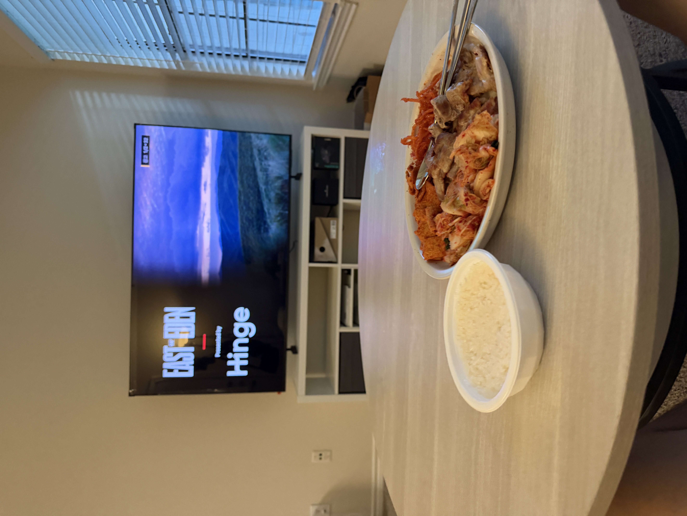

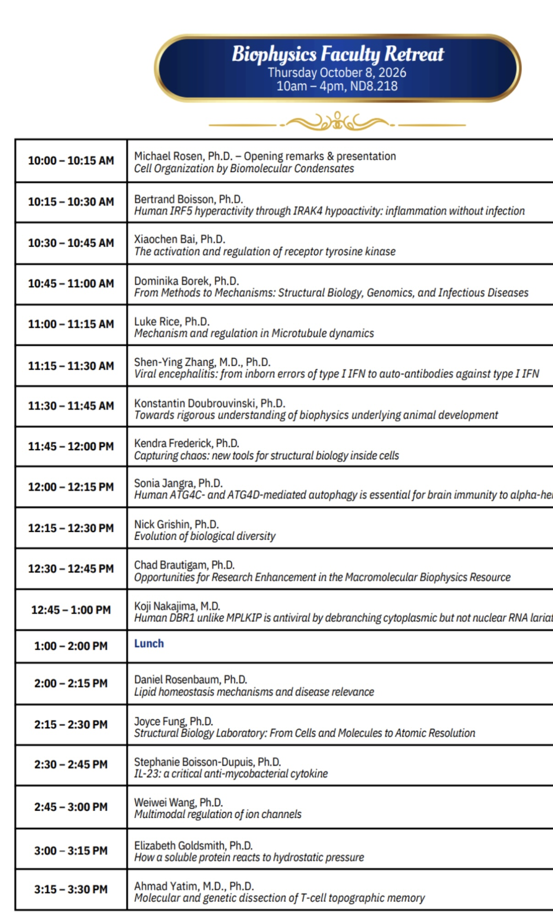

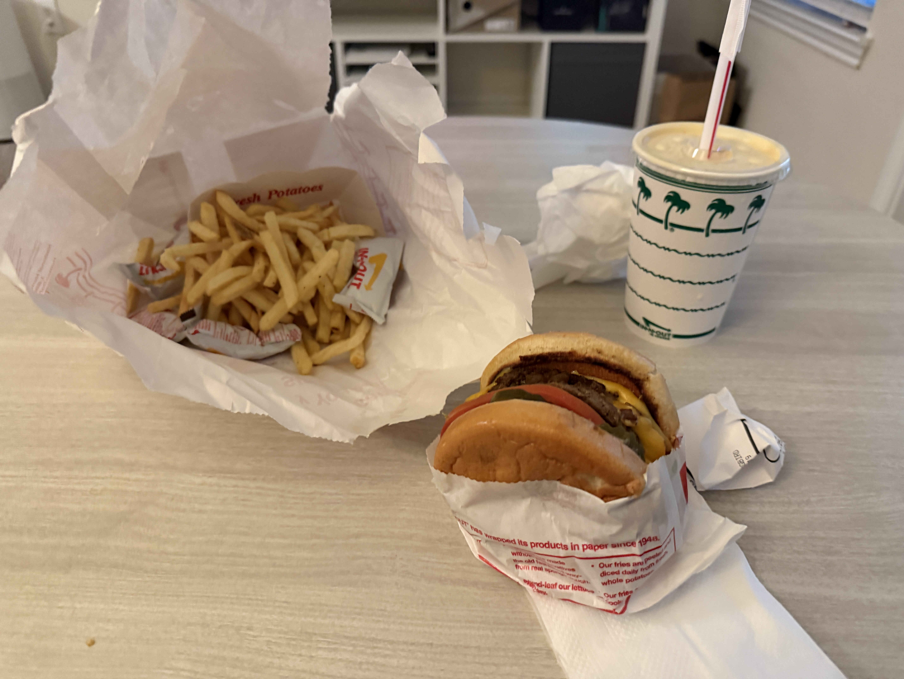

:::

## Day 6 - 10월 10일(토) · Genes Exam 1 D-3

맞다.
시험 3일전이었다.

자유에는 엄청난 책임이 따르고,
자유를 만끽한 영수증을 정산할 시간이었다.

주말에는 아점, 그리고 저녁 이렇게 두 끼를 챙겨먹는다.
아점을 먹고, 카공을 한 뒤에, 저녁을 먹었다.

그리고 드디어 신용카드 수령!

지금 이 글을 쓰는 시간에도, 내일의 시험이 다가오고 있다.
(글의 내용이 짧아도 이해해달라!)

::: {.photo-row}

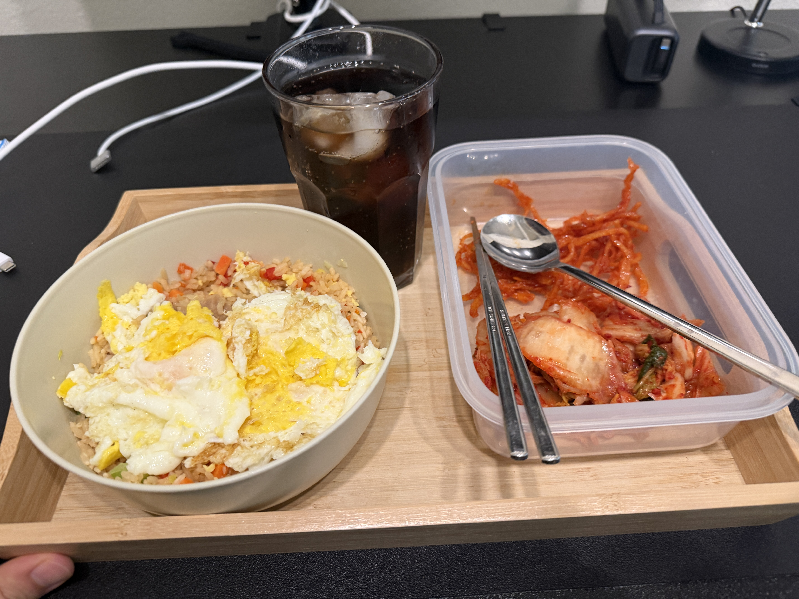

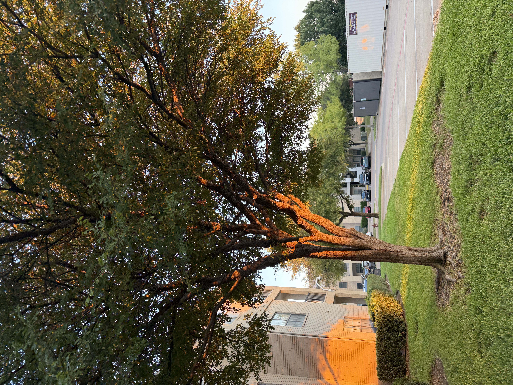

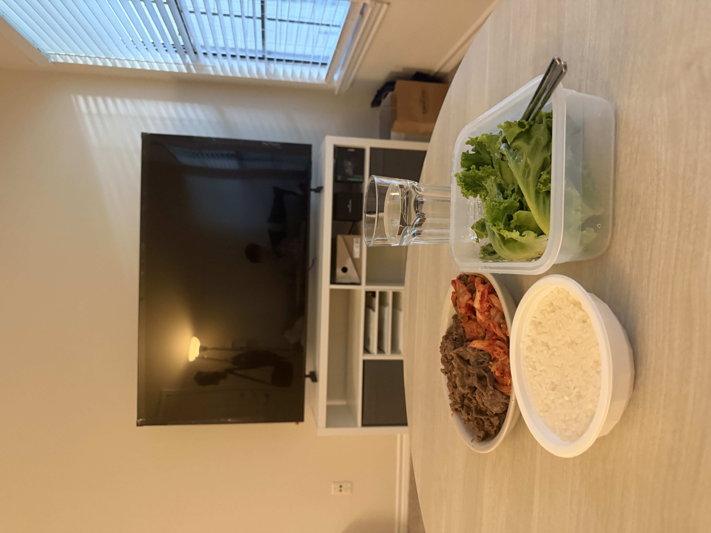

:::

## Day 7 - 10월 11일(일) · Marshall Stanmore III

곧 있으면 내 생일이다.

여자친구가 생일 선물을 사주기로 했고,
그건 바로 마샬의 스탠모어3 라는 스피커였다!

스피커가 놓여질 자리를 만들기 위해서, 뭘 사야할지 고민이 많았다.
일반적인 스피커 스탠드를 사자니,
스탠드 외의 용도로 전혀 못쓰면서 비싸기만 너무 비쌌다.

그래서 생각해본 것이 협탁 정도의 작은 책상이었고,
마침 페이스북 마켓플레이스(미국의 당근마켓 정도 되겠다)에 적당한 매물이 있어 보러갔다.

스피커가 언제 오려나, 생각하면서 집에 들어왔는데
못보던 상자가 있는 것 아니겠는가?
뜯어보니 바로 내가 기다리던 그 물건이었다.

잽싸게 책상과 스피커를 세팅하고,
티비와 연결해서 티비 스피커 대용으로도 써보고,
핸드폰으로 연결해서 내 플레이리스트도 틀어봤는데,
너무너무 만족스러웠다!

카투사 시절 썼던 Marshall의 acton III 보다 훨씬 저음이 빵빵했다.
그리고 음향의 공간감이라고 해야하나? 
집이 그래도 혼자살기에는 꽤 넉넉한데, 공간을 소리로 잘 채워줬다.

맞다, 이럴때가 아니다.

점심을 먹고, 카공을 갔다가 어느정도 공부가 마무리되어(우매함의 봉우리다)
평일에 못다한 운동을 잠깐 해주고,
항상 꾸며놓는 Student Center 사진을 나오는 길에 찍고,
저녁과 함께 하루를 마무리했다.

:::{.photo-row}

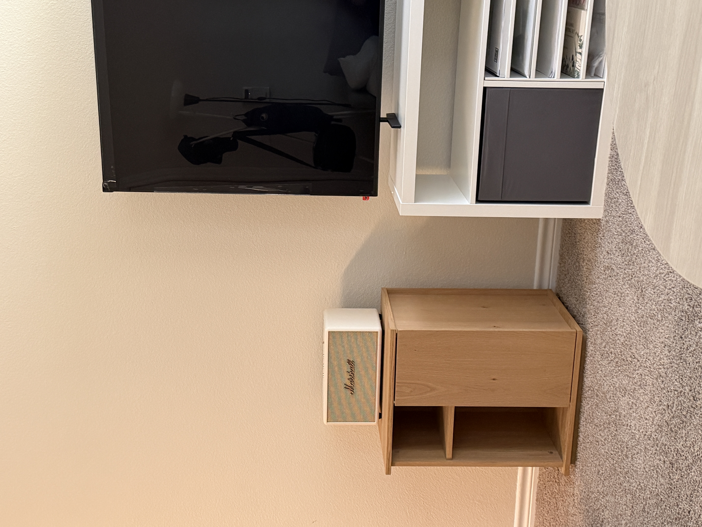

:::

미국에 온지 10주차,
한국에서 온 손님을 맞이하느라 기력을 다 썼다.

그렇지만 그만큼 내게 귀한 손님이었고,
후회 없을만큼 즐겁게 지냈던 것 같다.

형을 만나고 나면 항상 나를 스스로 돌아보게 되는 것 같다.
형이 인생을 즐기는 방식이, 나의 것과는 많이 달라보이기 때문일까?

속으로 부럽기도 하면서, 한편으로 나도 저렇게 자유롭게 지낼 수 있을지 의문이 들기도 한다.
각자의 삶, 각자의 고충이 있는 것 아니겠는가?

누추한 장소에 귀한 손님을 모시게 되어서 영광이고,
우리집은 항상 열려있으니 또 다음 손님을 기약해야지.

그리고 나도 다시 일상으로 돌아가야겠다.