13주차. 드디어 최종 세팅된 세포 실험을 환자 샘플을 이용하여 진행했다.
결과는 아래에서 확인!

그리고 갑작스럽게 보드게임이 너무 하고 싶어서,
페이스북 마켓 플레이스를 뒤져 여러 개의 보드게임을 구매했다.

점점 더 취미 부자가 되어가는 중이다!
(하라는 공부는 안하고)

## Day 1 — 10월 26일 (월) · 운전면허 최종

드디어 운전면허를 최종 최종(제발..) 신청하는 날이다.
사실 운전면허는 내가 미국에 오자말자 신청한 몇 가지 서류 중 하나였다.
그러나 악랄한 미국식 행정 덕분인지, 아니면 우리 아파트에 우체부가 잘못되었는지
나의 면허는 영영 배송되지 않았고, 임시 허가 기한을 아슬아슬하게 남겨두고 다시 DPS를 방문했다.
(DPS는 Texas Department of Public Safety의 약자이다)

마침 비슷한 용건으로 DPS에 가는 친구가 있어 함께 동행하기로 했다.
가서도 한참 기다려야 했기에 심심했는데, 덕분에 심심하지 않게 시간을 보냈다!
그리고 화요일에는 다 같이 친구집에서 마라탕을 끓여먹기로 했다.

밥을 다 먹고는 뭐할지 곰곰히 고민하다가,
다같이 보드게임을 하면 참 재밌겠다는 생각이 들어 급작스럽게 카탄을 구매했다.

::: {.photo-row}

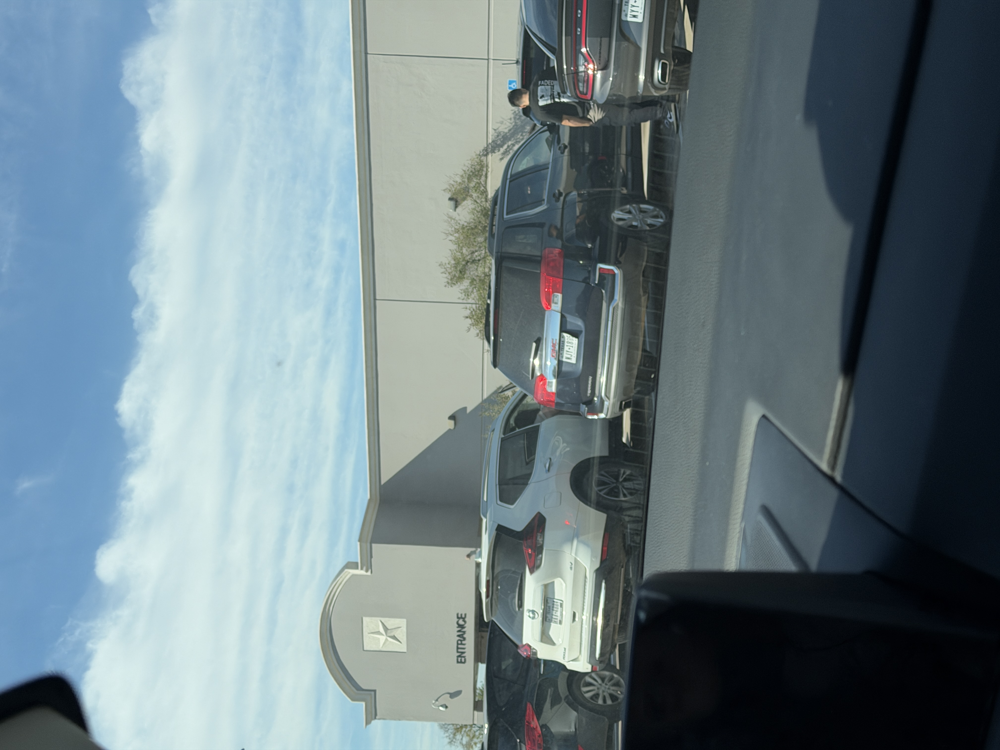

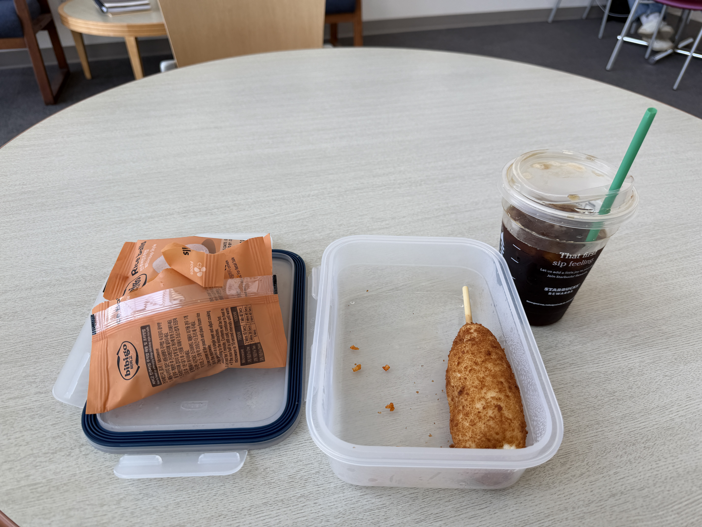

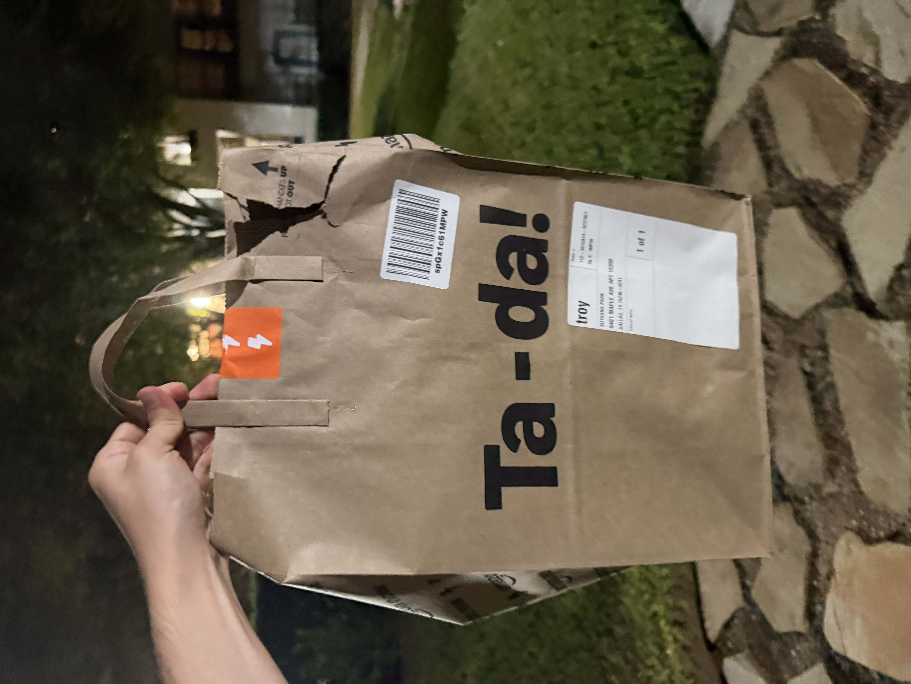

:::

## Day 2 — 10월 27일 (화) · 카탄의 개척자

오늘은 친구집에서 다같이 마라탕을 끓여먹기로 했다.
얼마 전부터 얼얼한 마라가 무척 땡기던 참이었는데, 정말 타이밍이 기가막혔다.

사실 어떤 보드게임을 살지 고민하다가,
facebook marketplace에서 마땅한 보드게임이 없어 포기하려고 했었다.
그러나 아마존 Now에 '카탄'을 팔고 있는게 아니겠는가!
구매하면 무려 한시간 내로 배송을 해주는 옵션이라 당장 구매했다.

아무튼 '카탄'을 챙겨서 퇴근 후에 친구집으로 향했다.
한국인 친구 넷이서 각자 아파트에 대한 고충이 있는데,
유일하게 이 친구는 본인 아파트에 만족하며 지내는 친구였고,
그래서 나머지 친구들이 내년에 이사를 계획하는 와중에 집을 구경하는게 주 목적이었다.

렌트비를 감안했을때 굉장히 깔끔하고 지내기 괜찮아보였다.
무엇보다 화장실이 정말 마음에 들었는데,
이사라는게 생각보다 쉽지는 않은 일이라 조금 더 고민해봐야 할 것 같다.

아무튼 그렇게 마라탕을 다같이 끓여먹었는데,
집주인 친구가 청경채랑 고기 등 각종 재료들을 더 준비해주어서
아주아주 풍성하고 맛깔난 마라탕을 먹을 수 있었다!
그리고 나서도 과일, 고구마빵 등 끊임없이 간식을 내어줘서 정말 배가 터지는 줄 알았다.

친구들은 보드게임 경험이 거의 없는 입문자들이었고,
나는 그래도 종종 카페에 가거나 보드게임을 좋아하는 룰마스터 친구가 있어서 경험이 조금 있었기에
처음으로 룰마스터 역할을 맡아 친구들에게 룰을 설명하고, 같이 보드게임을 즐겼다.

어떻게 설명하는게 친구들의 흥미를 돋우면서도 또 규칙을 정확하게 설명할 수 있는지를 고민하다 보니 룰마스터의 역할이 꽤나 재밌다는 생각을 하게 되었고,
친구들과 또 다른 보드게임을 해보고 싶다는 생각으로 이어졌다.

::: {.photo-row}

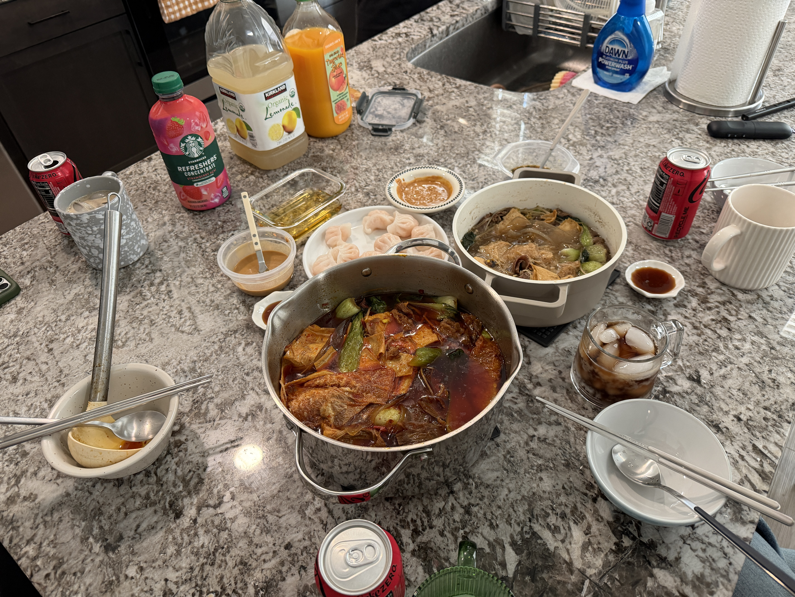

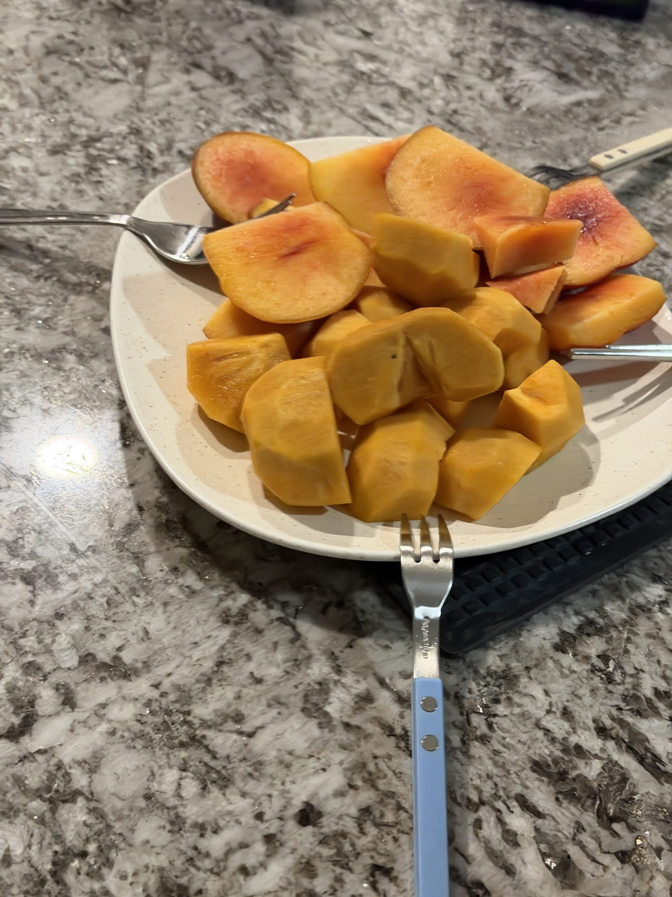

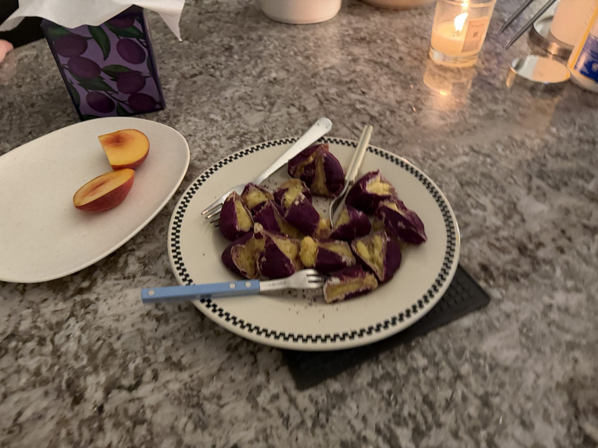

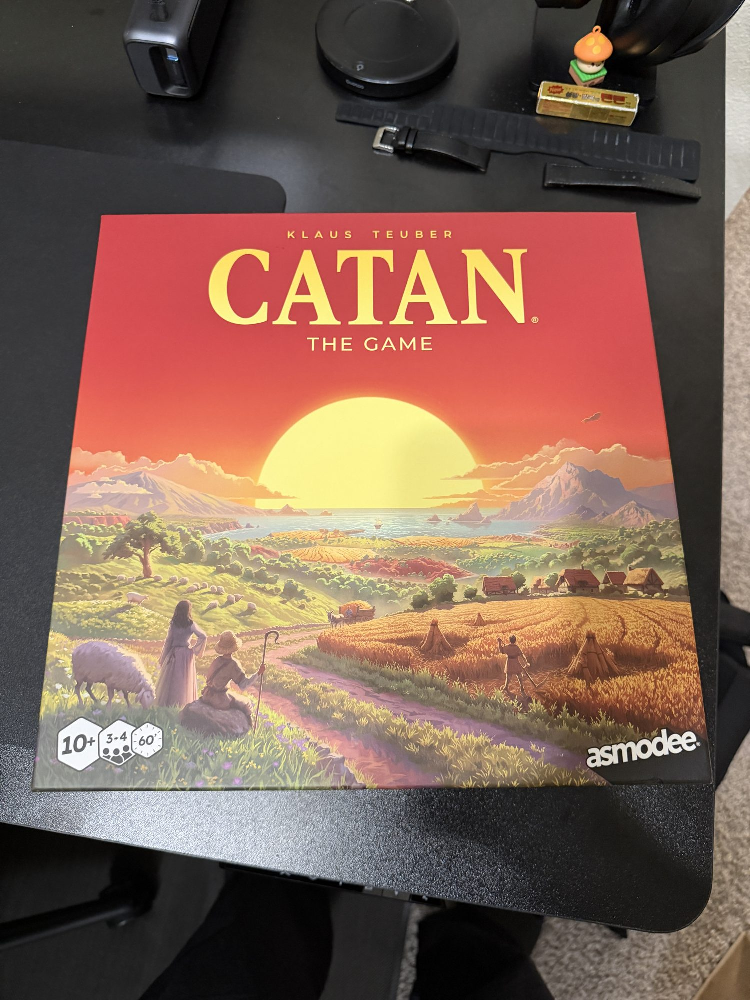

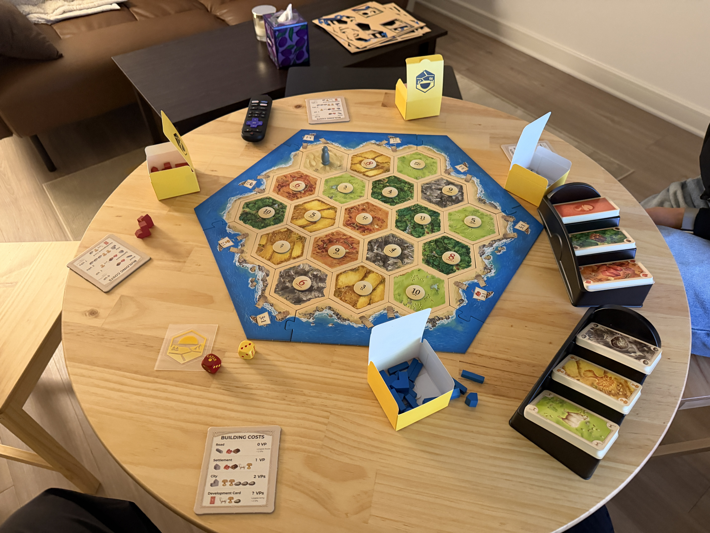

:::

## Day 3 — 10월 28일 (수) · Big Day!

드디어 약 두달간 셋업한 시험법을 가지고 가설을 테스트해보는 날이었다.

본격적인 실험을 앞두고, 친구들과 가볍게 커피 한잔을 테이크아웃했다.

환자 샘플은 준비되어 있었고,
또 그리고 이전 글에서 언급했던 기기 문제도 임시방편이지만 해결책을 찾았다.

그래서 나의 Supervisor인 Ahmad와 같은 실험 디자인으로 서로 다른 Plate를 각각 하나씩 실험하기로 했다.
사실 그렇게 가능성이 높지 않은 가설이었어서, 왠지 모르게 실험 시작전부터 겁이났다.
그렇지만 일말의 가능성이라도 확인하기 위해 끝까지 실험을 마쳤고,

...

결과는 음성이었다.

갑자기 두 달간의 시간이 허망하게 느껴졌다.
아무리 성공은 실패의 어머니라고 하지만, 내가 애정을 느꼈던 프로젝트인 만큼
그 결과가 예상과 달랐을 때 찾아오는 충격은 컸다.

가짜 음성일 가능성도 염두에 두고 추가로 확인해야 할 부분들도 분명 남아있지만,
사실상 그럴 확률은 더 희박했기에 기분이 영 좋지않았다.
이번 한 주는 기분이 좋지 않은 대로 나의 실패를 곱씹고 또 이를 받아들이는 시간이 필요할 것 같다.

::: {.photo-row}

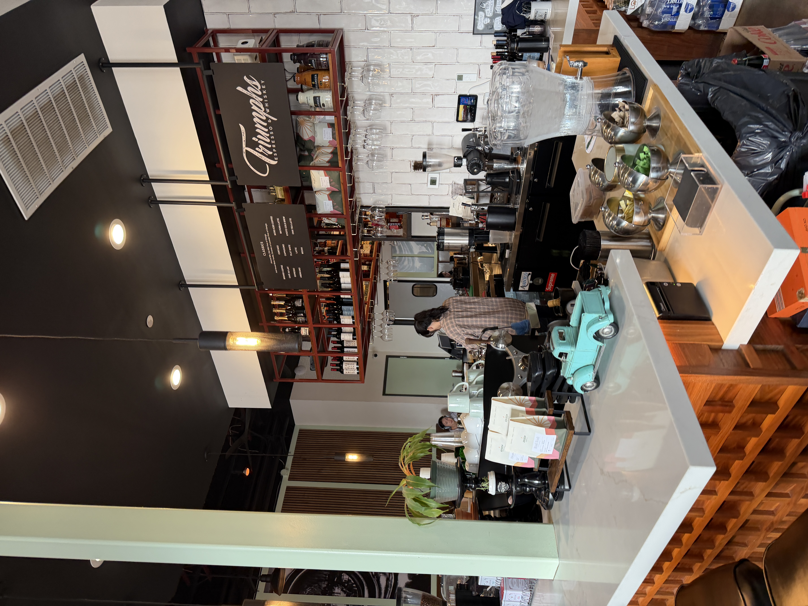

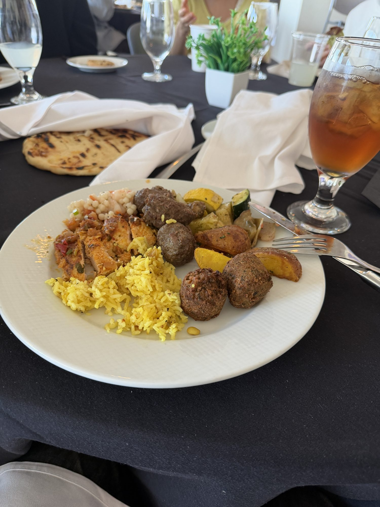

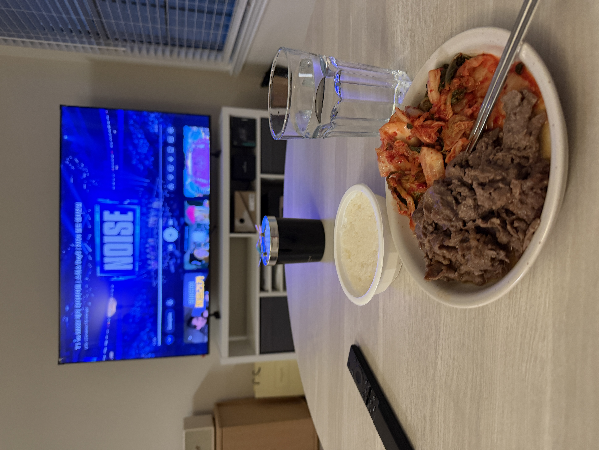

:::

## Day 4 - 10월 29일 (목) · 실패를 마주하기

요즘 커피를 부쩍 많이 사 마시는 것 같다.
점점 집에서 타 가져오는 카누의 맛이 질리기도 하고, 또 번거롭기도 한 것 같다.
다행히, 교내 카페는 학생 대상으로 20% 할인이 적용되어 꽤 저렴한 가격에 커피를 구매할 수 있다.

오늘 점심에는 AI Town Hall 행사가 있었다.
앞으로 AI를 어떻게 다뤄야할지에 대해 UTSW의 공식적인 입장을 표명하고, 방향을 제시하는 그런 자리였다.
AI를 어떻게 활용해야 할지에 대해 관심이 많아, 이에 대한 힌트라도 얻을 수 있을까해서 참석했지만 별다른 소득은 없었다.
그래도 Free Sandwich를 받아 점심으로 먹어주었다.

...

이제는 실패를 정면으로 마주해야 할 시간이었다.
어제 실패라고 생각했던 것은 microscope로 대략 확인했을 때,
가설로 세웠던 결과와 일치하지 않았음을 알게 되었기 때문이었다.

이번에는 제대로 된 결과를, 기기를 사용해서 정량화하는 단계였다.
UTSW에는 굉장히 큰 core hub들이 몇군데가 있는데,
Diabetes/obesity center와 alzheimer center가 있다.

나와 Ahmad가 방문한 곳은 alzheimer center였고,
그 곳에는 억단위의 기기들이 깔려있었다..
우리가 사용한 기기는 'Atune'이라는 기기였는데, 우리 랩에서도 구매할 예정이었다.
전에 사용했던 'Novocyte'와 비교해서 약 두 배가량 빠르게 결과를 확인할 수 있었다.

아무튼 그렇게 또 한번의 실패를 정면으로 마주하는 시간을 가졌고,
애지중지 모아두었던 Plate들을 쓰레기통으로 보내주었다.

::: {.photo-row}

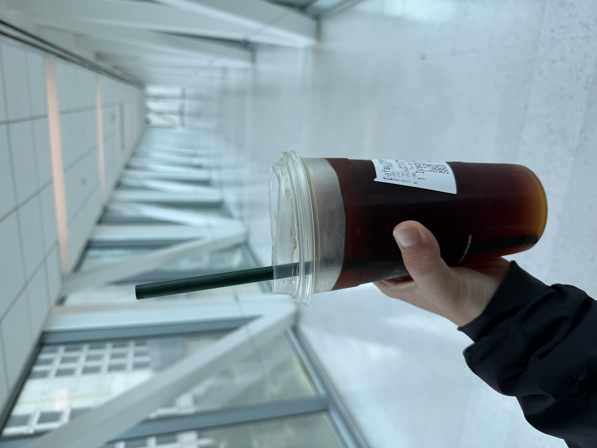

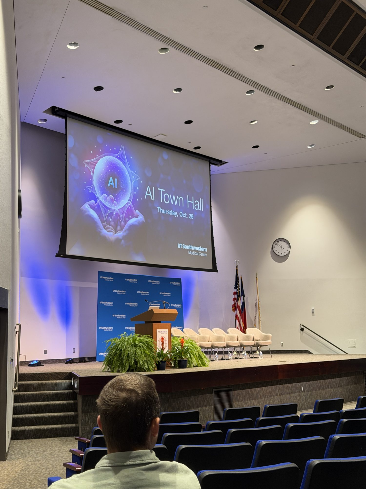

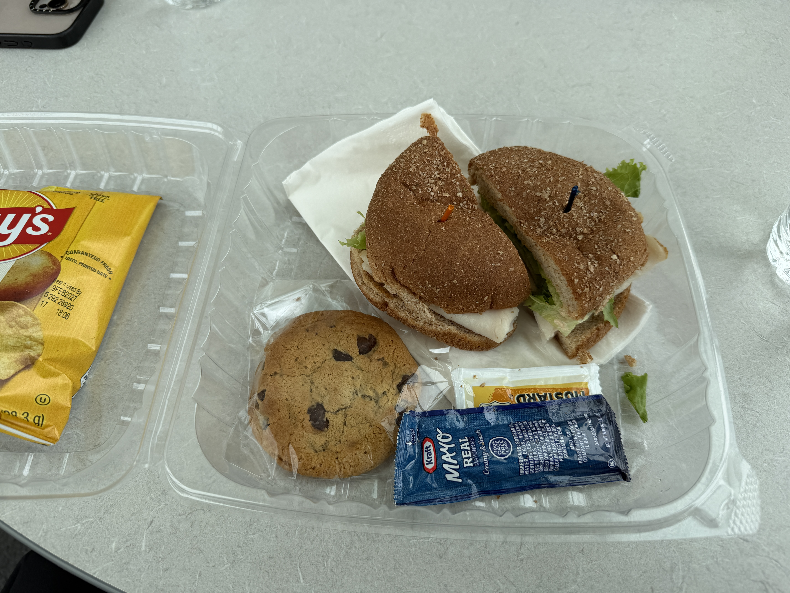

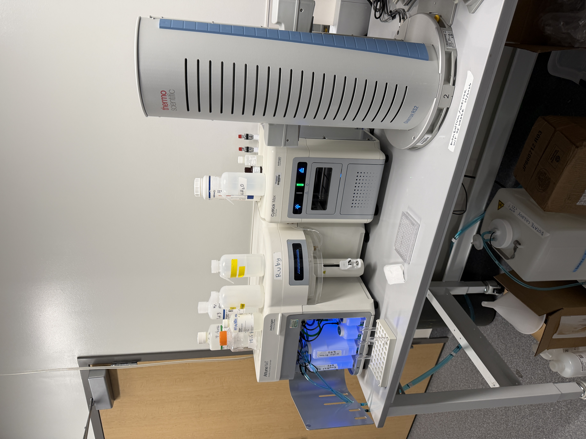

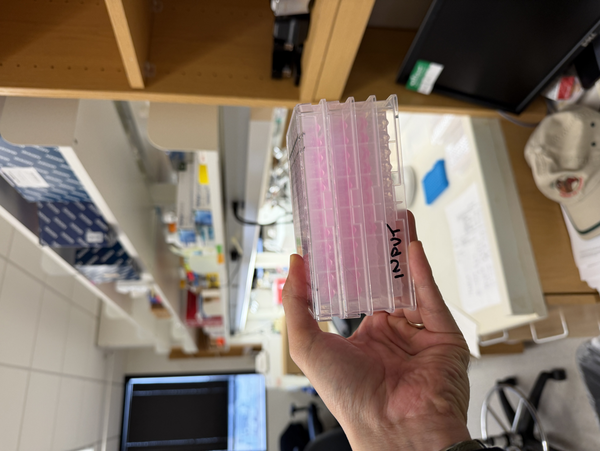

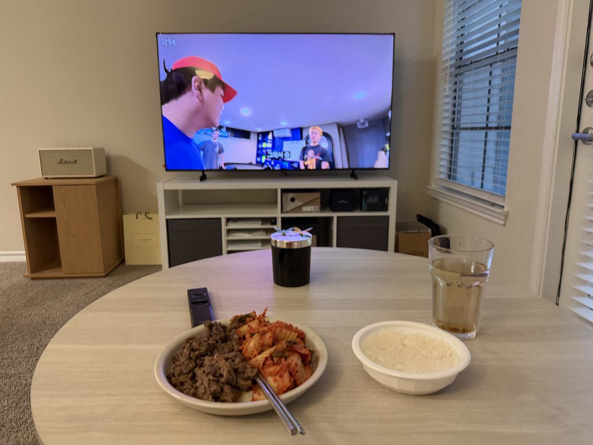

:::

## Day 5 - 10월 30일 (금) · 할로윈과 농구 경기

### Halloween Potluck

오늘은 연구실에서 할로윈을 기념해 Potluck을 하는 날이었다.
Potluck은 좀 생소한 개념인데, 간단히 말하자면 다같이 적당량 음식을 챙겨와서 다같이 쉐어하는 문화였다.
나와 같은 랩에 로테이션중인 한국인 친구들은 다 같이 김밥과 한국식 강정을 준비했고,
그 중 솜씨 좋은 친구는 직접 만든 호박맛 치즈케이크를 추가로 준비해주었다.

Potluck 전에, Student Center에 들려서 무료로 나눠주는 할로윈 간식을 챙겼다.
호박이 그려진 가방이 너무 귀여웠고, 가방 가득한 초콜릿&사탕을 다먹었다간 분명 이가 다 빠져버릴 것이다.

아무튼 그렇게 Potluck을 진행했고, National Lab인 만큼 각자의 나라에서 유명한 음식들을 준비해줘서 보는 맛이 있었다.
특히 일본인 친구가 준비해 준 야끼소바가 정말 맛있었다.

다같이 코스튬까지 준비해서 본격적으로 즐겼으면 더 재밌었을 것 같은데,
내년에는 코스튬도 한번 준비해봐야겠다.

::: {.photo-row}

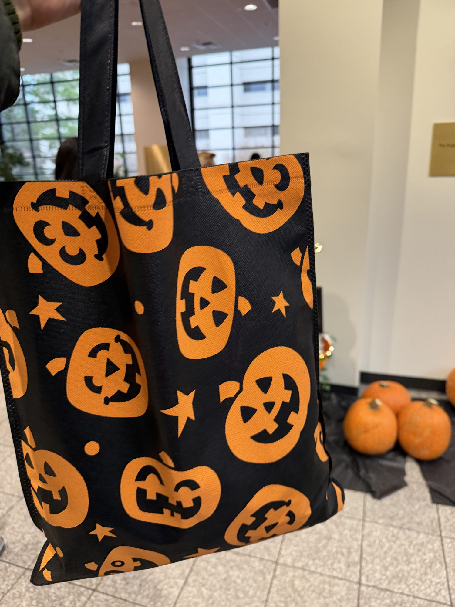

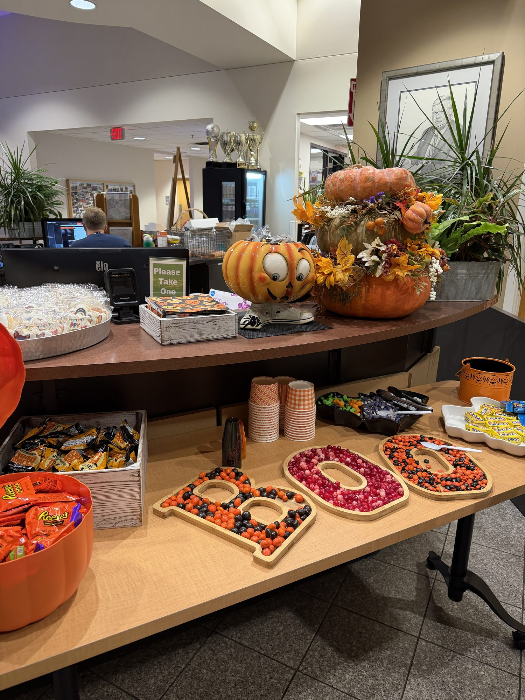

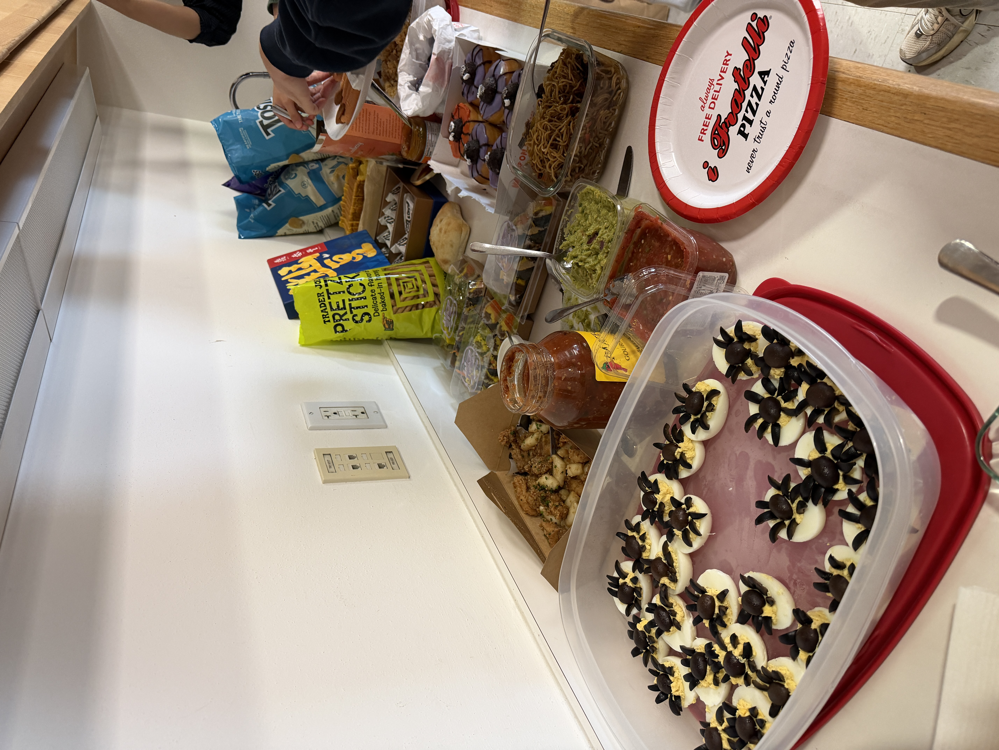

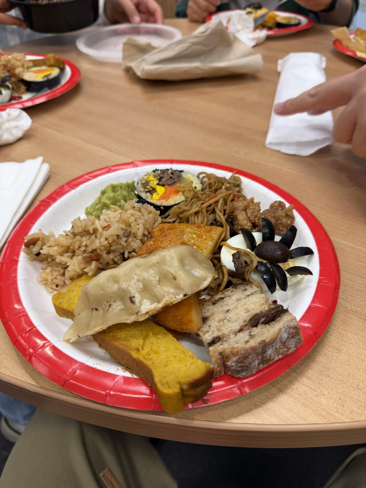

:::

### Dallas Mavs 농구 경기

퇴근하고서는 친구들과 농구 경기를 보러갔다.
한국인 친구 한명과, 대만 친구 한명, 그리고 중동계 미국인 친구 한명 해서 총 네명이서 놀러간 것이었다.

사실 대만 친구와 미국인 친구는 학교에서 인사만 하다가,
처음으로 같이 놀러간 것이라 재밌게 놀 수 있을지 걱정이 앞섰다.
그러나 걱정이 무색하게, 뇌빼고 농구 경기에 몰입하다 보니 정말 즐거운 시간을 보냈다!

홈팀인 달라스 매버릭스와, 그리고 Texas rivarly인 휴스턴 로키츠가 맞붙는 경기였다.
달라스 매버릭스에는 쿠퍼 플래그, 그리고 휴스턴 로키츠에는 케빈 듀란트가 가장 잘하는 선수들이었고, 아니나 다를까 이들의 활약을 지켜보는 게 경기의 주요 관전 포인트였다.

처음으로 관람한 NBA 경기였고, 정말 스포츠에 미친듯이 열광하는 미국의 에너지를 느낄 수 있었다.

...

그렇게 농구 경기를 보고 나서는 우리 집으로 초대해서 다 같이 보드게임을 즐겼다.
원래는 카탄을 하려고 했으나, 사실 굉장히 지쳐있었던 우리는 간단한 파티게임을 하기로 했고,
Rex라는 친구가 본인의 집에 들려서 보드게임을 가지고 와 맥주를 마시면서 즐거운 시간을 보냈다.

요즘 무거운 전략보드게임을 위주로 구매하려고 계획하고 있는데,
이런 경우에는 가벼운 파티 보드게임도 필요할 것 같다는 생각이 들었다.

::: {.photo-row}

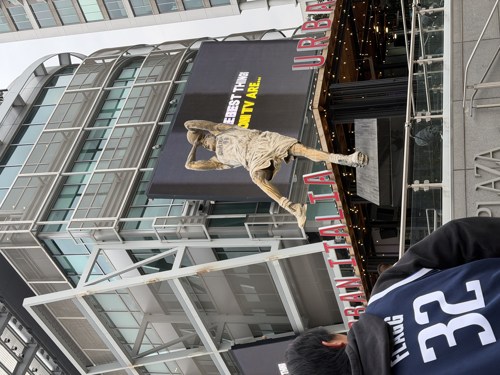

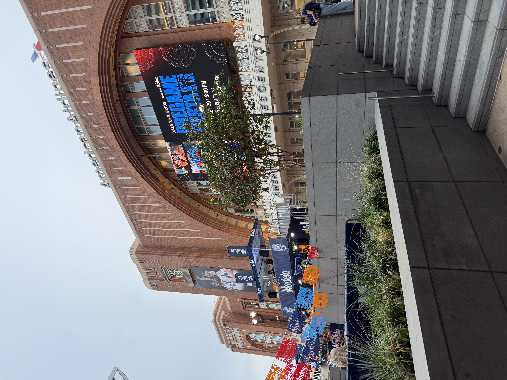

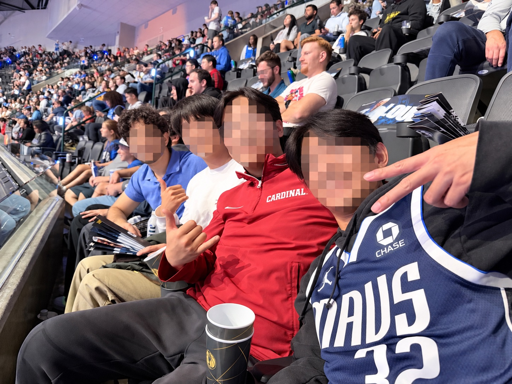

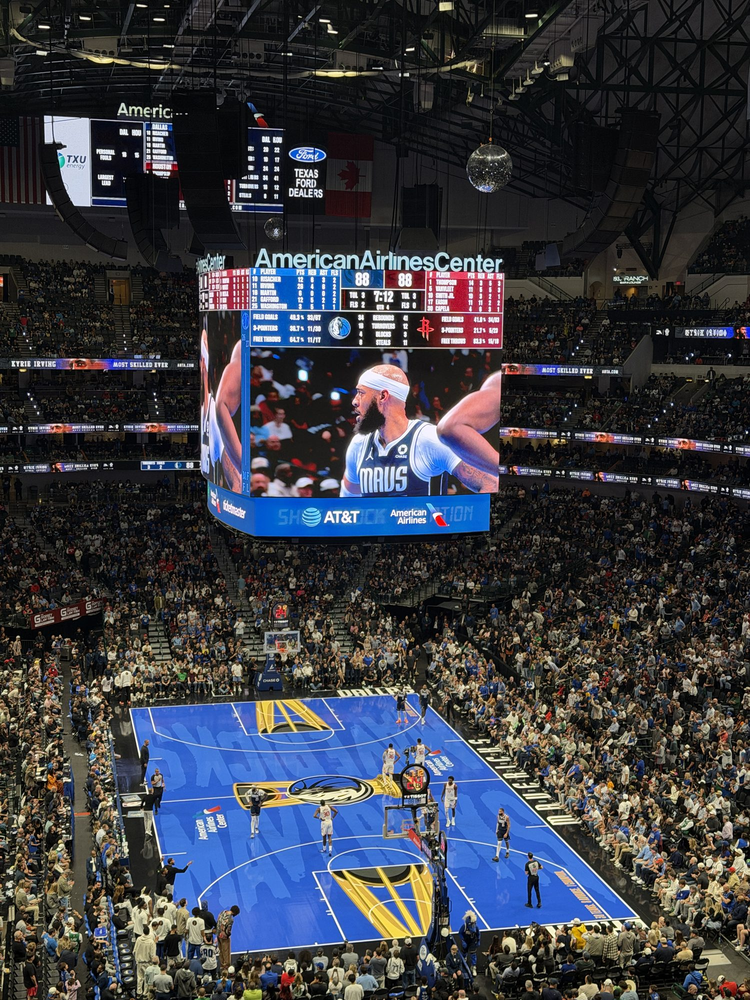

:::

## Day 6 - 10월 31일(토) · K-bioX 멘토링

오늘은 별다른 일정 없이, 저녁에만 Zoom으로 짧은 멘토링 일정만 있었다.
어제 늦게까지 놀았던 여파로 굉장히 늦게 일어났고,
여유로운 주말 낮시간을 만끽하며 휴식했다.

그리고 중고로 꽤나 저렴한 가격에 보드게임 번들을 파는 판매자가 있어,
나른한 주말 오후 시간을 뒤로하고 이를 구매하러 이동했다.
구매한 목록은 다음과 같다 : 아줄, 윙스팬, 티켓 투 라이드, 도미니언

같이 플레이할 친구들이 너무 헤비한 보드게임을 들이밀면 힘들어 할 것 같아서,
조금 더 라이트하면서도 덱 빌딩이나 엔진 빌딩의 기초가 될만한 게임들부터 시작해볼 생각이다.

그리고 내 최종 목표는 듄 : 임페리움 업라이징을 플레이하는 것이다!
(그날까지 Sealed로 보관해야겠다)
올 12월에 개봉할 듄 파트3도 너무 기대된다.

보드게임을 사고나서, H-mart에서 간단히 장을 보고난 뒤
옷이 배송되었다는 소식에 집으로 향했지만 택배를 찾을수가 없었다.
사진을 보니, 우리 아파트인건 맞지만 내 호실이 아니었고, 또 한번 미국의 배송 시스템에 절망했다.

어쩔 수 없이 모든 집들을 뛰어다니며 열심히 택배를 찾아다녔고,
결국 전혀 엉뚱한 숫자의 호실 앞에 버려져있는 내 택배를 찾아냈다(ㅠㅠ)

::: {.photo-row}

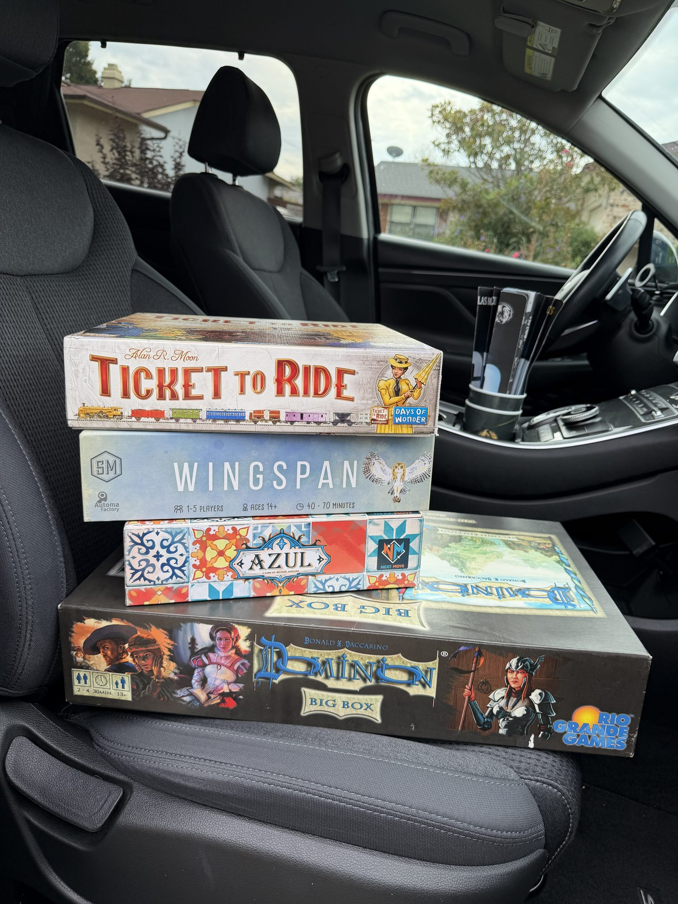

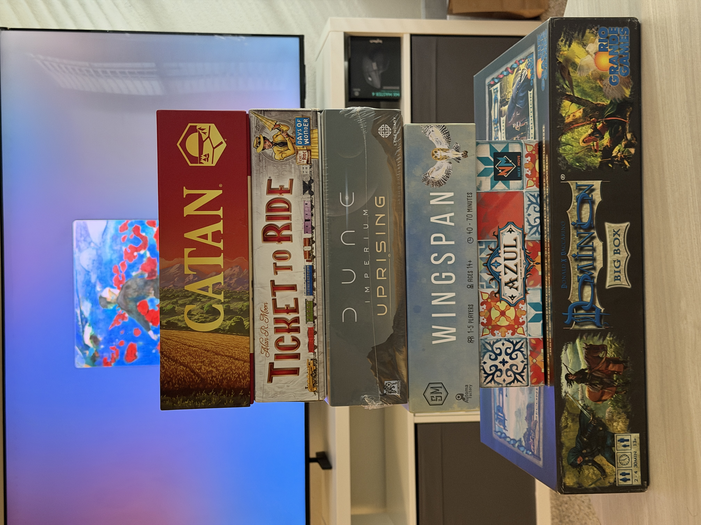

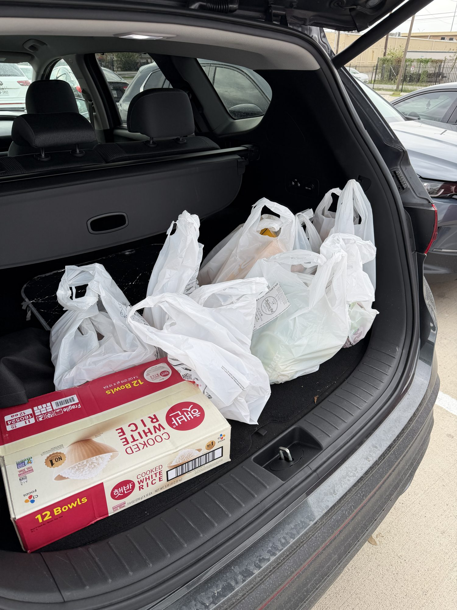

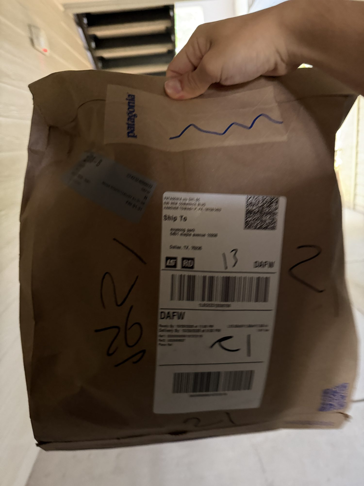

:::

그리고 저녁에는 K-bioX에서 주관하는 멘토링 세션에 멘토로 참여했다.
작년까지만 해도 내가 멘티의 입장에서 도움을 구하는 입장이었는데,
미국 박사과정을 준비하는 학생들에게 조금이나마 도움이 되고 싶어서 멘토로 참여하게 되었다.

녹록치 않은 미국 펀딩 상황에도 불구하고 도전을 결심한 친구들의 에너지가 느껴졌고,
어떻게든 조금이라도 더 도와주기 위해 이메일을 나눠주고 멘토링 세션이 끝난 이후에도 줌 미팅을 이어갔다.

더 많은 한국 친구들이 미국 땅에 와서 이 환경을 누리고, 연구자로서 성장할 수 있는 기회를 가졌으면 좋겠다.

## Day 7 - 11월 01일(일) · 주말 러닝

매 주말마다 꾸준히 러닝을 나가고 있다.
날씨가 너무 좋기도 하고, Katy Trail이 달리기 너무 좋아서 계속 찾게 되는 것 같다.

한 방향으로는 열심히 달리고, 다시 돌아올 때는 차분히 걸으며 생각 정리를 하는데
걸으면서 꽤나 많은 부분들이 정리되는 것 같아 매주 루틴으로 넣으려고 한다.
(적어도 날씨가 좋은 동안에는 말이다)

트조에서 간단히 필요한 것들을 추가로 구매하고,
저녁은 인앤아웃으로 하루를 마무리했다.

:::{.photo-row}

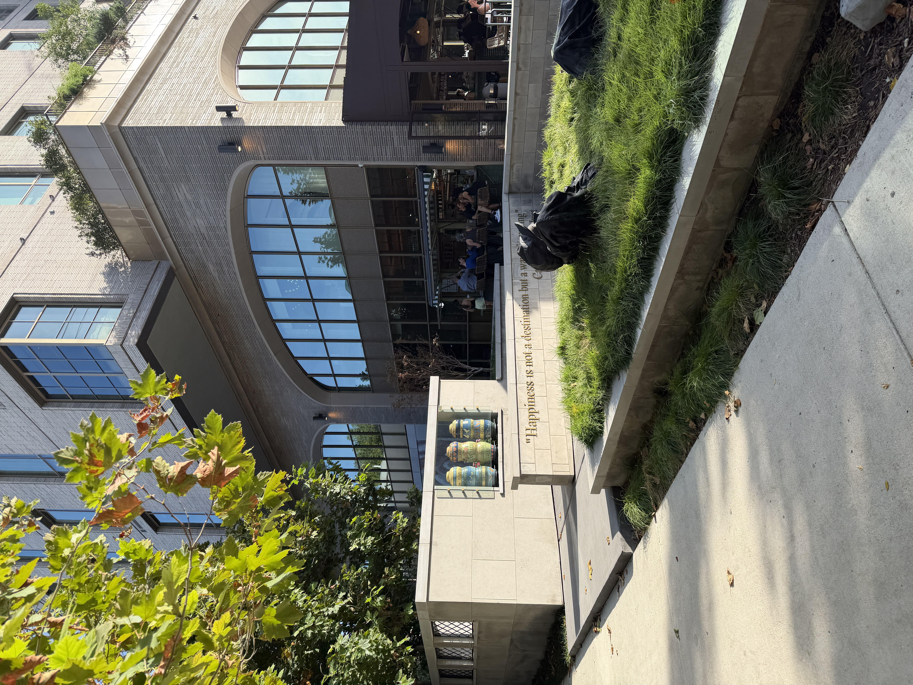

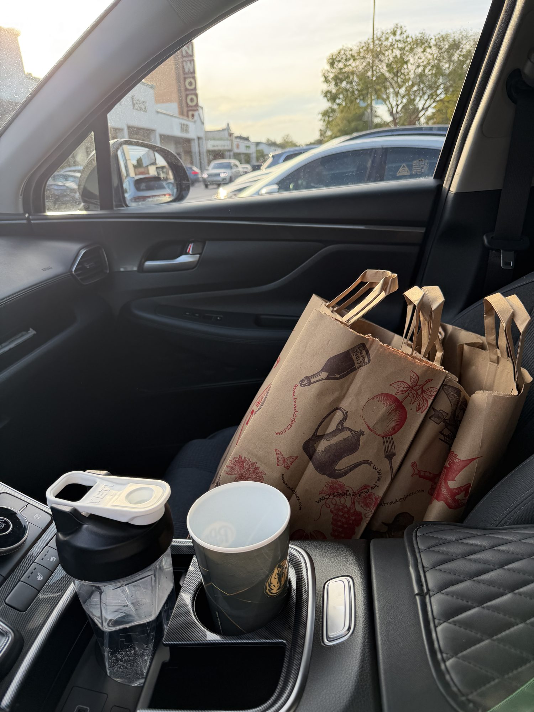

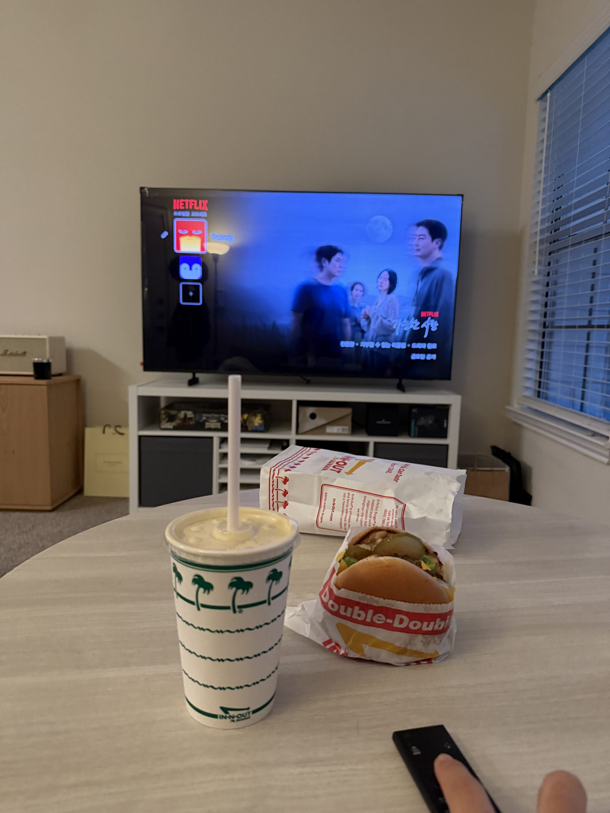

:::

미국에 온지 13주차,
처음으로 미국의 스포츠 문화를 경험했다.
다음에는 야구 경기도 한번 관람해보고싶다.

그리고 아직 고민중이긴 하지만 이번주에 LoL Worlds 준결승 경기가 달라스에서 열린다.
직접 가서 보고싶은 마음이 굴뚝같지만, 다음주 월요일에는 Genes 2차 시험이 있어 못가게 될 것 같다.. 어쩔 수 없지만 집에서 라이브로 봐야지.

그래도 Worlds 결승은 시험 이후라 마음 편히 볼 수 있을 것 같다.
다만 결승전은 Dallas가 아닌 NYC에서 진행될 예정이라,
오늘 농구 경기를 같이 봤던 Rex라는 미국인 친구네 집에서 다같이 어울려 보기로 했다!

그리고 새로운 취미인 보드게임은 정말 매력적인 취미이다.
적어도 하는 동안 핸드폰에서 해방되어, 직접 아날로그적인 손맛을 느끼며 뇌를 리프레쉬할 수 있다!

Sectioned Studio라는 유튜브에서 보드게임 소개 영상을 올려주는데,
정말 시간 가는 줄 모르고 보고 있다. 여기에 소개된 보드게임들은 언젠가 다 해봐야지!

그럼 이번 한 주도 끝.