14주차.

다음주 월요일에는 Genes 두번째이자 마지막 시험을 앞두고 있고,
그 직전 주말에는 내가 응원하는 팀 T1의 롤드컵 준결승이 있는 한 주.

시험 직전의 일탈이 가장 재밌는 법이다.

## Day 1 — 11월 02일 (월) · Immunology WIPS

별 다를 것 없는 평일이었다.

오늘은 2주 간격으로 있는 Immunology WIPS 행사가 있는 날이다.
Affiliation을 정한 학생들끼리, 해당 department에 모여 학술적 교류를 하는 행사인데,
1-2명의 발표자가 각각 30분 가량의 talk을 준비해온다.

원래 UT Southwestern에 오기 전부터 관심 있었던 랩에서 발표를 해 흥미롭게 들었다.
Thymus 관련 연구를 하는 곳인데, 교수님이 정말 연구 덕후셔서 대화를 해보면 연구를 사랑하시는게 느껴진다. 아마 나중에 커미티를 정하게 되면 꼭 Nicolai Van Oers 교수님을 포함시키고 싶다.

나눠주는 점심을 맛있게 먹고,
지난 주 potluck에 두고 온 우산을 찾아줬다.
(시간이 지날수록 점점 한국어가 퇴화하는 느낌이다.. 글을 쓰는데 더 많은 시간이 걸린다)

::: {.photo-row}

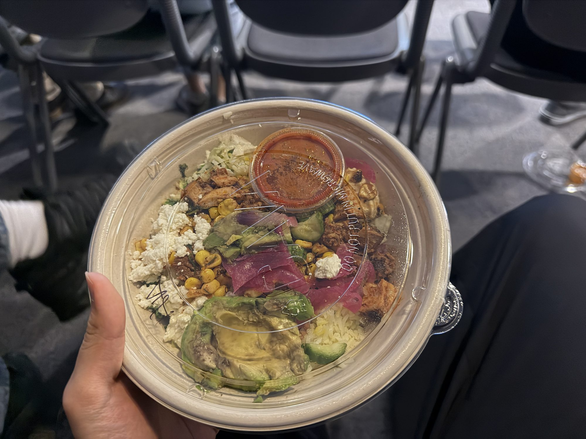

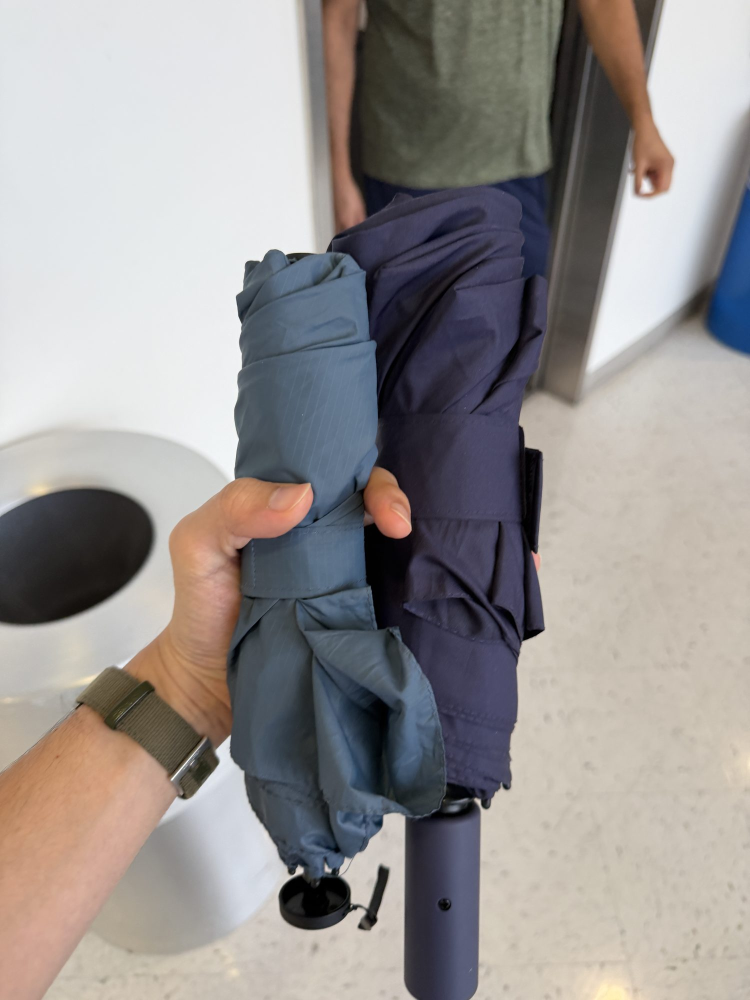

:::

## Day 2 — 11월 03일 (화) · 다음 실험으로

내가 주로 연구하고 있는 건 PML, 
즉 Progressive Multifocal Leukoencephalopathy라는 질병을 가진 환자들이다.

지난번 뼈아픈 실패 이후로, 또 다른 갈래에서 해당 질병의 원인을 밝혀내기 위해 가설을 검토중인데
그 중 랩에서 비교적 수월하게 수행할 수 있는 assay가 있어 이를 테스트해 볼 예정이다.

다른 포닥이 얘기해준 것처럼 kill the project가 중요한 것 같다.
다음으로 넘어갈 명확한 근거가 되기 때문이다.

어쨌든 assay를 본 실험에 사용하기 전에, 한 번 연습이 필요했다.
원래 하던 이전 assay보다 훨씬 간단하고 크게 어려운 부분은 없었지만,
positive control과 negative control에 상대적으로 의존하는 assay라 분명 장단점이 있었다.

그리고 이 assay는 총 3일동안 진행해야 했다.
1일차에는 세포를 깔고,
2일차에 처리를 하고,
3일차에 결과를 읽는 식이다.

그래서 어제 깔아둔 세포를 이용하여 오늘 실험을 했고, 결과는 내일 알 수 있다.
내일 결과를 읽으면서, 곧바로 목요일에 실험을 수행할 수 있도록 세포를 깔아두어야지.

::: {.photo-row}

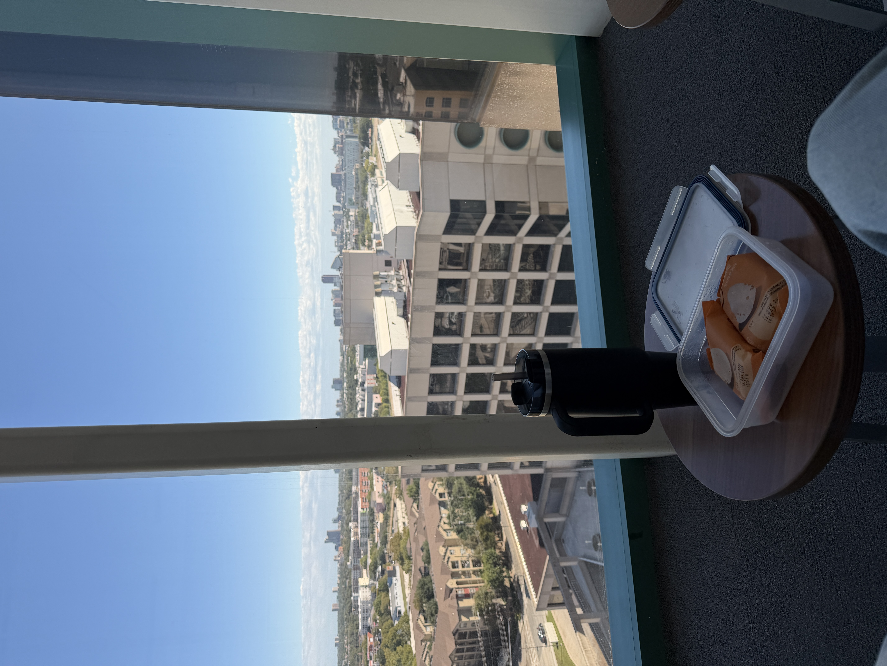

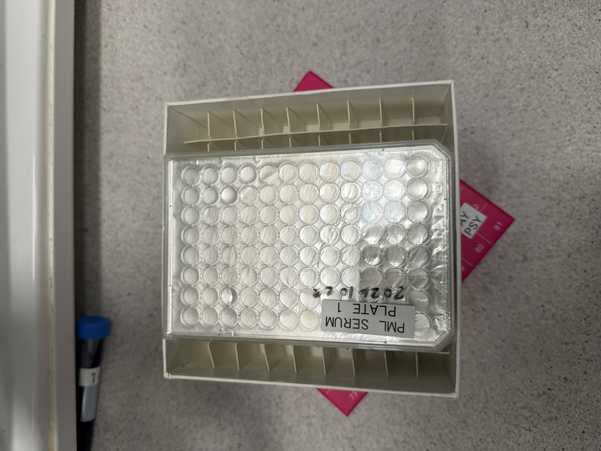

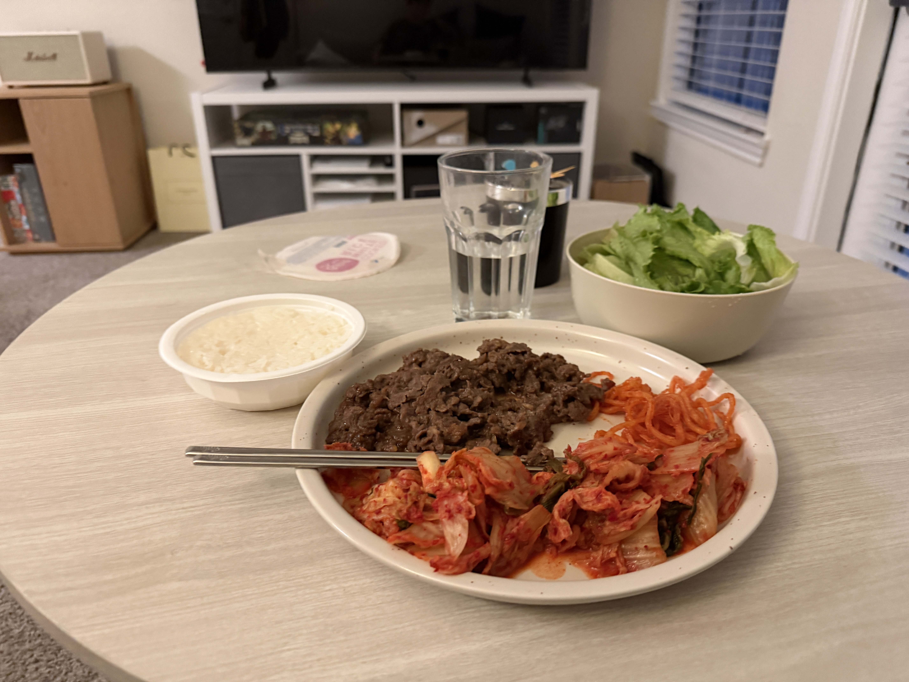

:::

## Day 3 — 11월 04일 (수) · Pilot Study 결과

다행히도 결과는 예상대로 나와주었다. 
과정에 크게 어려움이 없어 수월하게 진행할 수 있었던 것 같다.

계획한대로 목요일에 실험할 세포들을 미리 깔아두고,
미루고 있었던 Genetics 분석을 조금 들여다보았다.

우리 랩의 주 연구 방법론은 Human genetics인데,
실제 환자의 WGS/WES data를 받아서 genetic variant가 있는지 조사하고,
이 variant가 실제 phenotype으로 이어지는데 영향이 있는지를 실험으로 밝히는 식이다.

굉장히 직관적이고 강력한 방법이라,
내가 좋은 gene candidate hit을 찾게 되면 이게 Phd project가 될 수도 있다.

다만 아직까지 genetic variant을 어떤 식으로 필터링해야 하는지, 그리고 어떤 variant가 좋은 candidate인지 잘 모르겠다. 시간이 좀 더 필요한 영역이다.

와중에 병원으로 가서 맛있는 초밥과 라멘을 먹어주고, 저녁으로는 늘 먹던 한 상.

::: {.photo-row}

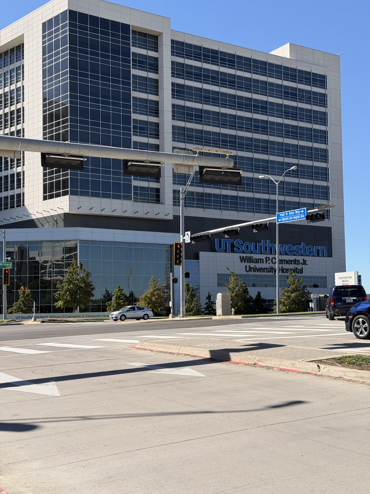

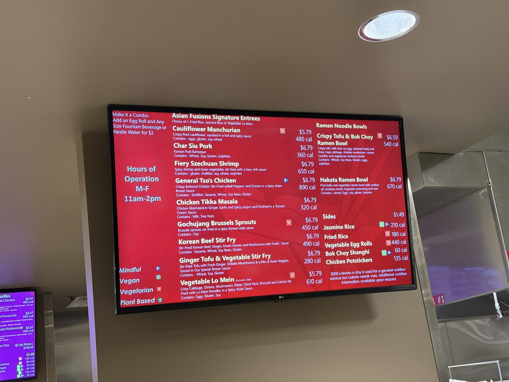

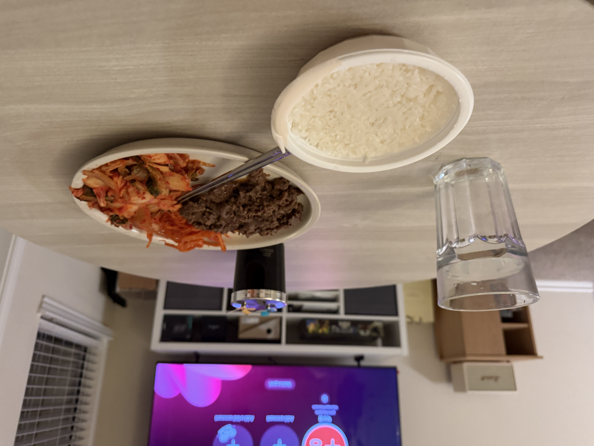

:::

## Day 4 - 11월 05일 (목) · 2nd Big day

오늘 테스트 할 환자 plasma를 나와 Vu라는 다른 포닥 각각이 하나의 plate씩 수행하기로 했다.
이는 Biological duplicate보다는 technical duplicate에 가깝지만,
어쨌든 내 숙련도가 완전하지 않아서 각자의 결과를 대조해보면 결론을 내기에 좀 더 수월할 것 같다.

또 결과를 모른 채로 하루를 기다려야 하지만,
왠지 기대되는 내일이다.

## Day 5 - 11월 06일 (금) · Hit!

오늘은 드디어 두번째 본 실험의 결과를 확인하는 날이다.
왠지 눈이 일찍 떠져 오랜만에 아침을 챙겨먹고 학교로 향했다.

표적 유전자 발현을 형광효소의 활성으로 확인하는 방식인데,
환자 샘플에서 positive control과 같은 활성이 검출되었다!
즉, 무언가 흥미로운게 환자 샘플에서 검출되었다는 의미이다.

가설과 일치하는 결과라 굉장히 놀랐고, 이런 순간이 이렇게 빨리 찾아올 줄 몰랐던 나머지 정말 기뻤다.
"Now you got a paper" 같이 일했던 포닥이 짧게 뱉은 한마디였다.

이제 앞으로 해당 결과를 보조할 다른 실험들을 고민하고,
이 결과의 임상적 의미를 알아내기 위해 여러 방면에서 생각해봐야겠다.
아무튼 Hit다!

::: {.photo-row}

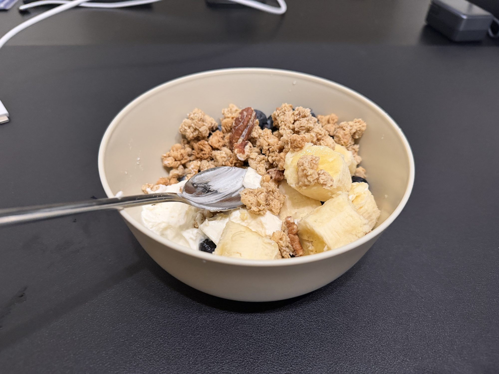

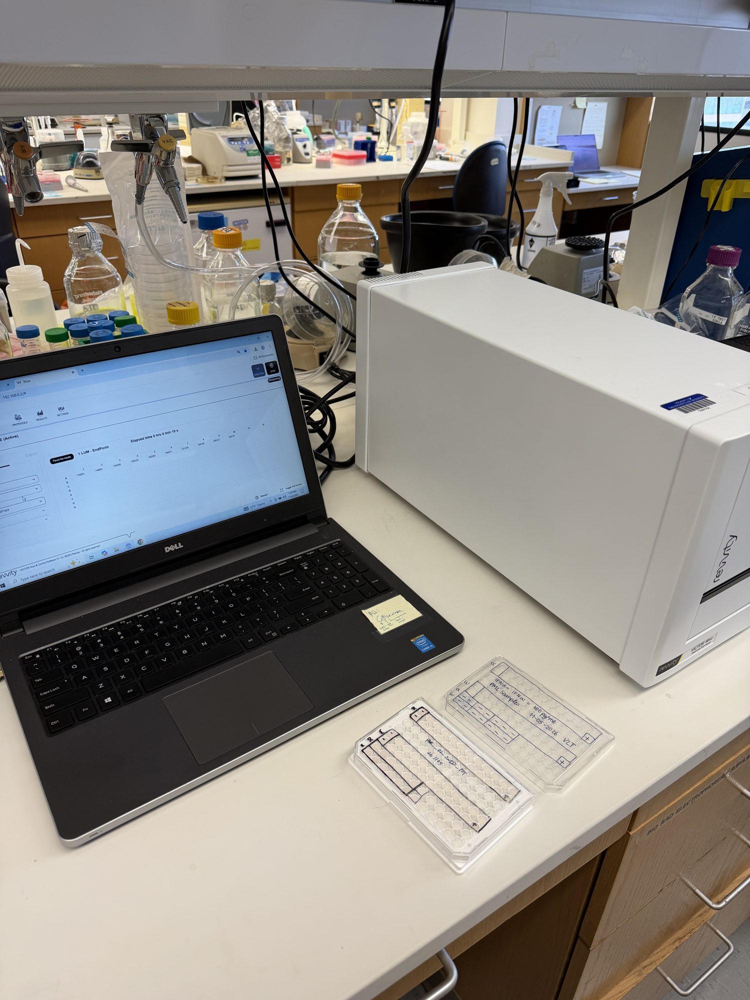

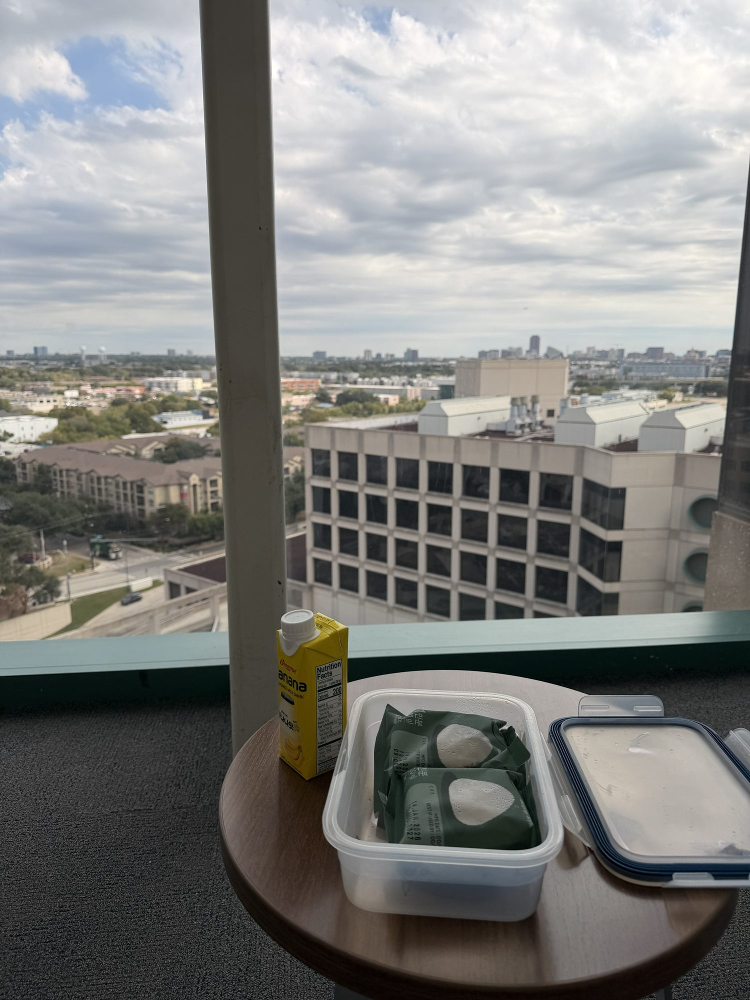

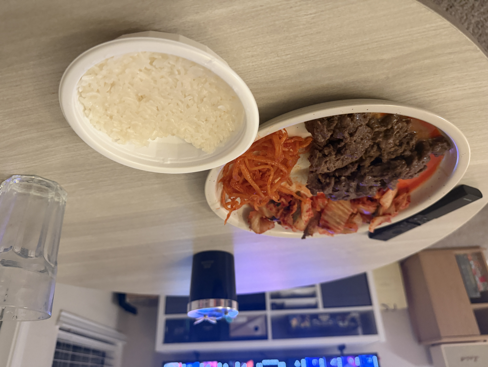

:::
## Day 6 - 11월 07일(토) · LoL Worlds GenG vs IG

텍사스 달라스에서 Worlds 준결승이 있는 날이다.

준결승 본방을 오후 네시부터 사수하기 위해 아침부터 부지런히 움직였다.
시험전까지 공부할 견적을 확인하고, 스타벅스에서 숨쉴 틈 없이 미친듯이 정보를 입력했다.
원래 간간히 쉬어줘야 능률이 오르는데, 그런 것을 따질 여유가 없었다.

...

무사히 할당량을 마치고, 집으로 돌아와 경기를 관람했다.

IG는 중국 LPL 리그 소속팀이고, GenG는 한국 LCK 리그 소속팀이다.
IG에서는 탑 포지션에 더샤이, 미드 포지션에는 루키 두 선수가 한국 선수이지만 중국 리그에서 활동하고 있다.

준결승은 5판 3선제로 이루어지는데,
첫 두판은 GenG가 쉽게 가져가는 듯 했고, 세번째 판에서는 고전이 이어졌다.

그러다가 IG 팀의 원딜러가 치명적인 실수가 터졌고,
그 틈을 파고든 GenG가 3:0으로 경기를 마무리지었다.

역시 큰 무대에서의 압박감은 전세계 누구나에게 공통인 것 같고,
그 압박감을 견뎌내고 더 큰 기회로 만들어내는 자가 모든 것을 결정짓는다.

::: {.photo-row}

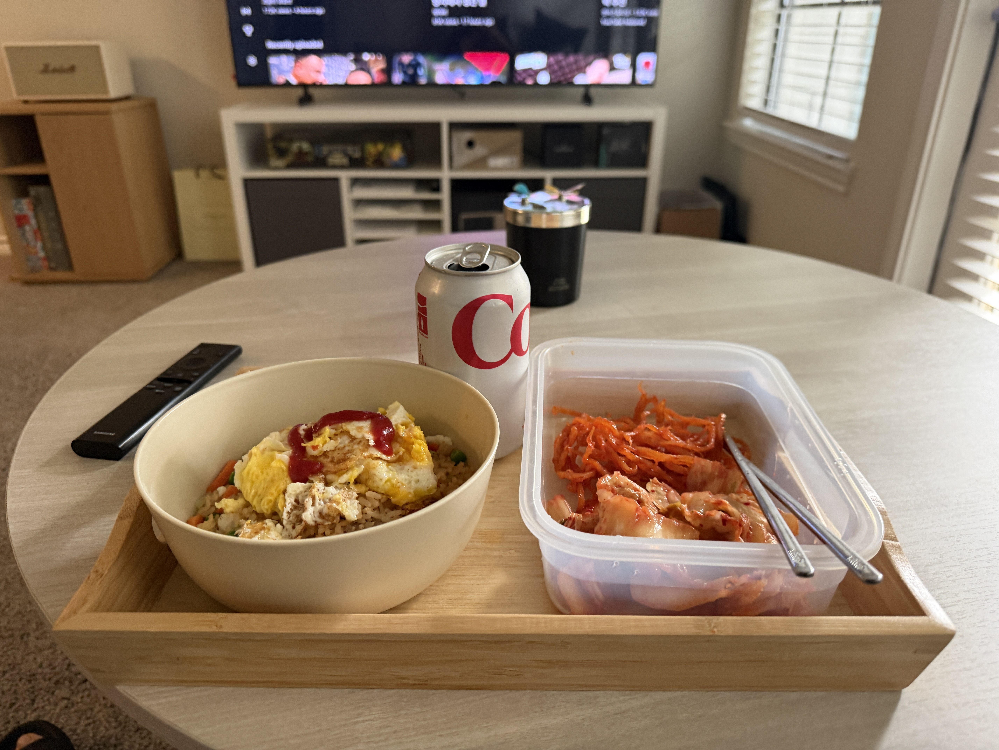

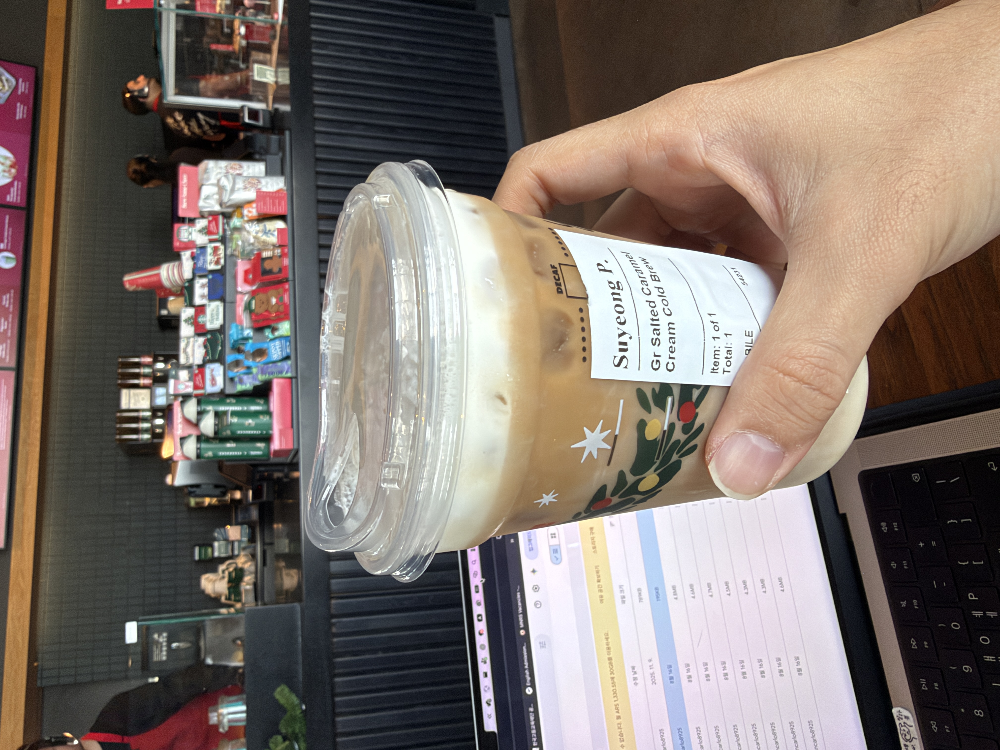

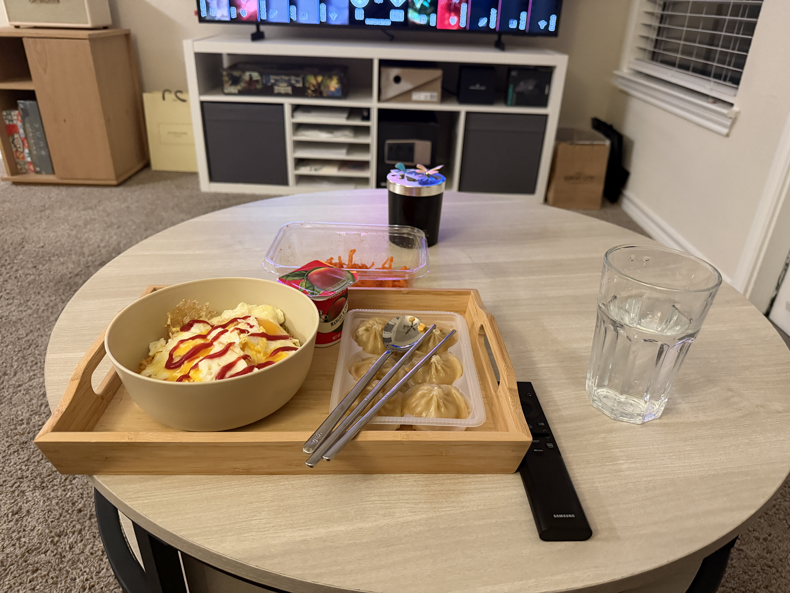

:::

## Day 7 - 11월 08일(일) · Good Game, T1

Genes의 두번째이자 마지막 시험 전날이다.
어김없이 LoL Worlds의 준결승 경기가 있었고, 어제보다 더 중요한 경기였다.
바로 T1과 BLG의 경기였다.

BLG라는 팀도 중국 LPL 리그 소속의 팀인데,
T1에게 월즈에서 만날 때마다 항상 패해서 리벤지를 위해 엄청나게 이를 갈고 나왔다.

그에 반해 요즘 T1의 폼은 예전같지 못해서,
많은 전문가들이 BLG의 승리를 예견하는 듯 했다.

...

결과는 3:1 패배였다.
마지막 판에서 페이커가 엄청난 활약으로 게임을 뒤집을 뻔한 순간도 있었지만,
결국 T1의 탑에서 무너진 밸런스가 게임 전반에 계속해서 악영향을 미치고 있었다.

개인적으로 좋아하는 선수이지만,
최근 많은 사람들에게 욕을 먹다보니 멘탈이 많이 안좋아보였다.
왕좌의 무게는 견디기 힘든가보다.

아마 T1과의 재계약은 이뤄지지 않을 것 같다.
다른 팀에서 계속 좋은 모습을 보여주면 좋겠다.

아무튼 아쉽게도 T1의 월즈 여정은 막을 내렸고,
나는 내일 시험 공부를 마무리했다.

:::{.photo-row}

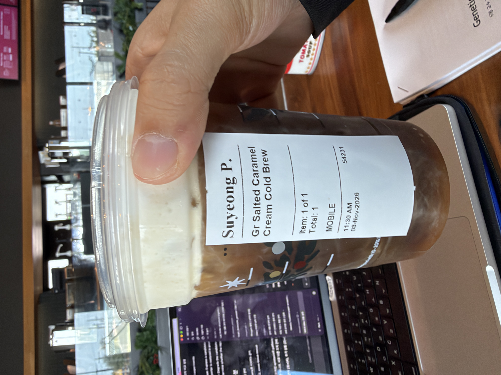

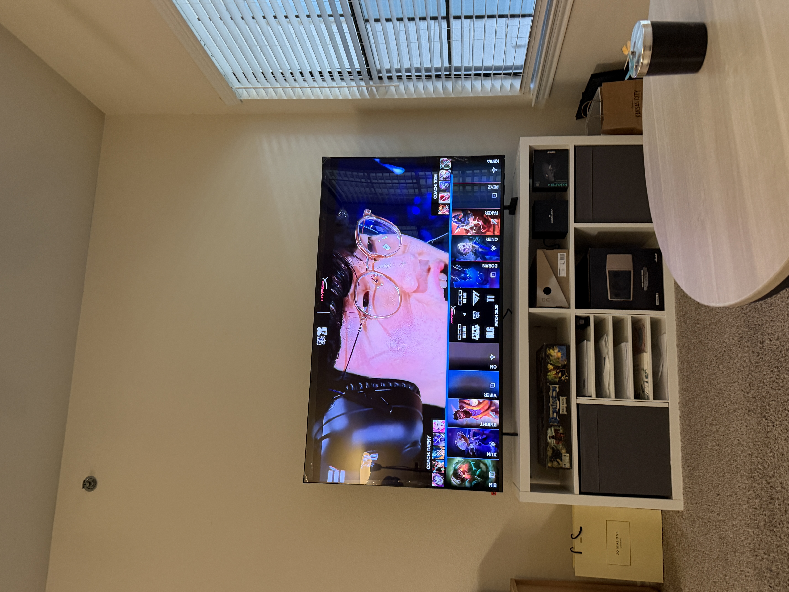

:::

미국에 온지 14주차,
다음주 토요일에는 GenG vs BLG Worlds 결승이 예정되어 있다.
친구네 집에서 다같이 시청하기로 했는데, 기대된다.

그리고 또 이번 시험을 기점으로 정확히 2주 뒤에 Cells 첫번째 시험이 예정되어 있다.

11/23 Cells 시험을 치루고, 11/24-28 설레는 워싱턴 DC 여행이다.
12/14 Cells 마지막 시험을 치루면, 이번 학기는 끝이난다.

어느샌가 벌써 학기의 끝이 보이고 있다.
조금만 더 힘내자!