16주차.

시험을 치룬지 얼마나 되었다고,
또 다시 시험을 준비해야 되었던 한 주.

이번 시험만 끝나면, 무려 총 6번의 시험 중 단 하나만이 남게 된다!
조금만 더 힘내자.

## Day 1 — 11월 16일 (월) · 소고기구이

어느 평범한 하루였다.

2주간의 길었던 휴가를 마치고, 내 이전 Supervisor였던 Ahmad가 파리에서 돌아왔고,
아주 귀여운!! 땅콩?이 든 오브제를 선물받았다. 너무 귀엽다.

그리고 이번주 수요일에 Thanksgiving 기념 랩 Potluck이 있어서,
어떤 음식을 가져올건지 미리 써두었다.

이번에는 트레이더조스에서 간단히 오렌지치킨을 만들어 가져갈 생각이다.
National lab이다보니 다양한 국적의 맛있는 요리를 골고루 맛볼 수 있어서 너무 기대되었다.

점심에는 2주 간격으로 있는 Immunology WIPS를 들어주고,

저녁에는 간만에 소고기구이!
이놈의 인덕션은 아직도 화력 조절을 어떻게 해야하는지 감이 안온다.

미뤄두었던 슬리브 400장 씌우기를 마치고, 오늘 하루는 마무리.

::: {.photo-row}

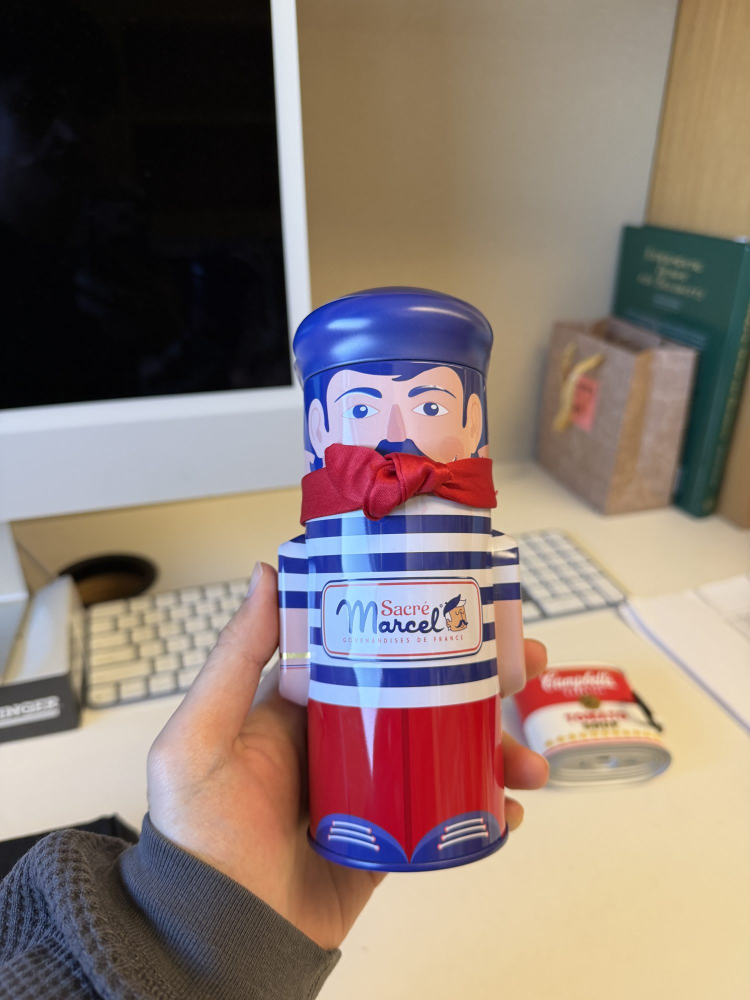

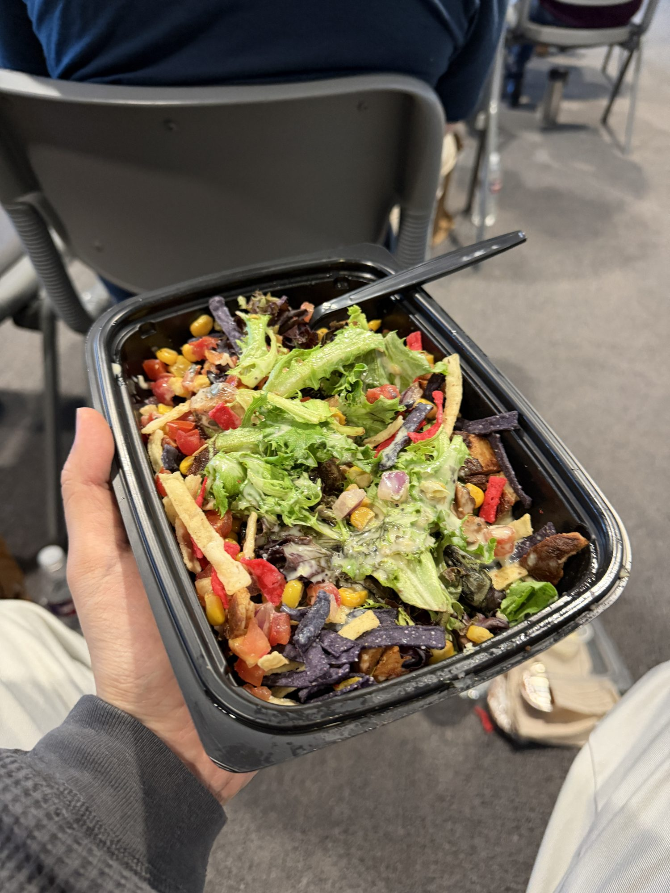

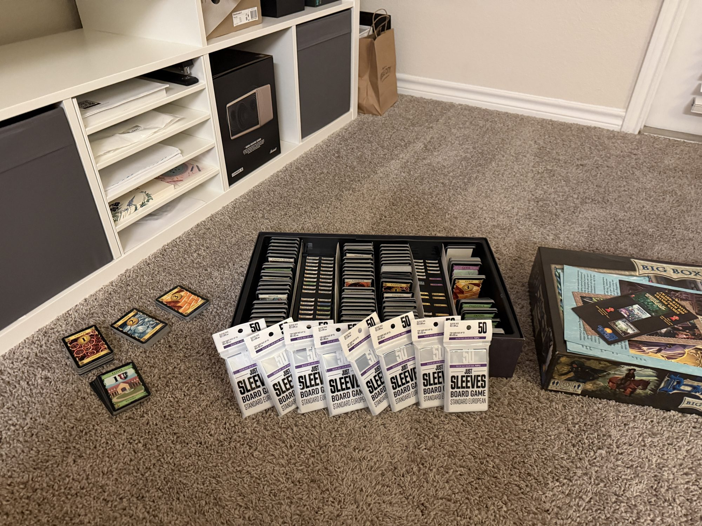

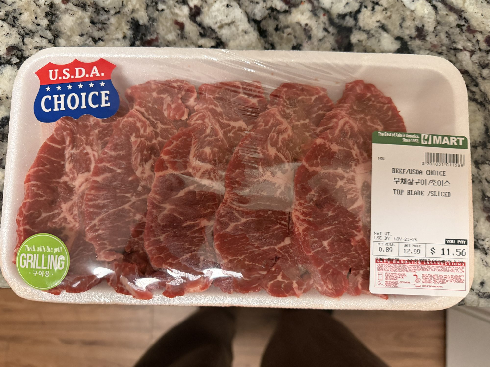

:::

## Day 2 — 11월 17일 (화) · 카센터 방문!

오늘은 미루고 미뤘던 카센터에 방문하기로 했다.

원래는 화요일마다 Literature discussion session이 있는데,
이번주에 이를 이끌어주실 교수님이 안계셔서 해당 세션을 스킵하기로 한 것이었다.

마침 시간도 남았겠다, 엔진오일을 갈아주러 Seeon Auto로 향했다.
유튜버 영알남의 지인분이 근무하는 곳이기도 한데, 첫 차를 구매할 때 여기서 Pre-purchase Inspection을 받았어서 원래도 알고 있던 곳이었다.

아무튼 사장님께서 한국분이시기도 하고, 가격도 괜찮아서 이 곳으로 쭉 다니려고 한다.
Full-synthetic oil로 $60 결제!

그리고 맛있는 점심을 먹고,
일찍 퇴근해서 오랜만에 헬스장을 방문했다.
꾸준히 운동을 해야하는데, 자꾸 시험이니 뭐니 이것저것 핑계가 생겨서 미루게 된다.
무한 반성의 굴레에 빠진 것 같다. (반성만 하고 안간다..)

나와서 바라본 노을이 예뻤고,
집에는 점점 내가 좋아하는 것들이 채워지고 있는 요즘 나날이다.

::: {.photo-row}

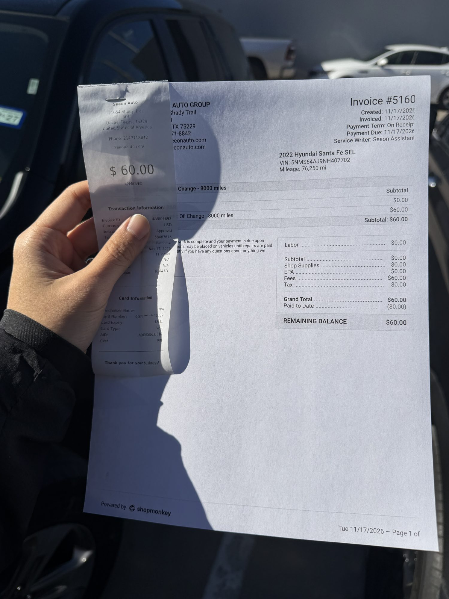

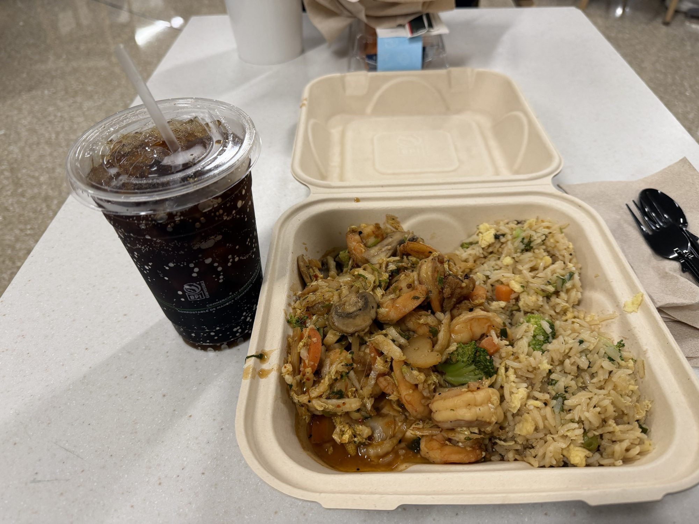

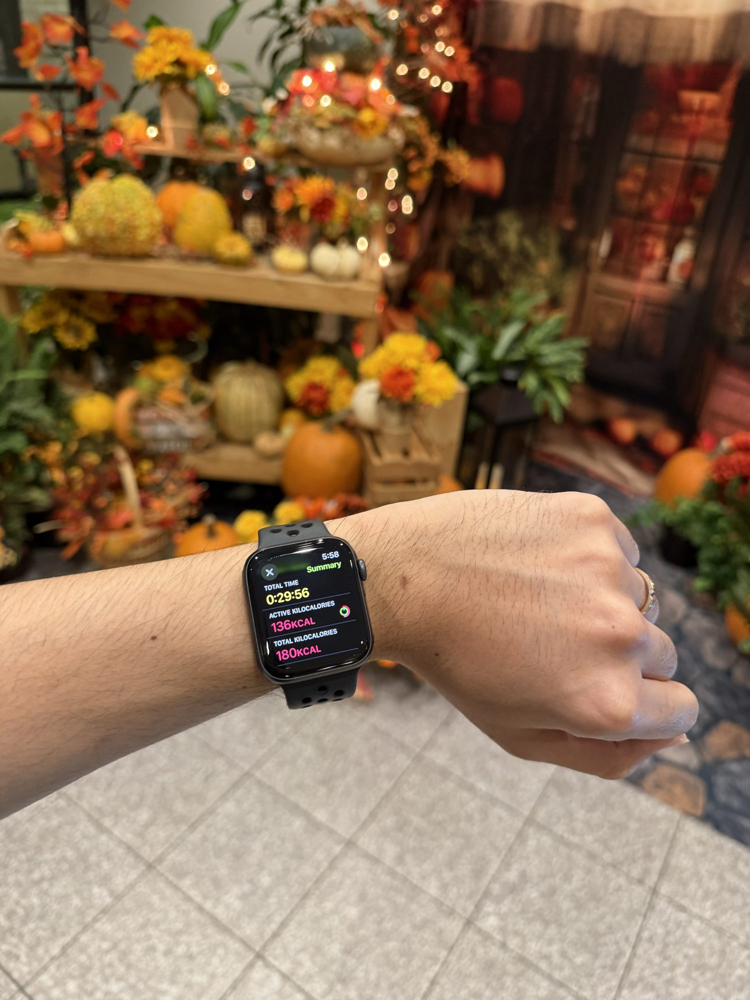

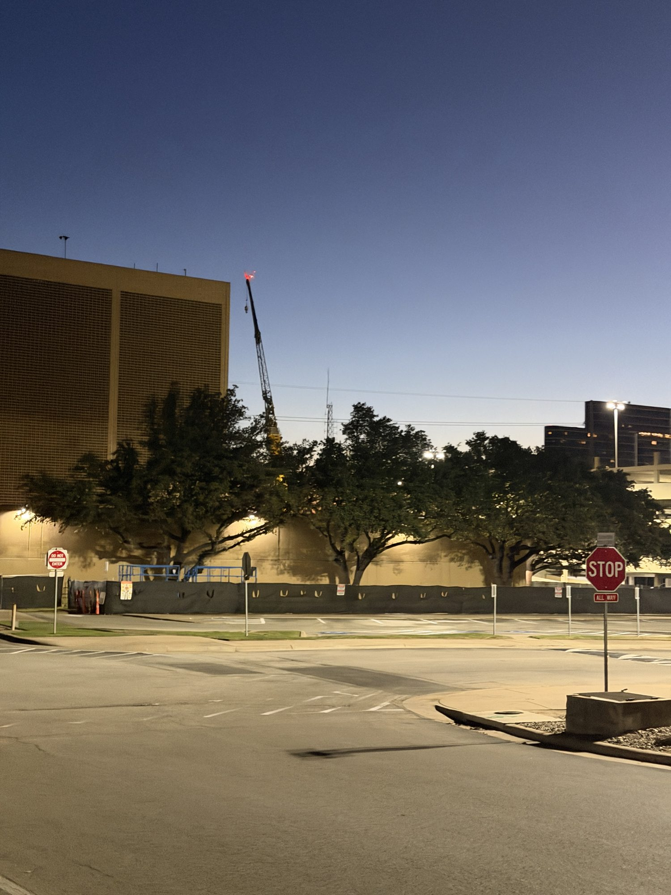

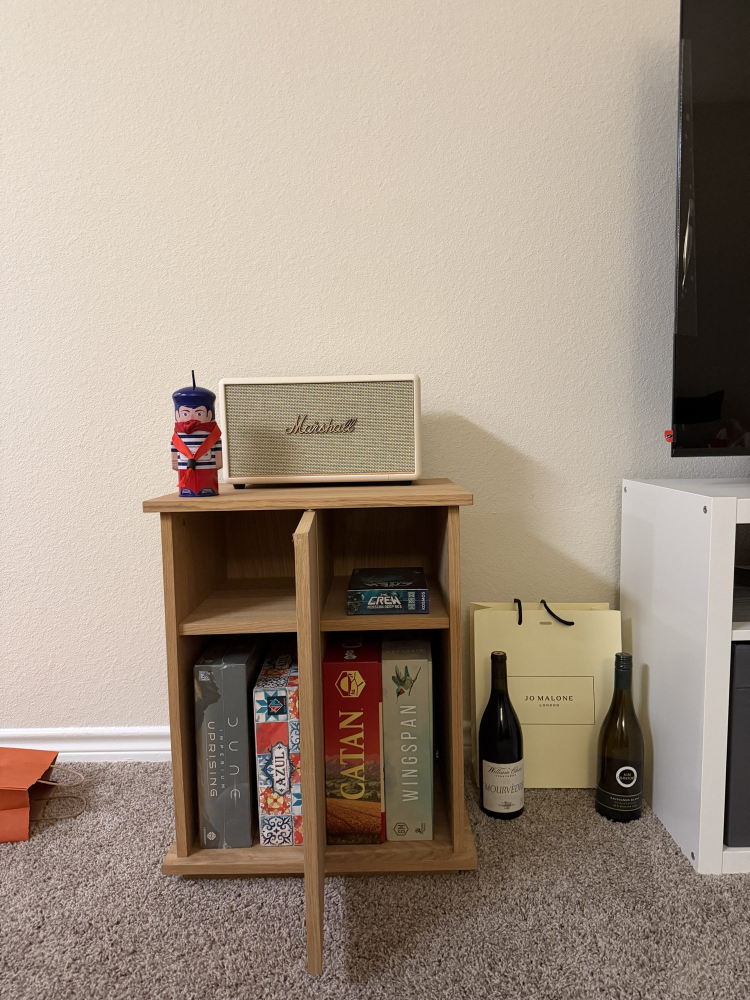

:::

## Day 3 — 11월 18일 (수) · Thanksgiving Potluck!

지난번 소개했던 Potluck 문화가 잊지도 않고 또 찾아왔다.
이번에는 Thanksgiving 기념이다!

행사의 시작을 알리는 Admin팀 mark의 오프닝 멘트가 인상적이었다.
"우리는 항상 서로에게 감사한 마음을 갖고 살아가는데, 이를 표현할 기회가 많지 않다. Thanksgiving은 말 그대로 감사를 전하는 날"

누군가에게 고마운 일이 있을 때 충분히 감사를 표했었나?
나를 다시 되돌아보게 되는 말이었다.

저번에는 mini-potluck이었다면,
이번에야 말로 main dish들이 넘치는 제대로 된 potluck이었다.

무슨 음식인지 제대로 모르고 먹는게 조금 아쉽긴 했지만,
대체로 모두 실패 없는 음식들이었어서 정말 배부르게 먹었다.

...

그리고 퇴근 후에는 RA!
내가 옛날 대전에 있을 때 친구들과 플레이했던 기억을 더듬다가 찾아낸 보드게임인데,
너무 재밌게 했던 기억이 있어서 구매했다.

새로운 보드게임을 사는 건 씰을 뜯는 맛은 있지만,
오브젝트들을 이렇게 하나씩 다 뜯어내는 과정이 조금 번거롭긴 하다.

뭐, 그만큼 시간과 노력이 들어가서 더 애정이 깃들기도 한다.

::: {.photo-row}

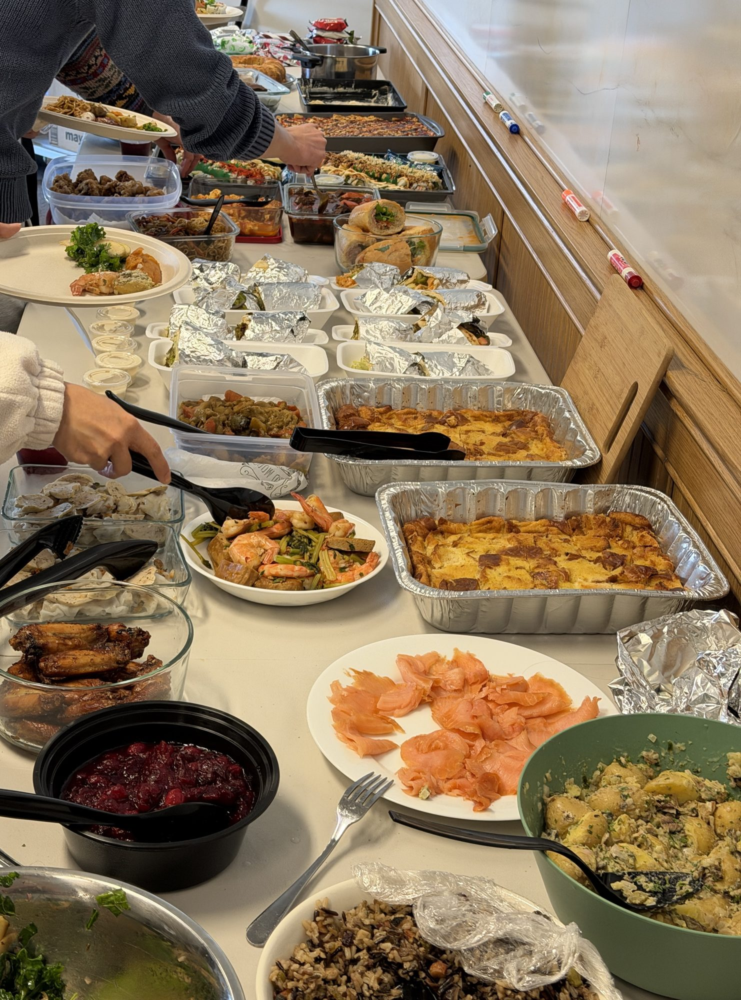

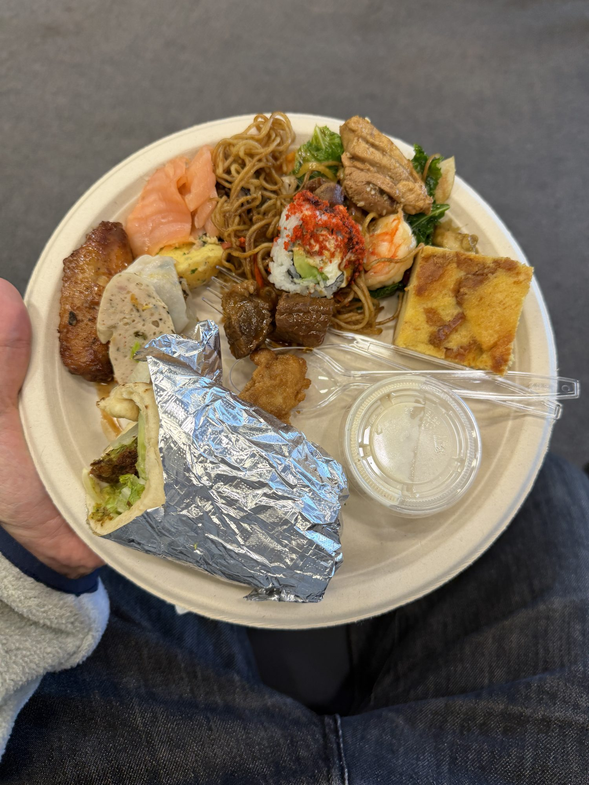

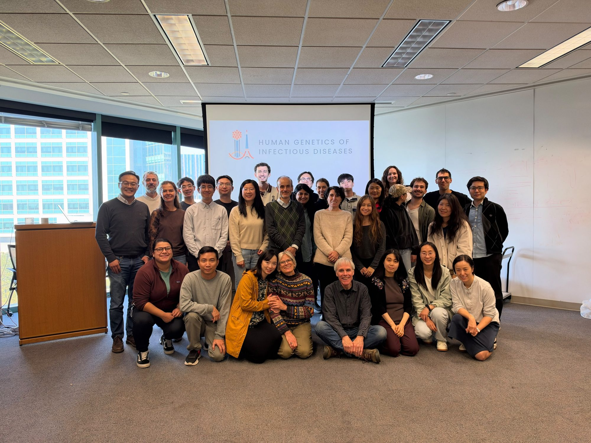

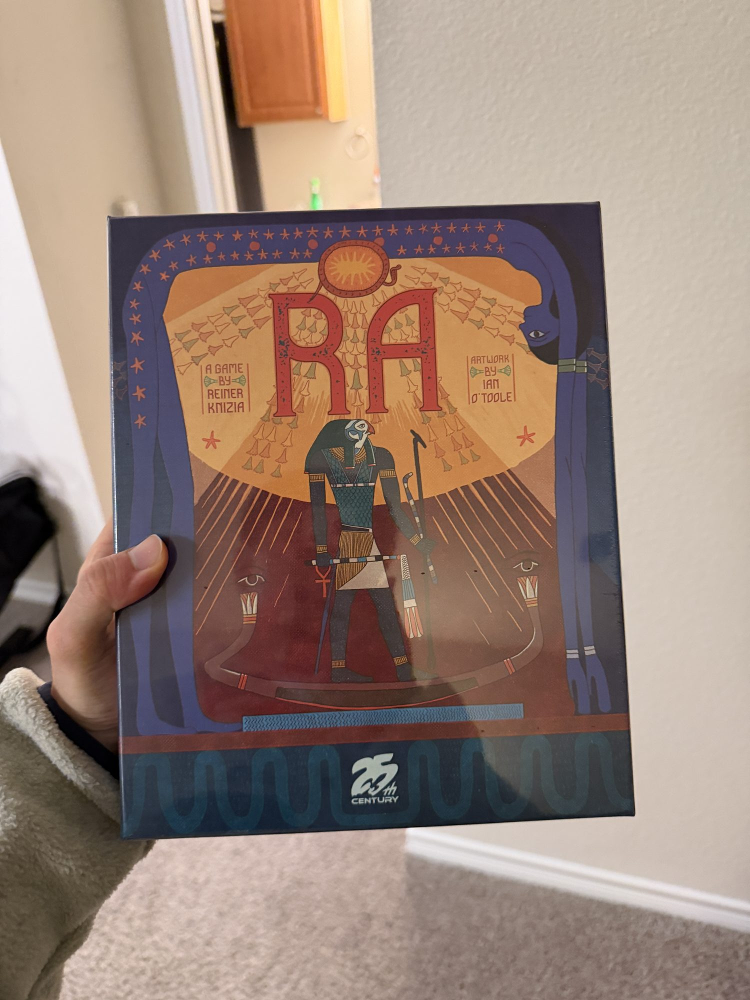

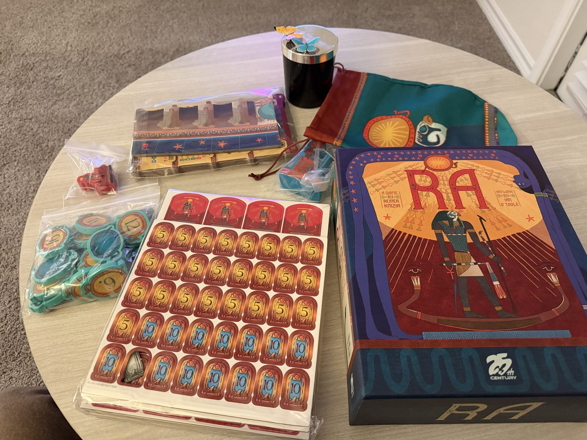

:::

## Day 4 — 11월 19일 (목) · 시험 준비

그래도 이제 미국 땅을 밟은 이후로 맞이하는 다섯번째 시험이라 그런지,
꽤나 어떻게 준비하면 좋을지에 대한 감각이 생긴 것 같다.

다만, 랩생활 도중에도 시험 준비를 위해 시간을 써야 하는게 조금 에러이긴 하다.
보통은 AI를 돌려놓고, 결과물을 요리조리 내가 보기 좋도록 가공하는 과정이 조금 시간이 걸려서
자료만 평일에 다 만들어두고 주말동안 몰아서 공부한다.

옛날에는 한땀한땀 강의자료를 직접 보고, 이해한 뒤에 내가 정리본을 직접 만들곤 했는데
이제는 모르는 부분이 있으면 그냥 그대로 긁어서 GPT한테 물어본다.

공부의 방식이 많이 바뀐 것 같고, '교육'이 더 이상 사람에 의해 이루어져야 할 필요가 있을지에 대해 의문이 생기는 지점까지 온 것 같다. 실제로 대치동 강사들은 그 변화를 체감하고 직업을 바꾸는 경우도 많다고 들었는데, 그 변곡점에 서 있으니 기분이 이상하다.

그리고 또 혹자는 더 이상 학생들이 '글을 읽지 못한다'라는 지적을 하곤 한다.
나또한 실제로 글을 잘 읽지 못하게 되어가는 것 같아서 걱정이 된다.

그래도 이 전에 해오던 관성이 있어서, 필요하거나 내가 관심이 있는 글들은 많이 읽긴 하지만
그 이외의 주제의 글들은 전혀 읽히지 않아 걱정이다.

## Day 5 — 11월 20일 (금) · 첫번째 논문?

다음주 화요일이면, 다섯번째 시험을 끝내고 디씨에 있는 사촌누나네로 가는 날이다.
4박 5일간 지내기로 했고, 그러니까 다음주는 거의 랩에 있을 시간이 없는 셈이다.

그래서 (글에는 잘 안담겼겠지만!) 실험을 엄청나게 하고, 또 그 데이터를 열심히 정리했다.
오늘은 Vu라는 포닥 친구가 직접, 데이터들을 Adobe illustrator로 어떻게 가공하는지 알려줬다.

Figure 1,2,3에 해당하는 데이터들은 어느정도 다 뽑아낸 상태이고,
어느정도 글쓰기를 하면 논문 초안 정도를 완성해볼 수 있을 것 같다.
D.C. Trip을 마치고 돌아와서, 논문 초안을 완성하는 것을 목표로 다시 달려봐야지.

사실 실험을 하는 Wet lab에서 쉽지 않은 속도이기는 하지만,
Viral infection이라는 큰 주제에서 autoantibody 기반의 연구가 잘 마련되어 있어서 screening은 어렵지 않게 수행할 수 있었고, 다행히 Hit가 있어서 진도가 잘 나가고 있는 듯하다.

Full paper는 아니지만, 그래도 첫 프로젝트를 논문의 형태로 꽤나 빠른 시간 안에 완성해볼 수 있는 기회가 생겨서 다행이다. 
(과학에는 Publish or Perish라는 밈이 있을 정도로, 논문이 중요하다)
((사진은 어제 저녁, 오늘 점심, 그리고 오늘 저녁))

::: {.photo-row}

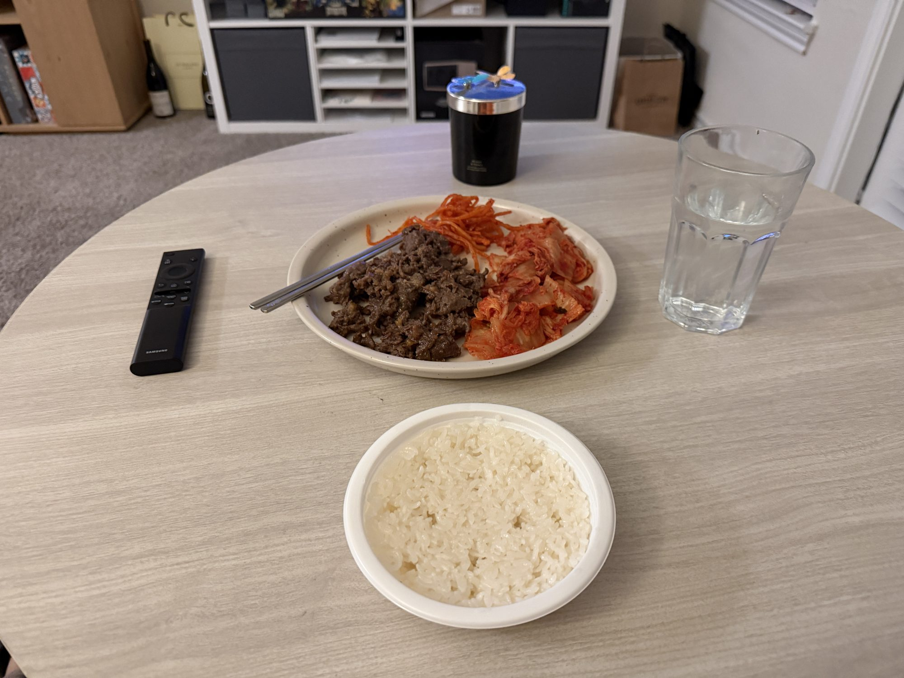

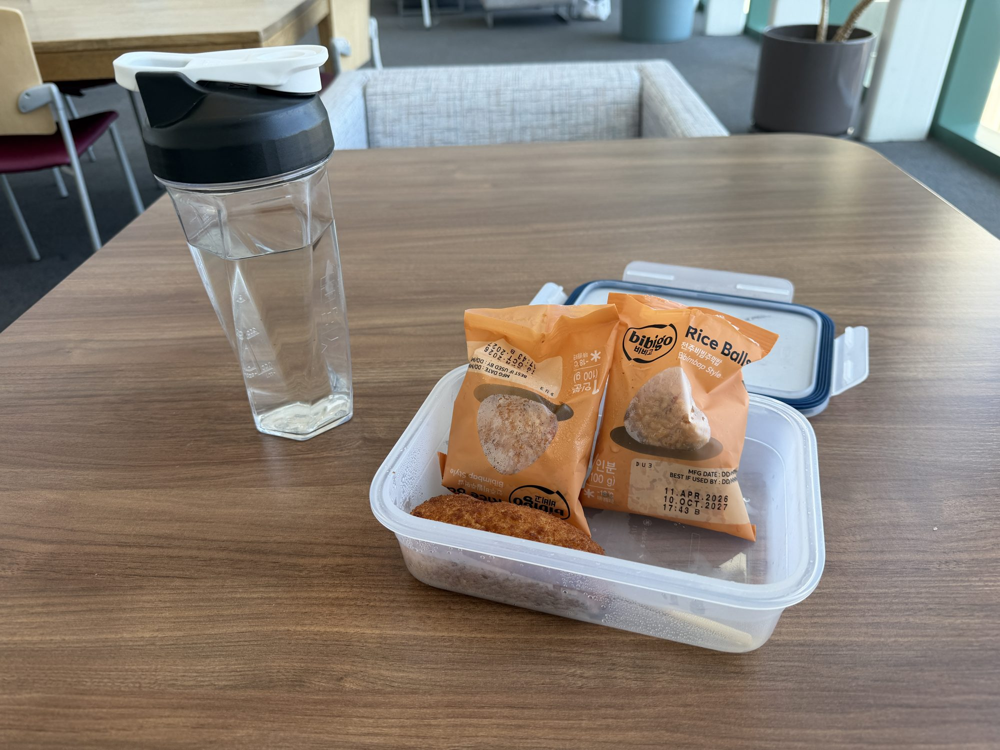

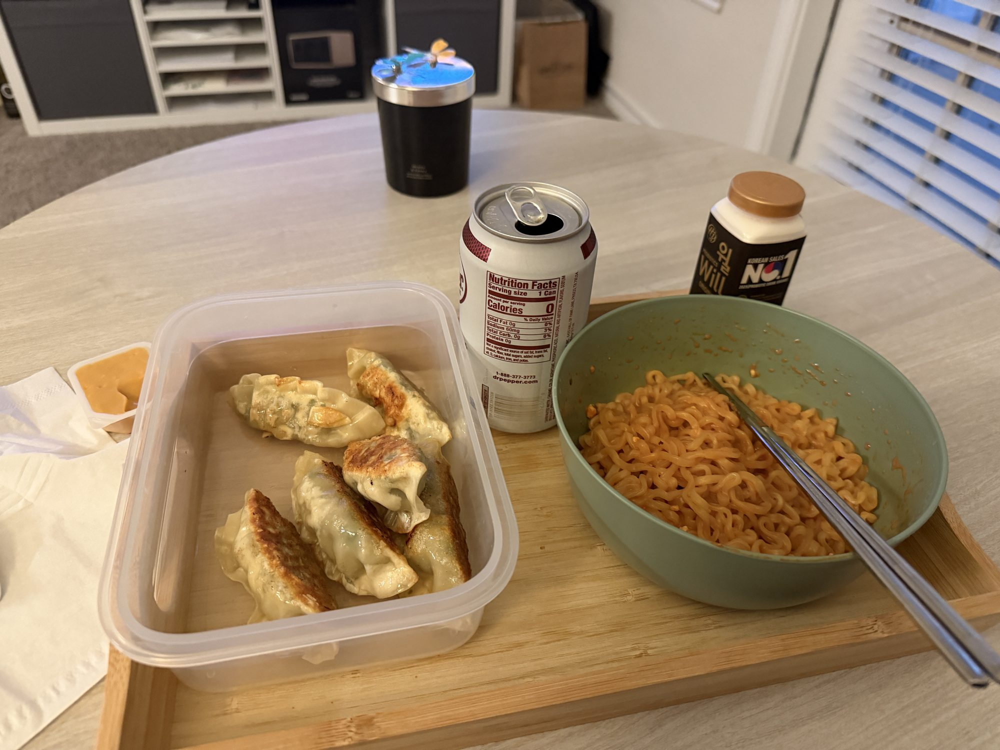

:::

## Day 6 — 11월 21일 (토) · 반복의 힘

다섯번째 시험을 목전에 두고 있고,
그간 쌓아온 빅데이터에 의거해 가장 쉽고 강력한 전략으로 가기로 했다.

점심, 저녁은 늘 먹던 세팅으로. 그리고 그 사이에 스타벅스.
평일에 왕창 만들어둔 자료를 소화시키고,
과도하게 뇌가 부하되는 것을 방지하기 위해 하루 5시간으로 공부량을 제한.

오히려 쉬는 시간을 여유롭게 둬야, 무의식 속에서 압축해서 입력해 둔 정보들이 부풀면서 자리를 잡아가는 느낌이다.
(절대 5시간 넘게 공부하기 싫어서가 아니다)

## Day 7 — 11월 22일 (일) · 시험 전날!

같은 사진이 아니라, 이틀 동안 똑같이 먹은 식단과 커피다.
생각보다 같은 음식을 먹는게 질리지도 않고, 새로운 음식을 시도해 볼 여력도 많이 없어서 이게 편하다.
그렇다고 영 못챙겨먹는 것도 아니라, 만족하면서 먹고 있다.

가끔 부족한 단백질은 단백질 쉐이크로 보충해주는 정도.

::: {.photo-row}

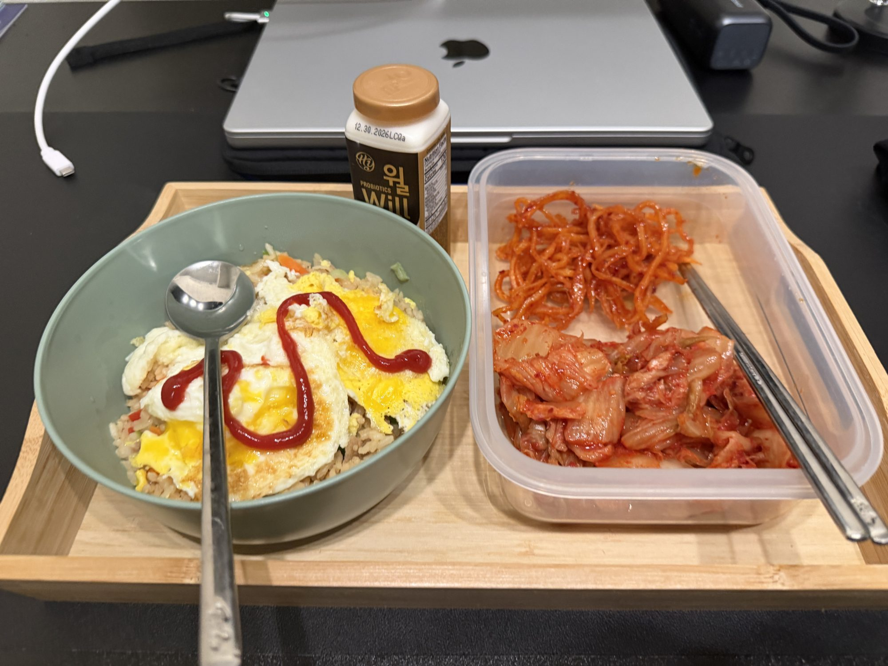

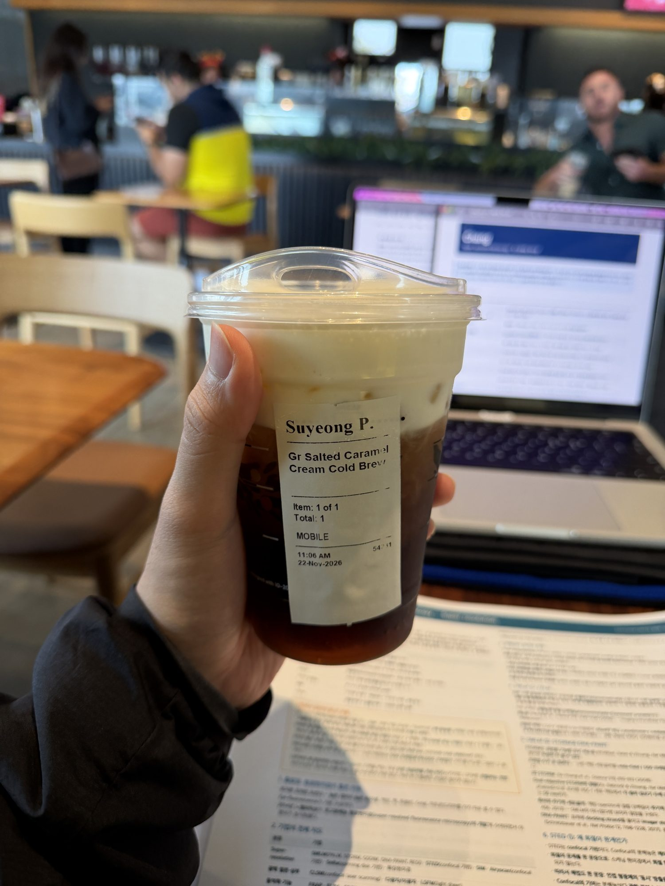

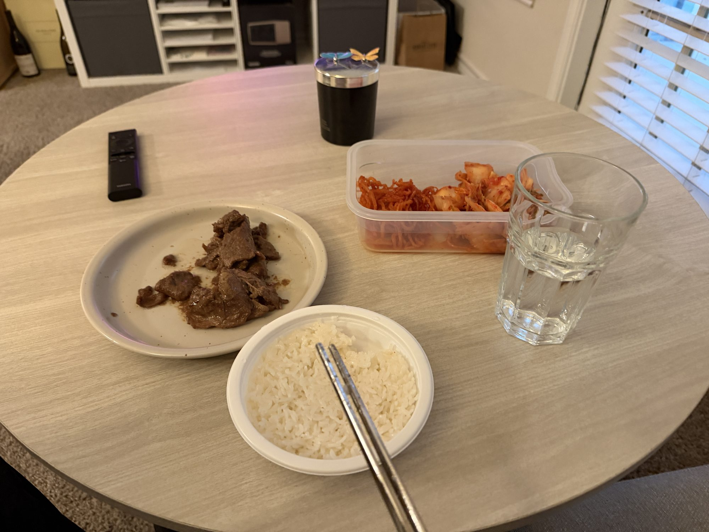

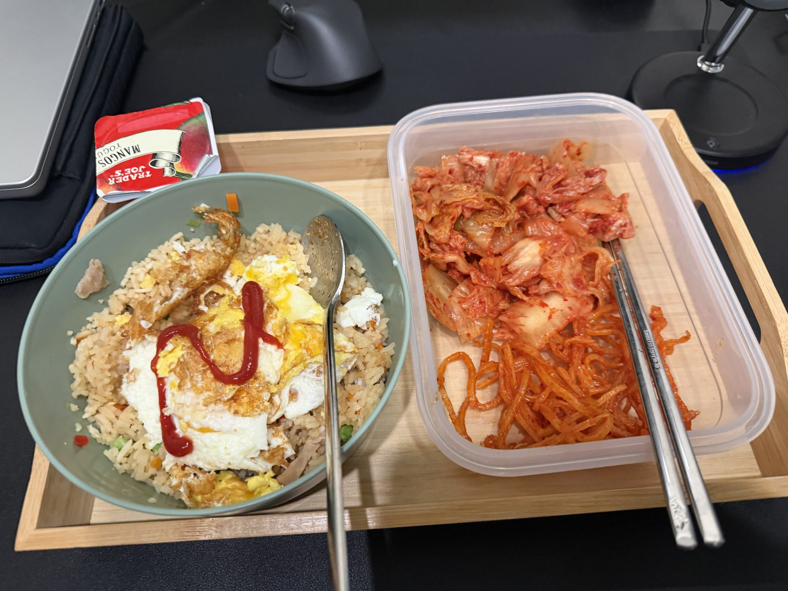

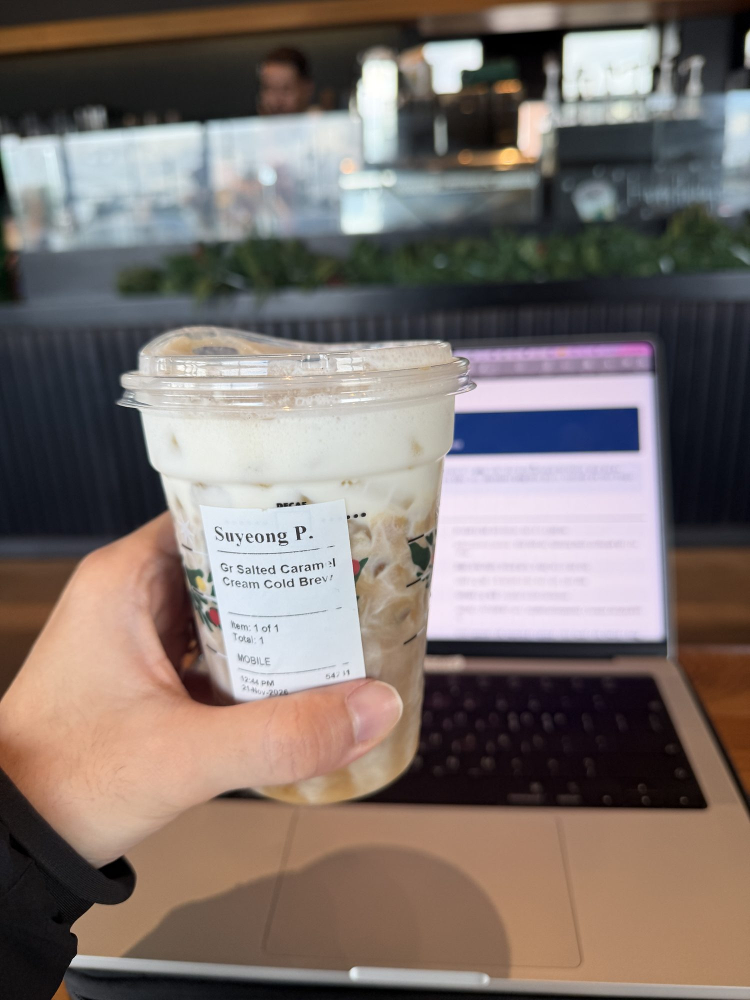

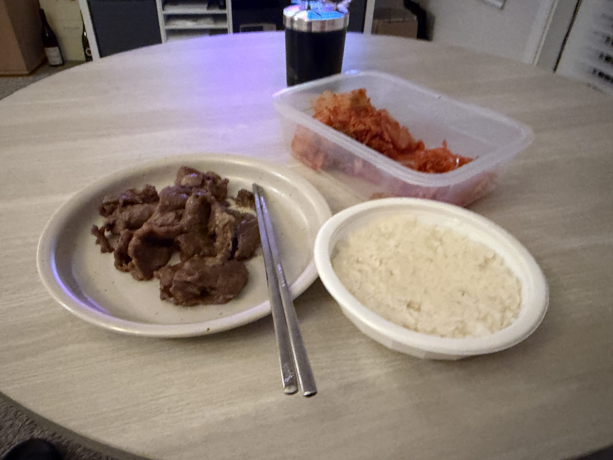

:::

미국에 온지 16주차,
이제 점점 보드게임의 수가 감당하기 힘든 지경으로 치닫고 있다.

그래도 다음주 월요일에 일본인 친구, 중동 친구, 나 셋이서 보드게임을 진탕 하기로 했다!
그 날을 위해 룰을 숙지하고, 게임을 준비해야지.

영어로 설명하는 건 처음이지만, 그래도 그 과정에서 영어 공부가 된다.

다음주면 시험도 끝나고, D.C로 여행을 가 있겠지.
모든 건 과정이고 힘든 것도 잠깐이다.
과정을 즐기자!