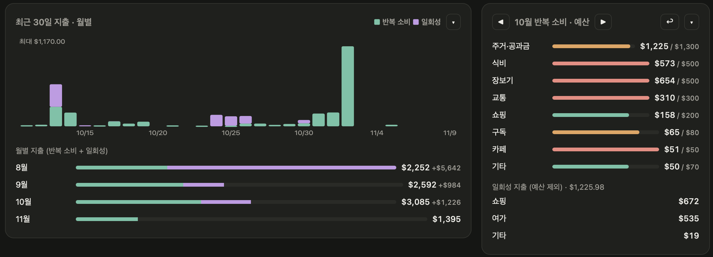

지난 [정착 초기 1달 지출 정리](us-cost-of-living-month1.html) 이후로 약 두 달이 더 지났다. 이번엔 8월, 9월, 그리고 10월까지 총 세 달간의 지출에 대해 총 정리를 해보려고 한다.

일단, 일회성 지출 중에 좀 크리티컬한 항목들이 몇 개 있어서 이들은 제외하고, 순수 반복 지출만 정리해보려고 한다. 일회성 지출은 사람마다, 성향마다 워낙 다르기 때문이다.(너무 많이 써서 차마 다루지 못했다)

Life agent라고 새롭게 어플리케이션 형태의 서포터를 ai로 만들었다.
나의 자산 / 운동, 영양 / 연구 이렇게 세 가지 테마로 나누어서 적극적인 도움을 받고 있다.
지금은 통장 소비 내역을 캡처해서 사진을 올리면 적절히 분류해서 이렇게 표로 보여주는 방식으로 쓰고 있다.

송금 내역이나, 지출이 명확하지 않은 내역 등은 아직 여전히 수동으로 분류해야 하지만
사용하면서 점점 단점들이 개선되어가고 있다.

아무튼 이번 글의 숫자는 전부 이 앱에서 뽑아온 것이다.

---

## 한눈에 보기

| 월   | 반복 지출  | 일회성 지출  |
| --- | ------ | ------- |
| 8월  | $2,252 | +$5,642 |
| 9월  | $2,592 | +$984   |
| 10월 | $3,085 | +$1,226 |

(11월은 9일 기준으로 벌써 $1,395인데, 월초에 렌트가 한 번에 빠져나가서 그렇다. 아직 집계 중이니 표에서는 뺐다.)

반복 지출이 매달 조금씩 올라가고 있다.
8월에서 10월까지 $833이 늘었으니, 숫자만 보면 꽤나 걱정스러운 그래프다.

그런데 8월은 렌트 첫 결제가 9월로 잡혀 있어서 애초에 공정한 비교가 아니다.
그래서 나는 집세가 온전히 잡혀 있고, 정착 비용의 여파도 어느 정도 가라앉은 **10월**을 기준으로 삼기로 했다.

::: {.callout-tip}
**월 $3,085** — 지난 글에서 예상했던 월 $2,919.62보다 약 $165 더 나왔다. 미국에서 혼자 사는 대학원생의 "매달 각오해야 하는 돈"은, 적어도 나의 경우에는 $3,000 언저리인 것 같다.
:::

---

## 10월 반복 지출 — 예산과 실제

이번 달부터는 항목별로 예산도 잡아두었다. 총 $3,000.
결과부터 말하자면, $85 초과다.

| 항목      | 실제     | 예산     | 차이    |
| ------- | ------ | ------ | ----- |
| 주거·공과금  | $1,225 | $1,300 | -$75  |
| 식비      | $573   | $500   | +$73  |
| 장보기     | $654   | $500   | +$154 |
| 교통      | $310   | $300   | +$10  |
| 쇼핑      | $158   | $200   | -$42  |
| 구독      | $65    | $80    | -$15  |
| 카페      | $51    | $50    | +$1   |
| 기타      | $50    | $70    | -$20  |
| **합계**  | **$3,085** | **$3,000** | **+$85** |

### 먹는 데 쓴 돈 = 사는 데 쓴 돈

식비 $573에 장보기 $654를 더하면 $1,227.
주거·공과금 $1,225와 거의 정확히 같은 금액이다.

전체 지출의 약 80%가 이 두 덩어리에서 나온다는 뜻이고,
결국 나는 집세만큼을 먹는 데 쓰고 있었다.

지난 글의 식비가 $1,166.64였으니 조금 늘었는데,
외식을 줄이면 장보기가 늘어나고, 장보기를 줄이면 외식이 늘어나는 것이 참 신기하다.
(둘 다 줄일 생각은 안 하는 중이다)

특히 장보기가 예산을 $154나 넘겼다.
요즘은 H-mart랑 트레이더조를 번갈아 가며 장을 보는데, 들어가면 꼭 계획에 없던 것들을 집어오게 된다.

### 생각보다 잘 지킨 것들

의외로 쇼핑은 예산 안에 들어왔다.
다만 이건 어디까지나 반복 지출로 분류된 쇼핑만 따진 숫자다.
10월의 일회성 쇼핑은 위 캡처에 그대로 찍혀있으니.. 굳이 말을 보태지는 않겠다.

카페는 $51로 예산을 딱 $1 넘겼다.
카누에 질려서 사 마시기 시작했는데도 이 정도면, 교내 카페 학생 할인 20%의 힘이 크다.

---

## 그래도 굵직한 일시적 지출은

맨 위에서 일회성 지출은 차마 다루지 못하겠다고 했지만,
그래도 정리는 한번 하고 넘어가야 할 것 같아서 큰 것들만 모아봤다.
(차는 지난 글에서 이미 다뤘으니 여기서는 뺐다)

아직 안 다녀온 여행도 있어서, 일정이 정해지지 않은 것들은 예상 금액으로 잡았다.
그리고 이미 지출한 내역과 지출 하게 될(여행) 부분이 섞여있다.

### 여행 — $14,400

| 일정                     | 금액      | 비고     |
| ---------------------- | ------- | ------ |
| 11/24-11/28 DC         | $800    |        |
| 12/19-1/2 달라스, 오스틴, 칸쿤 | $7,000  |        |
| 1/2-1/10 그랜드 캐니언       | $2,600  | 미정, 예상 |
| 4월 중순 뉴욕 2박 3일         | $1,500  | 미정, 예상 |
| 5/8-5/23 한국            | $2,500  | 미정, 예상 |
| **합계**                 | **$14,400** |        |

### 쇼핑 — $1,870

| 항목  | 금액     |
| --- | ------ |
| 시계  | $670   |
| 옷   | $1,000 |
| 신발  | $200   |

### 가구 — $2,010

| 공간  | 항목                                   | 금액   |
| --- | ------------------------------------ | ---- |
| 거실  | 티비 $450, 소파 $200, 테이블 $80, 티비장 $80    | $810 |
| 서재  | 책상 $150, 의자 $450, 모니터 $350            | $950 |
| 침실  | 침대 $200, 사이드 테이블 및 램프 $50            | $250 |

다 더하면 **$18,280**.

이 중 여행이 $14,400으로 거의 80%다.
나는 물건보다 경험에 돈을 쓰는 사람이었나 보다.
(옷에 $1,000을 쓴 사람이 할 말은 아닌 것 같지만)

8월부터 내년 5월까지 약 10개월로 나눠보면 한 달에 $1,830 정도이고,
여기에 10월 반복 지출 $3,085를 더하면 매달 $4,900 정도를 쓰는 셈이다.
좀 더 아껴써야 겠다;;

---

## 마치며

세 달을 살아보니 숫자가 어느 정도 자리를 잡아가는 느낌이다.

처음 한 달은 "대체 얼마가 드는 거지?"가 궁금했다면,
이제는 "이번 달은 어디서 넘쳤지?"를 보게 되었다.

다음 달 목표는 간단하다.
장보기 $500 지키기.

(11월 말에는 워싱턴 DC 여행이 예정되어 있으니, 다음 정산은 벌써부터 걱정이다.)
