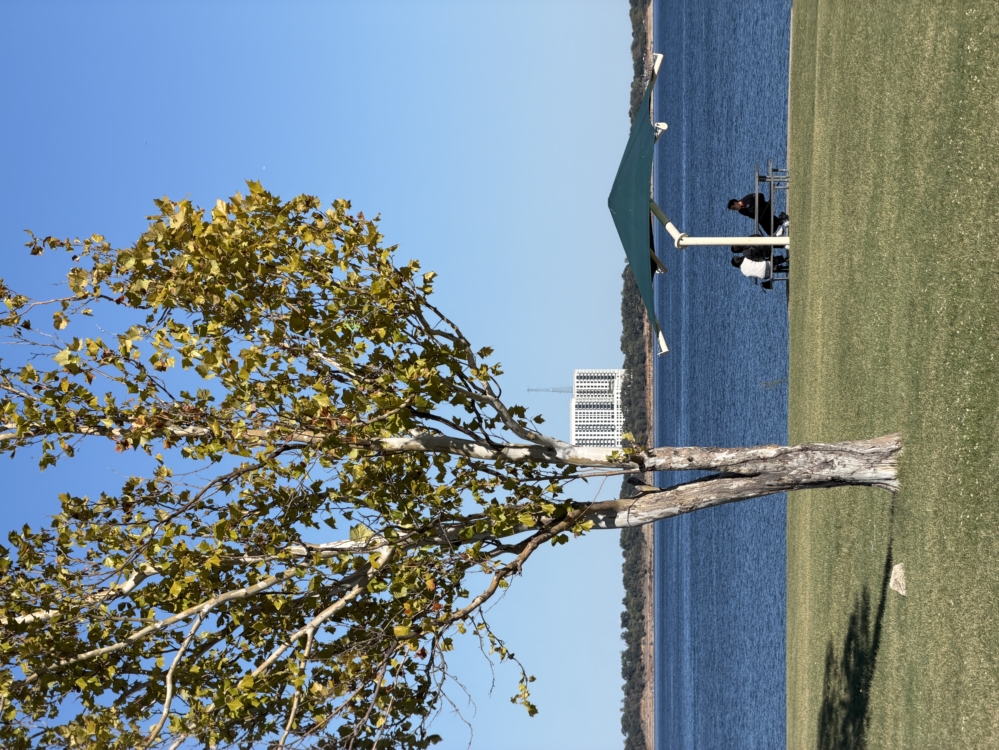

미국 박사과정을 시작한지도 두 달이 지났다.
(지금은 사실 거의 세달을 지나고 있는데, 게을러 글이 늦어졌다)

지난 10월 중순 쯤, 첫번째 로테이션을 마무리했다.
그러면서 약 8주간의 로테이션 프로젝트를 마무리하고, 두번째 로테이션을 시작했다.

나의 경우에는 조금 특수하게, 같은 랩에서 비슷한 주제로 계속해서 프로젝트를 진행중이지만
어찌됐건 첫번째 로테이션을 마무리하면서 느낀 점들을 적어보려고 한다.

나의 로테이션 목표는 다음과 같았다.
1. 연구실의 Ongoing project를 파악하는 것
2. 그 중에서 나의 관심사와 일치하는 연구에 참여할 것
3. 하나의 결론을 마무리할 것

## 연구실의 Ongoing project를 파악하는 것

1의 경우에는, 매주 월요일/금요일 주 2회로 진행되는 랩미팅을 계속해서 듣다보니 대략적인 그림이 파악되었다.
더불어 Nature's Typo와 같이 랩에서 주관하는 세미나로 같은 사람 주제를 여러 번 듣기도하고,
또 랩에서 내고 있는 논문들을 계속해서 팔로업하며 (자세히 읽진 못해도) 이런 연구들이 랩에서 나오고 있구나를 파악하는 것이 큰 도움이 되었다.

논문 팔로업은 크게 세부 관심분야를 나누고, AI를 이용하여 주간 다이제스트를 생성하고 있다.
나의 경우 Autoantibodies, Inborn errors of immunity, Human genetics 이렇게 세 분야로 나누어서
매주 월요일마다 세 주제와 밀접한 논문이 새롭게 publish 된 경우가 있으면 AI가 알려주는 방식이다.

아직은 스크리닝 단계라 논문을 붙잡고 깊이 있게 읽기보다는, 대략 어떤 연구들이 최근 발행되고 있는지를 살펴보기 위함이다. 꼭 읽을 것-관심-참고 이렇게 세 단계로 분류해서 각 논문을 어떤 무게감으로 바라봐야 할지 대략 분류를 하고 있다.

## 그 중에서 나의 관심사와 일치하는 연구에 참여할 것

이건 조금 다른 얘기이다.

Ongoing project 들이 talk에 나올 정도 혹은 논문으로 공개가 될 정도라면,
그와 관련된 데이터들이 왠만하면 다 정리가 된 상태이다.
즉, 내가 기여할 부분들이 많지 않다는 것이다.

나의 경우 박사과정을 통해 과학적인 사고력을 훈련하기 위한 목적으로,
어떤 연구에 참여해야 소기의 목적을 달성할 수 있을지 여러 방면에서 고민했다.
가령, 내가 주체적으로 실험 설계부터 진행할 수 있는지부터 시작해서
내가 정말 그 문제를 풀고 싶은게 맞는지, 그리고 그 문제가 실제로 임팩트가 있는 문제인지 등이다.

이를 위해서는 1이 굉장히 잘 수행되어져야 한다.
그래야 비로소 전체적인 그림이 머릿속에 들어오고, 그 중에서 내가 원하는 것이 무엇인지를 취사선택할 수 있기 때문이다.

나의 경우에는 PML 이라는 Virus infection에 의해 생기는 Brain disease를 다루고 있는데,
Brain context에서 Immunology를 연구하는게 흥미롭기도 하고, 또 환자가 워낙 희귀해서 기존에 잘 연구되어있지 않은 질병이라 이를 연구해보고 싶었다.

이를 또 다른 관심사인 Autoantibodies의 맥락과 연결해서 연구를 수행중인데,
밝혀진 것이 많이 없다보니 시작점을 찾기가 무척 어렵지만 반대로 말해서 무엇인가 조그마한 것이라도 밝힌다면 임팩트가 굉장히 강할 것이다.

## 하나의 결론을 마무리할 것

그리고 8주라면 길다면 길고 짧다면 짧은 로테이션 기간동안,
나는 하나의 독립 프로젝트를 마무리하고 싶었다.
(결국에는 하나의 결론을 내는 데에 8주보다 조금 더 시간이 걸린 10주 정도의 시간이 걸렸다)

나는 완벽보다 완성을 추구하는 사람이다. 이건 개인적인 성향이라 뭐가 옳고 그르다고 할 수 없지만,
석사 때 공 1 저자 논문을 내게 되었던 것도 이런 성향 덕분이라고 할 수 있다.

내가 맡은 부분에 대해서는 최선을 다해 Yes/No를 답할 수 있도록 실험을 설계하고,
그 결과를 적절한 범위 내에서 해석하고 결론을 내릴 수 있어야 한다.

만약 결론을 내릴 수 없다면, 그것은 실험 설계부터 잘못된 일일 수도 있다.
혹은 결론을 내리기에 너무 많은 과정을 요구한다면, 정말로 설계한 그 과정이 유일한 실험일지 다시 생각해보자.

모든 것은 가장 최소 단위에서부터 시작되어야 한다.
아주 fancy하고 멋진 방법으로 이론을 증명할 수도 있지만,
그것보다는 "딸깍" 한 번의 간단한 실험으로 이론을 파훼하는 게 더 멋진 과학이다.

여러 번 실험을 반복해서, "봐바. P-value가 0.05보다 낮지? 그러니까 내 말 맞아"
보다는, 흑백 논리에 따라 O/X를 보이는게 훨씬 직관적이고 강력하다.

어쩌면 가장 basic하고 fundamental한 논리가 때로 가장 강한 법이다.

## Coursework에 임하는 자세

미국 PhD에서 coursework는 단순히 "이론적 배경"을 배운다고 생각하기에는 아까운 시간이다.
가뜩이나 Rotation을 하느라 정신없는 와중에, 내가 그럼에도 Coursework 시험 전에는 온전히 이에 집중하는 이유는 아주 뚜렷하다.
왜냐하면 이게 정말 중요하기 때문이다.

내가 연구를 배우는 방법에는 두 가지가 있다고 생각한다.
1. 탑다운 방식 : 프로젝트에서 출발해서 필요한 지식을 채워나가는 방식
2. 바텀업 방식 : 일반적인 도메인 지식에서 출발해서 점점 좁혀나가는 방식

탑다운 방식은 로테이션 동안 특정 프로젝트를 수행하며 적용하고 있는 한편,
바텀업 방식은 Coursework을 통해 배우고 있다.
"내가 할 수 있는 일"과 "할 수 없는 일"에 대한 구분이 생기는 느낌이다.

탑다운 방식으로 절대 알 수 없는 일반적인 biology background에 대해 배우다 보면,
"어, 이런 지식은 이렇게 적용할 수 있겠는데", "이 부분은 이런식으로도 생각해볼 수 있겠구나"
하는 교차점이 생긴다.
이것이 coursework가 중요한 이유이다.

사실 얼마전까지만 해도 coursework가 별로 의미가 없다고 생각했었는데,
출국 전 찾아뵈었던 최무림 교수님께서 해주셨던 말을 계속해서 붙잡고 있었다.
"가서 coursework 열심히 들어, 엄청 도움 될거야"

반신반의하면서도 해주신 말씀을 지키기 위해 노력하고 있었는데, 이제야 조금 그 의미를 알 것 같다.
아무리 AI 시대라 하더라도, 절대적인 도메인 지식을 함양하기 위해서는 끊임없이 노력해야 한다.
그리고 coursework에서 다루는 biology의 거의 모든 것들을 실험적/이론적으로 어떻게 접근해야 할지를 무턱대고 하나씩 배우다보면, 내가 정말 필요한 실험 설계가 무엇인지 흐릿하게 나마 알 수 있다.

## 마치며

미국 박사과정 두 달 동안 느낀 점은 결국 '얼마나 지속가능한가'에 대한 영역이다.

아무리 영향력이 크고 중요한 연구라도, 내가 관심없으면 그만이다.
그만큼 나에 대한 이해에서 출발하는 것이 중요하다는 사실을 느꼈다.

또 반대로, 내가 하는 연구가 정말 사랑스럽고 좋더라도
다른 누군가 또한 관심있을만한 연구를 해야 영향력을 만들 수 있다.

그리고 생물학적 도메인 지식을 습득하기 위해 Project-driven하게 배울수도 있지만,
Coursework부터 시작해서 더 넓은 범위에서 배우는 것 또한 중요하다.
내가 정확히 뭘 모르는지가 정의되지 않은 시점에서, 이를 정의할 수 있는 근간이 되기 때문이다.