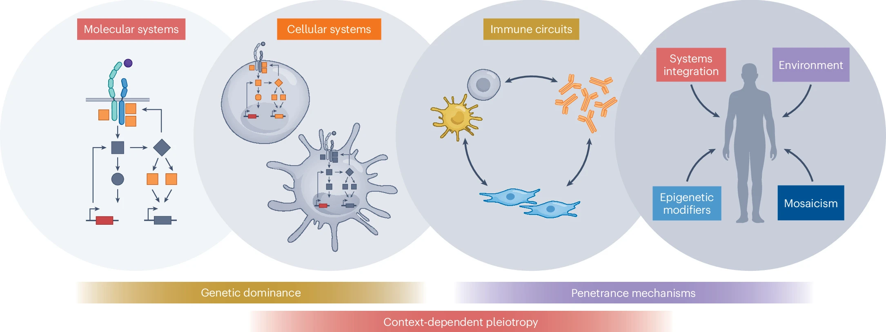

유전자 한쪽이 고장 났다. 그런데 어떤 사람은 심하게 아프고, 같은 변이를 가진 가족은 아무 증상 없이 살아간다.

희귀 유전질환을 연구하다 보면 이런 상황을 자주 만난다. 변이는 분명히 단백질 기능을 떨어뜨린다. 환자의 증상과도 관련 있어 보인다. 그런데 건강한 부모에게서 똑같은 변이가 발견된다. 그렇다면 이 변이는 원인이 아닌 걸까? 아니면 아직 병을 일으킬 조건을 만나지 않은 걸까?

Nature Genetics에 실린 리뷰 **「A systems perspective on monoallelic inborn errors of immunity」**는 이 질문을 조금 다른 방향에서 바라본다.

변이가 얼마나 심각한지만 묻지 말고, 그 변이의 영향을 몸이 얼마나 견딜 수 있는지도 함께 보자는 것이다.

이 논문은 새로운 유전자 하나를 발견한 연구가 아니다. 여러 선천면역이상 연구를 연결해, 유전자 변이와 실제 질병 사이에 놓인 생물학적 과정을 다시 정리한 글이다.

---

## 정상 유전자가 하나 남아 있으면 충분할까

대부분의 상염색체 유전자는 두 개의 사본을 갖는다. 하나는 어머니에게서, 다른 하나는 아버지에게서 받는다.

이 중 한쪽에만 변이가 있는 상황을 단일 대립유전자성, 즉 monoallelic이라고 한다. 이런 변이를 해석할 때 가장 먼저 떠올리는 질문은 단순하다.

> "정상 유전자가 하나 남았으니 괜찮지 않을까?"

어떤 유전자에서는 맞는 말이다. 한쪽에서 만드는 단백질만으로도 필요한 기능을 충분히 유지할 수 있다. 이를 **반수체충분성(haplosufficiency)**이라고 한다.

반대로 정상 유전자 한쪽만으로는 특정 기능을 유지하기 어려운 경우도 있다. 이것이 **반수체불충분성(haploinsufficiency)**이다.

하지만 실제 생물학은 이 둘 사이에서 훨씬 복잡하게 움직인다. 단백질 양이 절반으로 줄어도 평소에는 문제가 없다가, 감염이나 염증처럼 수요가 늘어나는 순간에만 부족해질 수 있다.

저자들은 이런 상태를 **"충분함의 임계점(tipping-point sufficiency)"**이라는 개념으로 설명한다.

평소에는 버틴다. 다만 여유가 거의 없다. 작은 추가 변화가 생기면 기능이 유지되던 상태에서 질병이 나타나는 상태로 넘어간다.

이 관점에서 보면, 증상이 없는 변이 보유자는 반드시 "아무 영향도 받지 않는 사람"은 아니다. 영향을 받고 있지만, 아직 다른 장치들이 그 영향을 보완하고 있는 사람일 수도 있다.

---

## 단백질이 절반으로 줄었다고 기능도 절반이 되는 건 아니다

유전자에서 만들어지는 단백질의 양과, 그 단백질이 수행하는 기능 사이에는 반드시 직선적인 관계가 성립하지 않는다.

어떤 반응에는 단백질이 조금만 있어도 충분하다. 다른 반응은 여러 분자가 함께 모여야 작동하기 때문에, 단백질이 줄어들면 기능이 훨씬 가파르게 떨어질 수 있다.

STAT1이 좋은 예다.

STAT1은 여러 인터페론 신호에 관여하지만, 모든 경로에서 같은 방식으로 작동하지 않는다. 제1형 인터페론 신호에서는 STAT2·IRF9과 함께 복합체를 이루고, 제2형 인터페론 신호에서는 STAT1 두 분자가 짝을 이룬다.

논문에 소개된 연구에서는 STAT1이 정상의 약 10–30% 수준으로 남아 있을 때, 제2형 인터페론 면역이 선택적으로 손상될 수 있었다. 제1형 인터페론 면역은 일부 방어 기능을 유지할 수 있었다.

같은 단백질이 부족해져도, 그 단백질을 사용하는 경로마다 부족함을 견디는 정도가 달랐던 것이다.

따라서 "단백질이 얼마나 남았는가"만큼 중요한 질문은 "어떤 기능을 유지하는 데 얼마나 필요한가"다.

---

## 브레이크를 잃으면 신호는 오히려 강해진다

변이를 설명할 때 흔히 쓰는 표현이 기능상실과 기능획득이다.

기능상실이면 신호가 약해지고, 기능획득이면 강해질 것 같다. 하지만 무엇의 기능을 말하는지 명확하지 않으면 이 표현은 쉽게 오해를 만든다.

논문은 IL-1R1 K131E 변이를 예로 든다.

IL-1R1은 염증 신호를 전달하는 수용체다. 여기에 억제 분자인 IL-1RA가 결합하면 신호가 제한된다. 그런데 이 변이는 염증을 일으키는 리간드의 결합은 유지하면서, 억제 분자의 결합을 방해한다.

결과는 다음과 같다.

> 억제 분자와의 결합 소실 → 브레이크 약화 → 염증 신호 증가

분자 수준에서는 상호작용 하나를 잃었는데, 신호 경로 수준에서는 과활성화가 일어난다.

반대 방향의 사례도 있다. IRF4의 일부 변이는 DNA에 더 강하게 결합하면서도 정상 표적의 전사 활성은 떨어뜨리고, 다른 표적에 대한 작용은 증가시킨다.

이런 변이에 "기능이 증가했다" 또는 "감소했다"라는 이름 하나를 붙이면 중요한 정보가 빠진다.

어떤 결합이 변했는지, 어떤 표적이 영향을 받는지, 어느 세포에서 무엇을 측정했는지까지 알아야 실제 작동 방식을 이해할 수 있다.

---

## 아예 없는 것보다 잘못된 단백질이 남는 게 더 나쁠 수 있다

유전자 하나를 완전히 없앤 실험이, 그 유전자의 모든 변이를 대표할 수 있을까?

꼭 그렇지는 않다.

변이 단백질이 만들어지지 않는 상황과, 잘못된 단백질이 만들어져 정상 단백질까지 방해하는 상황은 다르기 때문이다.

이것이 **우성음성 효과(dominant-negative effect)**다.

논문에 등장하는 STAT3처럼 두 분자가 짝을 이뤄 작동하는 단백질을 생각해보자. 정상과 변이 단백질이 같은 양으로 만들어지고 무작위로 짝을 이룬다고 가정하면, 정상끼리 만나는 조합은 전체의 약 25%다.

정상–변이 조합까지 기능을 잃는다면, 정상 유전자가 하나 남아 있어도 기능이 절반만큼 유지되는 것은 아니다. 물론 실제 비율은 단백질의 발현량과 결합 특성에 따라 달라지지만, 이 예시는 왜 단순 결핍과 우성음성 효과를 구분해야 하는지 보여준다.

여기서 중요한 역할을 하는 것이 **NMD(nonsense-mediated decay)**다. 조기 종결코돈이 생긴 RNA를 제거하는 감시 기전이다.

문제의 RNA가 제거되면 단백질 양이 줄어든다. 반대로 RNA가 제거를 피하면 잘린 단백질이 만들어질 수 있다. 그리고 그 잘린 단백질이 다른 단백질의 기능을 방해할 수 있다.

논문은 RELA와 POMP 사례를 통해, 조기 종결을 유발하는 변이라도 RNA가 제거되는지에 따라 병의 기전과 증상이 달라질 수 있다고 설명한다.

"단백질이 짧아지는 변이"라는 서열 정보만으로 최종 결과를 모두 알 수는 없는 셈이다.

---

## 같은 단백질이 맡은 서로 다른 일

단백질 하나에 기능 하나만 있는 것도 아니다.

논문은 한 단백질이 기존에 알려진 주된 역할 외에, 생화학적으로 구별되는 다른 역할을 수행하는 경우를 moonlighting function이라고 부른다.

STAT2는 항바이러스 유전자의 발현을 촉진하는 단백질로 잘 알려져 있다. 그런데 STAT2에는 인터페론 신호를 끄는 과정에 필요한 USP18을 수용체 쪽으로 데려오는 역할도 있다.

논문에 소개된 STAT2 R148Q 변이는 전자의 기능을 유지하면서 후자의 기능을 손상시킨다.

신호를 켜는 쪽은 작동하는데, 끄는 쪽이 제대로 작동하지 않는다. 그 결과 인터페론 신호가 지속되고 염증성 질환이 나타난다.

이 사례는 기능 실험을 해석할 때도 중요하다.

항바이러스 유전자 발현만 측정했다면 정상에 가까운 결과를 얻었을 수 있다. 하지만 그것만으로 STAT2의 모든 기능이 정상이라고 결론 내릴 수는 없다.

실험이 정상이라는 말에는 언제나 "우리가 측정한 기능에서는"이라는 조건이 붙는다.

---

## DNA에서는 같은 이형접합인데 세포에서는 다를 수 있다

같은 변이를 가진 사람들 사이의 차이는 단백질 기능에서만 생기는 것이 아니다.

DNA 검사에서 정상 대립유전자와 변이 대립유전자가 하나씩 보인다고 해서, 실제 세포가 두 대립유전자를 똑같은 비율로 사용하는 것은 아니다.

어떤 세포에서는 정상 쪽이 더 많이 발현될 수 있다. 다른 세포에서는 변이 쪽의 발현이 우세할 수 있다.

논문은 이러한 대립유전자 발현 불균형이 질병의 발현 여부에 영향을 줄 수 있다고 설명한다.

정상 JAK1 대립유전자가 우세하게 발현되면 기능획득 변이의 영향이 가려질 수 있다. 반대로 IRF7에서는 변이 대립유전자의 우세한 발현이, 한쪽에만 변이가 있는 상태에서도 면역 결함이 드러나는 데 기여한 사례가 소개된다.

이렇게 보면 DNA 수준의 유전자형은 출발점이다. 관련 세포에서 어느 쪽 RNA가 얼마나 만들어지고, 어떤 단백질이 얼마나 남는지도 중요하다.

여기에 세포별 차이가 더해진다. 같은 유전자를 사용하더라도 T세포, 골수계 세포, 피부의 상피세포가 가진 신호망과 보완 장치는 서로 다르다.

같은 변이가 어떤 조직에서는 조용하고, 다른 조직에서는 치명적일 수 있는 이유다.

---

## 세포가 약해도 몸 전체는 버틸 수 있다

보완은 한 세포 안에서만 일어나지 않는다. 다른 세포나 항체가 결함을 대신 메워줄 수도 있다.

논문의 OTULIN 사례가 흥미롭다.

OTULIN 반수체불충분성에서는 비백혈구 세포가 포도상구균의 α-toxin에 취약해질 수 있다. 그런데 혈청에 존재하는 독소 중화항체가 이 취약성을 보완할 수 있다.

세포 자체의 결함은 남아 있지만, 몸 전체의 방어 체계가 그 결과를 줄이는 것이다.

이것은 같은 변이를 가진 사람 중 일부만 발병하는 불완전 침투도를 이해하는 데 도움이 된다. 발병 여부는 변이의 성질뿐 아니라, 그 사람이 가진 다른 방어 수단에도 영향을 받을 수 있다.

나이와 면역 상태가 변하면 이 관계도 달라질 수 있다. 저자들이 면역계를 고정된 장치가 아니라 동적으로 변하는 시스템으로 보는 이유다.

---

## 연구자의 시선에서

이 리뷰가 바꾸자고 하는 것은 유전자의 중요성보다, 인과관계를 바라보는 해상도에 가깝다.

"이 변이가 단백질을 망가뜨리는가?"라는 질문은 여전히 중요하다. 다만 거기서 한 단계 더 나아가야 한다.

어떤 기능이 망가지고, 어느 세포에서 그 기능이 필요하며, 무엇이 그 결함을 보완하고 있는가?

이 질문은 실험 설계에도 직접 연결된다. 변이 단백질만 과발현시키는 실험은 정상 단백질과의 상호작용을 놓칠 수 있다. Knockout 모델은 변이 단백질이 남아서 일으키는 방해 효과를 재현하지 못할 수 있다. 정상 유전자를 넣는 rescue 실험도 발현량이 지나치면 단백질 복합체의 비율과 결합 관계를 바꿀 수 있다.

그렇다고 이 논문이 개별 변이의 발병 확률을 계산하는 도구를 제시한 것은 아니다. 어떤 환자에서 어느 보완 기전이 얼마나 작동하는지 정량적으로 예측하는 일은 여전히 남아 있다. 저자들도 조절 변이, 유전적 배경, 환경, 후성유전, 모자이크 현상을 더 충분히 통합해야 한다고 인정한다.

그래서 이 리뷰의 가치는 새로운 판정 기준을 주는 데보다, 다음에 무엇을 확인해야 할지 질문을 더 정확하게 만드는 데 있다.

이전에 읽었던 [LFA-1 결핍 연구](lfa1-skin-immunity.html)와 나란히 놓으면 이 관점은 더 선명해진다. 광범위하게 발현되는 단백질이 없어도 많은 기능은 다른 경로가 보완할 수 있다. 실제 질병은 그 보완이 충분하지 않은 지점에서 드러난다.

변이의 영향은 단백질에서 시작하지만, 환자의 증상은 그 단백질을 둘러싼 생물학 전체를 거쳐 만들어진다.

---

*Werner M, Spaan AN, Mogensen TH. A systems perspective on monoallelic inborn errors of immunity. Nature Genetics. DOI: 10.1038/s41588-026-02784-8.*
